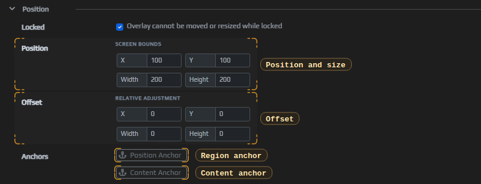

# Image — keep a reference picture in view

Image shows a picture from a file on top of other applications: a wiring diagram, a keyboard layout, any cheat sheet. You can set it up so the picture is visible only while you hold a key.

PNG or JPEG will do. Animated GIFs work too, but the overlay just plays the file.

## Hold F8 to view your reference

1. Create an aura with one [Hotkey Is Active](/en/triggers/hotkey-is-active). Choose an unused **F8** key and **Hold** mode.
2. Under **Overlays**, add **Image**. In its Image section, click **Load image from file...** and select the file. The picture appears in **Preview**.
3. Under **Visual style**, turn on **Aspect Ratio** so the picture does not stretch when you resize it.
4. Turn **Locked** off, drag the overlay where you want it and pull its edge to resize it. If the picture has small labels, start with a large size. Turn Locked back on and, if you need it, Click-through.

   
5. Switch to your working application, hold F8, then release it.

The picture is visible while the key is held. Release the key and it disappears. If the aura is selected in the editor or Locked is off, the picture can stay visible without the key.

## Image settings

| Setting | What it does |
| --- | --- |
| Load image from file... | Loads the file. The dialog lists JPEG, PNG, BMP, GIF and TGA. |
| Preview | Shows the selected picture in the editor. |
| Clear | Removes the picture from the overlay. |
| Aspect Ratio | Keeps the proportions when you resize. Unavailable while the position is linked to a source. |
| Position / Locked | Placement and locking. See [Common Options](/en/overlays/common-options). |

The picture is stored in the overlay configuration. If you change the file on disk, the overlay does not update on its own. Load the picture again.

To keep the picture always visible, use [Fixed Value](/en/triggers/fixed-value) set to Is Active instead of the hotkey. If you need a live part of another window, such as a progress bar, use [Replica](/en/overlays/replica).
