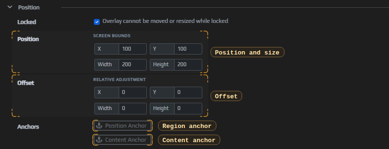

# Replica — keep a useful window region in view

Replica shows a live copy of a window, or a part of it, on top of other applications. Say a program is busy for a long time and its progress bar sits in the corner of a large window. Replica puts that bar where it is easy to watch.

For the first check, keep the source application open and do not minimize it. Choose an area that really changes, such as a status line or a progress bar.

## Mirror a progress region

1. Create an aura with [Fixed Value](/en/triggers/fixed-value) set to **Is Active** and add **Replica** under **Overlays**.
2. Under **Replica → Target Window**, select the source application's window. Check which window is shown as the target. If it is the wrong one, refine the [window matching expression](/en/features/window-matching-expressions).
3. Under **Source region**, click **Select region** and draw a rectangle around the indicator in the source window. Leave **Source offset** at zero, **Source anchors** at their defaults and **Linked auras** empty.
4. In the common overlay settings, turn **Locked** off, drag the copy where you want it and set its size. Turn on **Aspect Ratio** to keep the proportions. Then turn Locked back on.
5. Switch to your working application and wait for the indicator in the source to change.

The same region changes in the overlay. Source region sets **what to copy**. The common Position sets **where and how large to show the copy**. If things move around in the source window, select the region again.

## Source settings

| Setting | What it does |
| --- | --- |
| Target Window | The window the copy is taken from. It is not the window the copy sits on top of. |
| Source region / Select region | The part of the source window to copy. Stored in pixels relative to the window's client area. |
| Reset | Clears the source region, offsets, anchors and links. If the region is empty, the whole window is copied. |
| Source offset | X, Y, Width and Height adjustments to the copied region. |
| Source anchors | Reference points for the region and its content. See [coordinates](/en/features/coordinate-system). |
| Linked auras | Takes the source window and region from another aura, such as an Image Search result. |

To link Replica to [Image Search](/en/triggers/images/image-search), first make sure the search finds the right rectangle. Then add that aura under Linked auras. Replica will follow the found region and its window. If there are several sources, Replica uses the first available one that has a region. Start with one link so the setup is unambiguous.

## Visibility and limits

In the example, Fixed Value keeps the aura active, so the locked Replica is always visible. To show it with a key, replace Fixed Value with [Hotkey Is Active](/en/triggers/hotkey-is-active). Locked, Click-through and normal-window mode are covered in [Common Options](/en/overlays/common-options).

Clicking the copy does not send a click to the source window. With Click-through, the click goes to the window **under the overlay**.

A closed window cannot be copied. A minimized or capture-protected window may not update, so restore it and check again. No copy? Check Target Window, the size of Source region and the message inside the overlay, such as **No window matched**. If the window was recreated, its earlier temporary handle may no longer match.
