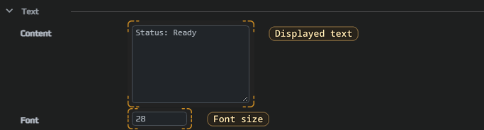

# Text — toggle a reminder with a key

Text shows a line of text on top of other applications. For example, a reminder that says “Check the microphone before recording”, which you turn on and off with a key.

## Show and hide a reminder with F7

1. Create an aura with just [Hotkey Is Active](/en/triggers/hotkey-is-active). Choose an unused **F7** key and **Toggle Trigger state on Click**.
2. Under **Overlays**, add **Text**. Expand its Text section and type “Check the microphone before recording” in **Content**.
3. Set **Font** to `24` and turn **Size to fit** off. Choose a white **Font Color**. In **Outline**, set thickness `2` and black.

   
4. Turn **Locked** off, put the reminder in place and make its rectangle wide enough, for example `500 × 80`. Then turn Locked back on and, if you like, Click-through.
5. Switch to your working application and press F7. Press it again to hide the reminder.

While the aura is selected in the editor, the overlay may stay visible for editing, so test in another application.

To check the display without the key, replace Hotkey Is Active with [Fixed Value](/en/triggers/fixed-value). If the condition you need already exists in another aura, use that aura's state through [Aura Is Active](/en/triggers/aura-is-active).

## Text settings

| Setting | What it does |
| --- | --- |
| Content | Your message. Type it in or get it through a [binding](/en/features/bindings) to another property or variable. |
| Font | Font size when Size to fit is off. |
| Size to fit | Picks a font size to fit the display area. Long text still needs enough space. |
| Font Color | Letter color. |
| Outline | Thickness and color of the letter outline. |
| Alignment | Text placement inside the overlay rectangle. |

Alignment supports Center, Top, Bottom, Left, Right, TopLeft, TopRight, BottomLeft and BottomRight. This is where the text sits **inside** the overlay. To move the overlay itself, use Position.

Size, background, border, opacity and locking are covered in [Common Options](/en/overlays/common-options). To show a message when something happens, replace the hotkey with a suitable trigger, such as [Text Search](/en/triggers/images/text-search).
