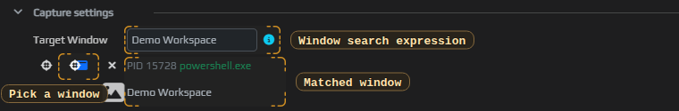

# Make a notification key belong to one application

F6 plays a short cue only while your Notepad window is in the foreground. One aura watches the window and allows or blocks the hotkey in the second one.

Open one Notepad window with a throwaway text document. You need a working audio output. F6 must not start anything disruptive in the windows where you test. If it does, pick another unused key. Leave **Suppress Key** off everywhere: the application can still receive the original key.

## Create the source condition

1. Right-click an empty area of the tree, choose **New Aura**, and name it **Notes active**.
2. In **Triggers**, click **+** and add **Window Is Active**. Set **Target Window** to `notepad`. Check in the selected window details that it is your document. Leave the action lists and overlays empty.

   

3. Switch from Notepad to another application and back. **Notes active** should be **Active** only while the matching window is in the foreground. Keep this aura loaded and enabled.

## Limit the hotkey and add its cue

1. Create another **New Aura** at the root and name it **Notes notification**. In **Triggers**, add **Hotkey Is Active**. Assign **F6**, select **Hold**, and leave **Suppress Key** off.
2. Open that trigger's **Advanced** section. Under **Interception Condition**, click **Links**, select **Notes active**, and require its **Active** state. Do not add other links. Leave **Ignore If Hotkey Is Pressed** off: here each press starts fresh after you change applications.
3. In **On Enter**, click **+**, add **Play Sound**, choose **Audio notification → Ping**, set **Volume** to **50%**, and preview the sound. Leave **While Active** and **On Exit** empty.

| Setting | Value |
| --- | --- |
| Hotkey | F6, or your unused replacement |
| Mode | Hold |
| Suppress Key | Off |
| Interception Condition → Links | Notes active, required Active |
| Ignore If Hotkey Is Pressed | Off |
| On Enter | Play Sound → Ping, Volume 50% |

4. Keep both auras enabled and EyeAuras unpaused. Go from the editor to Notepad. Press and briefly hold F6: you should hear one Ping. The cue should not repeat while the key is held. Release the key so the Hold condition returns to **Not Active** before the next try.
5. Switch to a different application and press F6 there: there should be no cue. Release the key and return to Notepad, where a new press should work again. Do not compare in the EyeAuras window itself: it has its own option for input in its own window, and that can skew the result.

[Window Is Active](/en/triggers/window-is-active) supplies the window state, the [hotkey's Links](/en/triggers/hotkey-is-active) limit interception, and [Play Sound](/en/actions/play-sound) plays the cue. If you just put a window trigger and a hotkey trigger side by side with AND, their results are combined, but that does not set up the hotkey's interception.

Release the key before you change applications.
