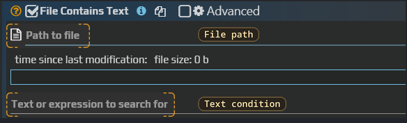

# Keep unfinished checklist items visible

While your text file contains `TODO`, the reminder **Finish the checklist** stays on screen. Save the file without that marker and the reminder goes away. The file sets the condition. The reminder text is something you type into Text separately.

You need a small local UTF-8 file that EyeAuras can read. In a folder you can write to, save `checklist.txt` with two lines: `TODO review notes` and `DONE choose filename`. Remember its full path. EyeAuras does not see unsaved text in the editor. If you rename the file, the path does not update on its own.

## Read the saved checklist

1. Right-click an empty part of the EyeAuras tree, choose **New Aura**, and name it **Checklist warning**. In **Triggers**, click **+** and add **File Contains Text**.
2. In **File path**, enter the full path to your file or select it with **...**. **File contents** should show both saved lines, including TODO.

   

3. In the text evaluator, choose **Regex**, enter `TODO` without quotes or outer slashes, and enable **Ignore Case**. This finds the word anywhere in the file. **Text** mode would compare the whole file instead. Keep **Test mode** off so the result depends on the real file.
4. In **Overlays**, click **+** and add **Text**. Enter `Finish the checklist` in **Content** and use the settings below. Turn **Locked** off, place the 450 × 80 reminder where you can read it, then turn **Locked** on again. Leave the action lists empty.

| Setting | Value |
| --- | --- |
| Text → Font | 24 |
| Text → Size to fit | Off |
| Window → Mode | Overlay |
| Position → Locked / Clickthrough | On after placement |

5. Keep the aura enabled and EyeAuras unpaused. Select another aura and leave the editor. The reminder should be visible while the saved file contains TODO.
6. In your file editor, replace `TODO review notes` with `DONE review notes` and **save**. Wait for the new text in **File contents**. The trigger should become **Not Active** and the locked reminder should disappear. Put TODO back and save, and the reminder appears again.

The file is read on connecting and on filesystem changes. Events that come close together are grouped over about 250 ms. If the reminder does not change, check File contents and the path first. `TODO` also matches inside a longer word. To match a whole word, enter `\bTODO\b` in Regex.

If the path or the file is missing, the trigger shows **Unknown**. That is not the same as "the checklist has no tasks". Reading uses the encoding marker when there is one and UTF-8 otherwise. You cannot pick an arbitrary legacy code page.

[File Contains Text](/en/triggers/file-contains-text) reads the saved file, [text matching](/en/features/text-match-expressions) finds the marker, and [Text](/en/overlays/text) with [common options](/en/overlays/common-options) shows the reminder. An unlocked overlay and the preview of a selected aura can stay on screen, so check the condition after locking and with another aura selected.
