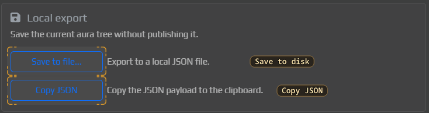

# Experiment on a copy of your own reminders

You will make a local copy of a two-aura set and change the reminder in the copy, while the original stays as it was. You need a folder you can write to and permission to export your own contents.

## Prepare a small linked set

1. At an empty place in the tree, create **New folder** named **Transfer test**. Inside it create **New Aura → Allow reminder**, with **Triggers → Fixed Value → Is NOT Active** and no actions or overlays.
2. Create a second aura **Reminder** in the folder. Add **Aura Is Active** in Triggers. In **Links**, select only Allow reminder from this folder, require **Active**, and choose **All must match (AND)**.
3. In Reminder, add **Text** under Overlays: **Content** `Original reminder`, **Font 24**, **Size to fit** off, **Window → Mode → Overlay**. Unlock the overlay, position it, then enable **Locked** and **Clickthrough**. Add no actions to either aura. Keep both auras loaded and enabled and EyeAuras unpaused. Leave Allow reminder inactive: that way neither the original nor the copy is shown outside the editor yet.

## Save JSON and choose Copy

1. Select the **Transfer test** folder and open **Share/Export** with the export button or **Ctrl+S**. In **Content**, check that the folder and both auras are there.
2. If **Missing linked objects detected** appears, look at the links. In this example there is one link and it points inside the selected folder. If you added a source outside it, include that source with **Add linked objects** and check Content again, or keep the external dependency on purpose. Neighboring items are not included on their own.
3. Choose **Destination → Local export → Save to file...**, save `reminder-copy.json` in your own folder, and close the export window.

   

4. Click **Import**, choose **Source → Import from file → Open...**, and select your JSON. In **Preview**, check the folder, the two auras and their stored paths. Selecting a folder in the tree before opening this dialog does not change where the import goes.
5. The originals are still in the tree, so open **Import Options** and choose **Copy** when the conflicts are shown. This adds copies with separate identities and adjusts the conflicting paths. Do not choose Replace: it replaces existing items.

| Choice | Result for this exercise |
| --- | --- |
| Copy | Keep the original set and add copies |
| Replace | Replace conflicting original objects; not the intended operation |
| Ignore Conflicts | Skip conflicting incoming objects; not an independent full copy |

## Check that the copy is independent

1. Find the new folder by its adjusted path. In the **copied** Reminder, open Aura Is Active → Links and use the link's navigation control to confirm that it points to the **copied** Allow reminder, not the original. Check property bindings the same way if your set has any. Keep both switches inactive until you have checked.
2. Change the Text Content to `Copied reminder` in the copy only, position it separately and lock it. The original should still say `Original reminder`.
3. Set the copied Allow reminder to **Is Active**, select an unrelated aura and leave the editor. Only Copied reminder should appear. The original switch stays **Is NOT Active**. Return the copied switch to Is NOT Active to hide the copy again.

[Export/import](/en/features/export-import) covers the JSON and the conflict choice, [Aura Is Active](/en/triggers/aura-is-active) covers the link between auras, and [Bindings](/en/features/bindings) covers the property bindings that travel with the set.

Arbitrary strings in code, external paths and references to objects outside the copied set are not repaired automatically. Before you give the file to someone, review the settings and embedded resources: export does not remove secrets for you.
