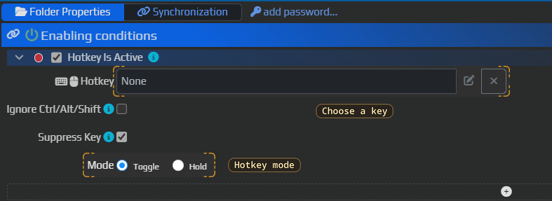

# Hold F8 to inspect a colored panel

Here the color check runs only while you hold a key. An aura shows **Green state found** when the captured panel matches the green sample. Release the key and the whole group stops working.

You need a visible panel in your own application with two known states: a solid green patch and a clearly different gray patch at the same position and size. The easiest way is to make two 200 × 100 PNGs of your own, one green and one gray, and show them in one image viewer at the same zoom. Keep the viewer window open and not minimized, and use a capture method that gets its current picture. Use F8 only if it is unused in your application. Otherwise choose another unused key.

## Build and tune the color check first

1. Right-click an empty part of the tree and create **New folder**, named **Inspect panel**. Right-click that folder, choose **New Aura**, and name the aura **Green panel**.
2. In this aura's **Triggers**, click **+** and add **Color Search**. Select your viewer in **Target Window** with the window picker and check the selected window details. Set **Image Capture Rate** to **5 FPS** and open **Preview**. Show the green image and make sure Preview shows the current panel.
3. Use **Crop region** to select a small area fully inside the solid patch, without borders, labels or shadows. Keep the effects list empty.
4. Under **Color source - what to search for and how**, set **Comparison Granularity** to **Aggregate Average Color of Entire Area** and **Comparison Method** to **Human Perception**. Click **Copy Captured Color to Target Color** while the patch is green.
5. Under **Trigger activation conditions**, enable **Min** and use the range below. Click **Refresh Once** with green shown, then show gray and refresh again. Green should match and gray should not. If both match, fix the source and the crop first, not the range.

| Color Search setting | Value |
| --- | --- |
| Image Capture Rate | 5 FPS |
| Match Threshold → Min | 95% |
| Match Threshold → Max | 100% |
| Effects | Empty |

6. In this aura's **Overlays**, add **Text**. Set **Content** to `Green state found`, **Font** to **24**, **Size to fit** off, and **Window → Mode** to **Overlay**. Turn **Locked** off, place a 400 × 70 area where the text is readable, then turn **Locked** and **Clickthrough** on.

## Put the group behind the held key

1. Select the **Inspect panel** folder. In **Enabling Conditions**, click **+** and add **Hotkey Is Active**. Assign **F8**, choose **Hold**, and leave **Suppress Key** off. Do not add this key to the aura's ordinary Triggers list.

   

2. Select an aura outside this folder. If there is none, create an empty **Setup** aura at the root. Go from the editor to your viewer. Keep the folder and the aura inside it loaded, and EyeAuras unpaused.
3. With green shown, hold F8: the label should appear. Release F8 and it should disappear. With gray shown, holding F8 should not show the label. Release the key between checks.

[Enabling conditions](/en/features/enabling-conditions) allow or block the whole group. An ordinary false trigger only takes part in the aura's overall condition and does not stop the other triggers from calculating. Items selected in the tree can still be evaluated or shown for editing, which is why you select an aura outside the folder. [Color Search](/en/triggers/images/color-search) compares the color, [Hotkey Is Active](/en/triggers/hotkey-is-active) watches the key, and [Text](/en/overlays/text) shows the answer.

If Preview is blank or shows an old picture, fix the [capture source](/en/triggers/images/imagecapturetriggers) instead of lowering the threshold.
