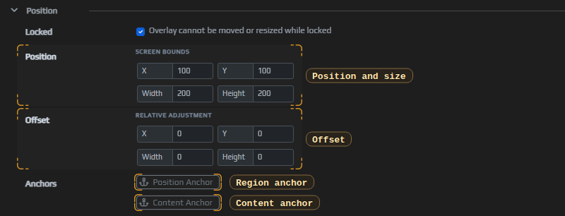

# Watch one changing area of your window

Replica shows a live copy of a small area of another window wherever it suits you. For the example, type the line **Status: 10** in your own Notepad document, then change it to **Status: 20**. Replica repeats the picture of that line.

Open one Notepad window, put the line near the top of the document, and do not minimize the window. Put a second window, the one you work in, beside it. The source must give a live thumbnail. A closed, protected or minimized window may not give an updating picture.

## Choose visibility and source separately

1. Right-click an empty area of the tree, choose **New Aura**, and name it **Live status crop**.
2. In **Triggers**, click **+** and add **Window Exists**. Set **Target Window** to `notepad` and check the selected window details. This trigger keeps the aura active while the window exists. It does not give Replica a picture.
3. In **Overlays**, click **+** and add **Replica**. In the overlay's own **Replica** section, set **Target Window** to `notepad` too, and check separately that the right window is matched there.
4. Leave **Linked auras** empty: everything here is set up by hand. Click **Source region → Select region** and select a rectangle around the line. It is a region in the source window's client area, in physical pixels. Leave **Source offset** at zero and **Source anchors** at their defaults.

| Replica setting | Value |
| --- | --- |
| Target Window | `notepad` |
| Source region | Rectangle around your Status line |
| Source offset | Zero |
| Linked auras | Empty |
| Window → Mode | Overlay |

5. Under the common **Position** options, turn **Locked** off and move the copy next to your second window. Enable **Visual style → Aspect Ratio** and resize the copy until the line is readable without stretching. Then turn **Locked** and **Clickthrough** on.

   

6. Keep the aura enabled and EyeAuras unpaused, select another aura, and return to your working window. The copy should show **Status: 10**. Change the line in Notepad to **Status: 20** and go back to work: the copy should update. Do not scroll the line out of the selected region.
7. Close the Notepad window. **Window Exists** should become **Not Active**, and the locked copy should disappear outside editing preview. When you reopen Notepad or recreate the source, check the window match and the region again.

[Replica](/en/overlays/replica) sets the source and the region, [Window Exists](/en/triggers/window-exists) sets the window presence condition, and [common options](/en/overlays/common-options) place the copy. With **Linked auras** you can take the window and region from a suitable aura, but this recipe does not need it.

If you see the whole window, select a region again and make sure it is not empty: **Source region → Reset** goes back to showing the whole window. If the copy stops updating, first check that the source is available instead of changing the display size. Clicking the copy does not send input to the source window. Clickthrough passes the mouse to the window under the overlay. If you do not need live updates, there is [the static reference card recipe](/en/recipes/basic/reference-card).
