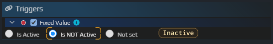

# Pause a group of reminders with one shared mode

The **Maintenance** switch turns off two normal reminders and shows **Maintenance mode** instead. It sits outside the folder it controls, so you can still reach it when the folder is disabled.

Keep the auras loaded and EyeAuras unpaused.

## Create the switch and the normal reminders

1. Right-click an empty area of the tree, choose **New Aura**, and name it **Maintenance**. Add **Triggers → + → Fixed Value** and choose **Is NOT Active**: maintenance mode is off for now. This aura needs no actions or overlays.

   

2. At the root, create **New folder** named **Normal reminders**. Do not put Maintenance inside it.
3. In that folder, create an aura **Review notes**. Add **Fixed Value → Is Active** in Triggers and **Text** in Overlays. Set **Content** to `Review your notes`, **Font 24**, **Size to fit** off and **Window → Mode → Overlay**. Unlock the overlay, place a 450 × 80 area, then enable **Locked** and **Clickthrough**.
4. Create a second aura **Save draft** in the same folder, with the same settings but **Content** `Save your draft`. Place it below the first reminder, not over it. Leave both auras' action lists empty.
5. Select the **Normal reminders** folder. In **Enabling Conditions**, click **+** and add **Aura Is Active**. Through **Links**, select only Maintenance. Set that link's required state to **Not Active** and choose **Logical operator → All must match (AND)**. Now the folder works only while maintenance is known to be off.

## Show which mode you chose

1. Outside Normal reminders, create another root aura **Maintenance notice**. Add **Aura Is Active** to its ordinary **Triggers**, link only Maintenance, require **Active**, and keep **All must match (AND)**.
2. Add **Text** with **Content** `Maintenance mode`, **Font 24**, **Size to fit** off and **Window → Mode → Overlay**. Position it separately, then enable **Locked** and **Clickthrough**. It needs no actions.

| Consumer | Required Maintenance state |
| --- | --- |
| Normal reminders → Enabling Conditions | Not Active |
| Maintenance notice → Triggers | Active |

3. Set Maintenance's Fixed Value to **Is NOT Active**. Select an unrelated aura outside the folder and leave the editor. You should see both normal reminders and no maintenance notice.
4. Return to Maintenance, select **Is Active**, and leave the editor again. The normal reminders should disappear and Maintenance mode should appear. Switch back to **Is NOT Active** and the normal group comes back.

[Fixed Value](/en/triggers/fixed-value) sets the shared manual state, [Aura Is Active](/en/triggers/aura-is-active) reads it and compares it with the expected one, and the folder's [Enabling Conditions](/en/features/enabling-conditions) allow or block the auras inside it. An ordinary false trigger would only change one aura's result, not turn off the whole group.

Do not use **Not set** to mean "maintenance off": Unknown is not the same as a known Not Active. While you are editing, a selected aura can still be evaluated and an unlocked overlay can stay on screen. The [Text guide](/en/overlays/text) covers the text display settings.
