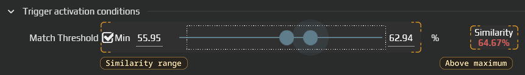

# Keep a separate status panel in view

You work in one application, a warning color appears in another window of yours, and **Check status panel** pops up on screen. EyeAuras looks at the captured picture of the panel, and a separate Text overlay shows the reminder.

Prepare a source with two known colors at the same position. The easiest way is to make two 200 × 100 PNGs of your own, one solid red and one solid gray, and open them in one image viewer at a fixed zoom. Put a second, unrelated window, the one you work in, beside it. To start with, keep the source not minimized and not covered. The capture method you choose must keep getting fresh frames after the window loses focus.

## Match the warning color

1. Right-click an empty area of the EyeAuras tree, choose **New Aura**, and name it **Panel warning**. In **Triggers**, click **+** and add **Color Search**.
2. Use the **Target Window** picker to select your source viewer, not the second working window. Check the selected window details. Set **Image Capture Rate** to **5 FPS** and open **Preview**.
3. Show the red image. Use **Crop region** to select a small solid area without edges or text. Leave **Effects** empty. Switch between the red and gray images and make sure the cropped preview really changes.
4. In **Color source - what to search for and how**, select **Comparison Granularity → Aggregate Average Color of Entire Area** and **Comparison Method → Human Perception**. With red shown, click **Copy Captured Color to Target Color**.
5. In **Trigger activation conditions**, enable **Min**, set **Min 95%** and **Max 100%**, and click **Refresh Once** in each state. Red should give **Active**. Gray should give **Not Active** on a valid frame. If the two states do not differ, check the window, the crop and the colors themselves first.

   

| Setting | Value |
| --- | --- |
| Target Window | Your source viewer |
| Image Capture Rate | 5 FPS |
| Comparison Granularity | Aggregate Average Color of Entire Area |
| Match Threshold range | 95–100% |

## Put the answer beside your work

1. In **Overlays**, click **+** and add **Text**. Enter `Check status panel` in **Content**. Use **Font 24**, **Size to fit** off, **Font Color** red and **Window → Mode → Overlay**.
2. Turn **Locked** off, place a 400 × 70 overlay near your second working window, then turn **Locked** and **Clickthrough** on. Leave the action lists empty: all you need here is a reminder.
3. Keep the aura enabled and EyeAuras unpaused. Select a different aura and return to your working application. While the source is red, the warning should be visible. Show the gray image and return to the working application: the warning should disappear. Show red again and it comes back.
4. In Preview, check that the unfocused source keeps giving fresh frames as you change its state. Close Preview after setup. If capture goes black, freezes or becomes unavailable, choose another supported capture method or keep the source in a state where capture works. Do not mistake a capture failure for the normal gray state.

[Color Search](/en/triggers/images/color-search) compares the selected area, [Text](/en/overlays/text) shows the answer next to your work, and [capture settings](/en/triggers/images/imagecapturetriggers) decide whether you can watch the window in the state you need. An editing preview and an unlocked overlay can stay on screen regardless of the condition.
