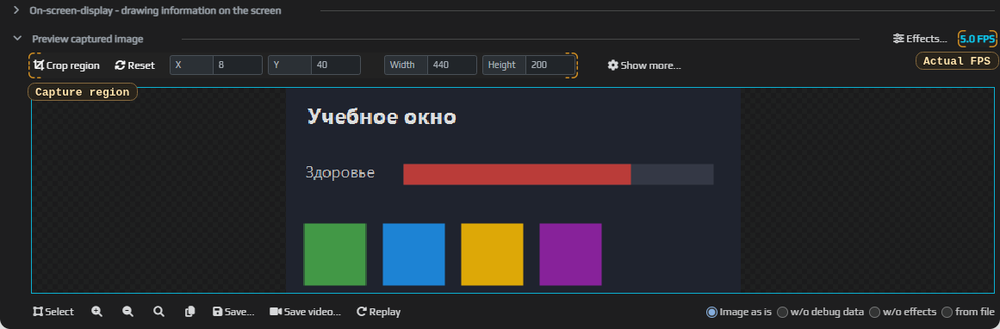

# Hear one alert for a Ready icon

A distinctive readiness icon appears in your application, and EyeAuras plays a sound once. The check looks at the picture on screen.

Use your own application or one you are allowed to watch. It must have two states you can easily reproduce: **icon present** and **icon absent**. Keep its window not minimized, and use the same UI scale and theme in both states. You need a capture that gets the window's current picture and a working audio output.

## Capture the source and make the sample

1. Right-click an empty area of the tree, choose **New Aura**, and name it **Ready icon**. In **Triggers**, click **+** and add **Image Search**.
2. Choose your application in **Target Window**, check the selected window details, and set **Image Capture Rate** to **5 FPS**. Open **Preview** and select the view **w/o debug data** so diagnostic drawings do not get into your sample. Make sure the preview changes along with the real application.
3. With the icon visible, use **Crop region** to bound the area where it can appear. Leave a little space around it, but keep other similar icons out. Leave the effects list empty for now.

   

4. In **Template source - what to search for**, click **Load from Preview Pane**, then **Edit...**. In the Image Editor, use **Crop** to select just the icon, click **Apply crop**, then **Save**. Leave out anything that changes: filenames, timers, progress numbers. The sample must fit inside the search region and have the same pixel size as the icon on screen.
5. In **Trigger activation conditions**, set **Match Threshold** to **95%**, leave **Include All Matches** off, and click **Refresh Once**. Look at the result and the found rectangle: it must cover the right icon. Show the icon-absent state and refresh again: a valid current frame should give no match. Bring the icon back and make sure the match returns. Only then add the sound.

| Setting | Starting value |
| --- | --- |
| Image Capture Rate | 5 FPS |
| Match Threshold | 95% |
| Include All Matches | Off |
| Effects | Empty |

## Notify on the new match

1. In **On Enter**, click **+**, add **Play Sound**, choose **Audio notification → Ping**, and set **Volume** to **50%**. Check the sound with its preview button. Keep **While Active** and **On Exit** empty.
2. Keep the aura enabled and EyeAuras unpaused. Start from a confirmed **Not Active** with no icon, then make your application show it. You should hear one Ping on the change to **Active**. While the icon just stays on screen, the sound should not repeat on every frame.
3. Remove the icon and wait for **Not Active**. The next time it appears, Ping can play again.

[Image capture](/en/triggers/images/imagecapturetriggers) sets the source, the [Image Editor](/en/triggers/images/image-editor) cuts out the sample, [Image Search](/en/triggers/images/image-search) finds it, and [Play Sound](/en/actions/play-sound) plays the cue on the change.

If the match is found in the wrong place, refine the region or the sample first, and only then change the threshold. At a different DPI, zoom or theme the icon looks different: take the sample again at the scale you need. A black, stale or unavailable frame does not mean the icon is absent.
