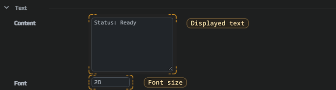

# Keep your recording checklist beside your notes

While you work in Notepad, three preparation reminders stay on screen. Switch to another application and they go away. The condition checks only the foreground window.

You need EyeAuras open and one Notepad window with your own notes. Keep exactly one Notepad window so the expression `notepad` finds it without ambiguity.

## Create the reminder

1. Right-click an empty area of the EyeAuras tree and choose **New Aura**. Name it **Recording checklist**.
2. In **Triggers**, click **+** and add **Window Is Active**. Set **Target Window** to `notepad`. Check in the selected window details that it is your notes window. If several windows match, narrow the expression: see [how to pick the right window](/en/features/window-matching-expressions).
3. In **Overlays**, click **+** and add **Text**. Enter three lines in **Content**, with real line breaks: `Check microphone`, `Choose recording file`, `Review notes`.

   

4. Use the settings from the table. Under **Position**, temporarily turn **Locked** off, move the reminder next to your notes and pick a size that fits all three lines. Start with 500 × 120. If the text is clipped, make the area bigger.

| Setting | Value |
| --- | --- |
| Text → Font | 24 |
| Text → Size to fit | Off |
| Text → Font Color | White |
| Window → Mode | Overlay |
| Position → Locked | On after positioning |
| Position → Clickthrough | On |

5. Keep the aura enabled and EyeAuras unpaused. Select a different aura and return to Notepad: the checklist should appear. Switch to another application: it should disappear. Return to Notepad and it appears again.

An unlocked overlay and an aura selected in the open editor can stay on screen so that they are easy to set up. Before you check, turn **Locked** on and select another aura. The position belongs to the overlay itself: if you move the Notepad window, the reminder does not follow it.

[Window Is Active](/en/triggers/window-is-active) sets the foreground-window condition, [Text](/en/overlays/text) holds your checklist, and [common overlay options](/en/overlays/common-options) control placement and mouse behavior.
