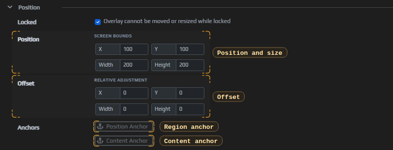

# Keep a reference card beside your notes

While Notepad is in the foreground, your own reference picture stays next to it: a diagram, a checklist or a key map. You do not have to open an image viewer every time.

Save a local PNG beforehand, either your own or one you are allowed to use. For example, a readable 600 × 300 card with your own notes. Open one Notepad window and close its other windows so the right one is found without ambiguity.

## Import, place and lock the card

1. Right-click an empty area of the tree, choose **New Aura**, and name it **Reference card**.
2. In **Triggers**, click **+** and add **Window Is Active**. Set **Target Window** to `notepad` and check that the selected window is your notes editor.
3. In **Overlays**, click **+** and add **Image**. In its **Image** section, choose **Load image from file...** and select your PNG. Check in **Preview** that the right card loaded. The image is stored inside the configuration.
4. Use the common options from the table. Temporarily turn **Locked** off and drag the card next to your notes. With **Aspect Ratio** on, drag an edge until the content is readable. The proportions are kept. For a 600 × 300 card, start with a 600 × 300 display area. Shrink it only if the text stays readable.

| Setting | Value |
| --- | --- |
| Window → Mode | Overlay |
| Visual style → Aspect Ratio | On |
| Position → Locked | On after placement |
| Position → Clickthrough | On |

5. Keep the aura enabled and EyeAuras unpaused. Select another aura and return to Notepad: the card should be visible. Switch to a different application: it should disappear. Return to Notepad and make sure the same card appears again.

[Window Is Active](/en/triggers/window-is-active) decides when to show the card, [Image](/en/overlays/image) holds the picture, and [common overlay options](/en/overlays/common-options) set its size, place and mouse behavior. While you are setting it up, an unlocked card and the preview of the selected aura can stay on screen.

If you edit the original PNG on disk, the embedded copy does not update on its own. When the card changes, load the new file again. If you need a constantly changing view of another window, use the [live status crop recipe](/en/recipes/basic/live-status-crop).
