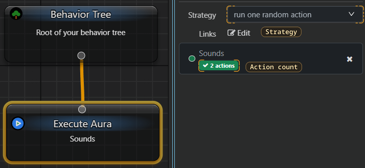

# Mark the start and finish of a short routine

The macro plays Ping, waits 1500 ms after it ends, and plays Bell. Run it by hand when you want to hear a beginning and an end.

You need EyeAuras with the **New Macro** editor and the **Run Aura** template available, and an audio output you can hear. Build a separate set with sounds only.

## Prepare two callable sound auras

1. Right-click an empty area of the aura tree and choose **New Aura**. Name it **Routine start**. Add **Fixed Value** to Triggers, set **Is NOT Active**, and leave it that way. Then the aura does not play the cue on its own.
2. In **On Enter**, click **+**, add **Play Sound**, choose **Audio notification → Ping**, set **Volume 50%**, and turn **Play in background** off. Preview the sound. Leave While Active, On Exit and Overlays empty: the aura must contain exactly one action.
3. Create another loaded aura **Routine finish** the same way, but choose **Bell** instead of Ping. Its Fixed Value is also **Is NOT Active**, it also has one action, and Play in background is off. Keep both auras enabled even though their triggers are inactive.

## Put the three steps in a macro

1. In the tree's creation menu choose **New Macro** and open it. In the top settings row, enable **Activation → Is Loaded** and choose **Execution → When Activated → Do nothing**. Do not add automatic activation conditions.
2. In the **Drag'n'drop instructions here** block, use **Add new Node** to add **Run Aura**, **Wait** and another **Run Aura** side by side, in exactly that order. Use the macro Wait, not a BT wait from a different tree.
3. In the first Run Aura, open **General → Auras → Links** and select only Routine start. Its row should show **1 action**, not NO ACTIONS. Set **Strategy → run 1-by-1 in order of addition**.

   

4. In Wait, set **General → Delay** to **1500 ms**. If Min/Max are shown, turn randomization off with the shuffle button.
5. Link the last Run Aura only to Routine finish, check **1 action**, and choose the same ordered strategy. Do not add Repeat or anything else after it.

| Position in the macro Block | Configuration |
| --- | --- |
| First | Run Aura → Routine start, ordered |
| Second | Macro Wait → Delay 1500 ms, randomization off |
| Third | Run Aura → Routine finish, ordered |

6. Unpause EyeAuras and click the upper **Run Macro Once**. You should hear Ping, about 1.5 seconds of silence after it ends, then Bell, and the macro should show a completed result.
7. After it finishes, leave it alone: a second pair of cues should not play on its own. Click Run Macro Once again only when you want another full run. To stop a run in progress, click its **Stop**. Cancellation is cooperative and does not undo a sound that has already played.

A [macro](/en/macros/getting-started) sets the order of the steps and waits for each one. [Run Aura](/en/behavior-trees/nodes/execute-aura) runs the auras' actions without changing their activity. It collects actions from On Enter, While Active and On Exit, which is why the unused lists are empty here. [Play Sound](/en/actions/play-sound) waits for the sound to end because Play in background is off. In an ordinary aura you can put [Delay](/en/actions/delay) between actions, but this recipe uses a finite macro.

If a cue is missing, check the audio preview, the linked aura and the action count. An ordinary Failure in a Macro Block child does not have to stop the nodes after it, as it would under BT Sequence rules. [Event Viewer](/en/features/event-viewer) helps you see what actually ran.
