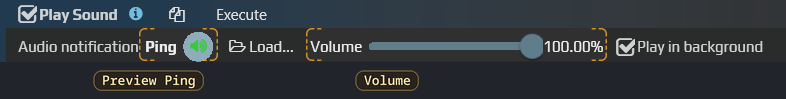

# Notice your viewer opening and closing

**Ping** plays when a Notepad window appears, and **Bell** plays when the last matching window closes. You can tell the two apart by ear while you are busy with something else and not looking at the aura tree.

Prepare your own local text file, such as `EA-Preview.txt`, and open it in Notepad. Close the other Notepad windows. You need a working audio output. Both sounds are in the notification list, so you do not need a sound file.

## Connect the two transitions

1. Right-click an empty area of the tree, choose **New Aura**, and name it **Viewer cues**.
2. In **Triggers**, click **+**, choose **Window Exists**, and set **Target Window** to `notepad`. Open your text file in Notepad and check in the selected window details that the viewer is the one found.
3. In **On Enter**, click **+** and add **Play Sound**. Choose **Ping** in **Audio notification** and set **Volume** to **50%**. With the speaker button beside the list you can preview the sound and check the audio output at the same time.

   

4. In **On Exit**, add another **Play Sound** with **Bell** and **Volume** **50%**. Leave **While Active** empty: an action in that list can repeat while the window exists.

| Action list | Reaction |
| --- | --- |
| On Enter | Play Sound → Ping, Volume 50% |
| While Active | Empty |
| On Exit | Play Sound → Bell, Volume 50% |

5. Keep the aura enabled and EyeAuras unpaused. Close the whole Notepad window, not just a document tab, and wait until **Window Exists** shows **Not Active**. Open your file again: you should hear Ping on the change to **Active**. Close the window: you should hear Bell on the change back to **Not Active**.
6. Leave the viewer open and switch to another application. Bell should not play: the window lost focus, but **Window Exists** still sees it.

If the viewer is already open, the first cue can play while you are still setting up. Start the comparison from a confirmed **Not Active** state. If two windows match, the state stays Active after you close the first one: the expression `notepad` is broad and does not watch a single document.

[Window Exists](/en/triggers/window-exists) tells whether the window is there, and the two [Play Sound](/en/actions/play-sound) actions play the cues for the transitions. If a cue is missing, check its preview, volume and action list. To see records of actions starting, open [Event Viewer](/en/features/event-viewer) beforehand, enable its Aura events and repeat the transition.
