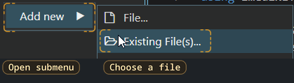

# Bundle help text and your own reference image

You can keep a small help card right inside the script project, with no path to a file on your own disk. The script reads the packaged text, and a Razor component shows it next to your PNG.

You need desktop EyeAuras with the script-hosted [Blazor window services and WebView2 Runtime](/en/scripting/blazor-windows/getting-started). Use a **C# Script action**: its Run keeps going while the window is open. The short setup script of C# Overlay will not do here.

1. Create your own aura `RecipeHelp` and add **Actions → On Enter → C# Script**. You will start it by hand with Run. In its project, choose **New file → Component**, name it `MainWindow`, and replace `MainWindow.razor` with the file below. If the template also created `MainWindow.cs`, remove it from the new project: here the whole component is one Razor file.
2. Prepare a UTF-8 file `help.txt` with the text below and a real reference PNG with no secrets in it that you are allowed to use. In the script file tree, choose **Add → Existing File(s)...**, import both files as resources, and use **Rename** to give them the project paths `docs/help.txt` and `images/reference.png`.

   

3. Replace **Script.csx** with the complete file below. Each logical path must match exactly one resource. Keep the spelling and folder case as shown. The component namespace is `RecipeHelp`. It does not have to match the generated project's namespace.
4. Wait for compilation and click **Run**. A window titled **Project reference** should show all three help lines and your PNG. When you resize the window, the image keeps its aspect ratio and fits the available width.
5. To finish the Run, close the window or click the action's **Stop**. A new Run reads the packaged text again.

## Script.csx

```csharp
using System;
using System.Reactive.Linq;
using System.Reactive.Threading.Tasks;
using PoeShared.Blazor.Wpf;
using RecipeHelp;
using System.IO;
using EyeAuras.Repl;

{
    var files = GetService<IScriptFileProvider>();
    var helpFile = files.GetFileInfo("docs/help.txt");
    var imageFile = files.GetFileInfo("images/reference.png");
    if (!helpFile.Exists || !imageFile.Exists)
        throw new FileNotFoundException("Add docs/help.txt and images/reference.png to this project.");
    string help;
    using (var stream = helpFile.CreateReadStream())
    using (var reader = new StreamReader(stream))
        help = await reader.ReadToEndAsync(cancellationToken);
    using var window = GetService<IBlazorWindow>();
    window.ViewType = typeof(MainWindow);
    window.DataContext = help;
    window.Title = "Project reference";
    window.Width = 480;
    window.Height = 320;
    var closed = window.WhenClosed.Take(1).ToTask(cancellationToken);
    window.Show();
    try { await closed; }
    catch (OperationCanceledException) when (cancellationToken.IsCancellationRequested) { }
}
```

## MainWindow.razor

```razor
@namespace RecipeHelp
@using PoeShared.Blazor
@inherits BlazorReactiveComponent<string>

<h2>Project reference</h2>
<pre style="white-space: pre-wrap;">@DataContext</pre>

```

## docs/help.txt

```text
Project reference
This help text belongs to this script project.
Compare the image below with your own original PNG.
```


| Part | Responsibility |
| --- | --- |
| `IScriptFileProvider` | The service for this project's resources. It is not yours, so do not dispose it. |
| `CreateReadStream()` and `StreamReader` | Your own stream and reader. They are closed before the window is shown. |
| `DataContext = help` | Passes a string explicitly to `BlazorReactiveComponent<string>`. |
| `images/reference.png` | A relative resource URL. This script-aware window serves it from the page base URI. It is not a Windows file path. |
| `WhenClosed` then `Show()` | Subscribes before the window is shown, and the wait for closing stays inside the `using` block that owns the window. |

Right now the file provider can find a resource by a unique folder-qualified ending of its manifest name, such as `ProjectName.docs.help.txt`. Make sure the ending does not match two resources at once. The full name includes the project namespace, not the component's `@namespace`. If the file is not found, print `typeof(MainWindow).Assembly.GetManifestResourceNames()` to the script log and check the import. [Embedded resources](/en/scripting/embedded-resources) explains full names and export packaging. Direct `Assembly.GetManifestResourceStream` has its own requirement: the case must match exactly.

If you change the original file on disk, the packaged bytes stay the same. Replace the resource or import it again, and recompile the project. Exporting and importing the whole project carries its resources along. Moving a single `.csx` does not. Reading an ordinary file from disk is covered in the [file provider example](/en/scripting/examples/basic/file-provider).
