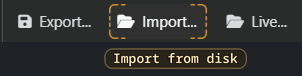

# Edit an exported project with an explicit helper

Here a two-file project is exported to disk, edited in an IDE and brought back into EyeAuras. An ordinary class formats the numbers and gets its logger through the constructor.

You need an editable **C# Script**, a C# IDE and a separate empty folder for the export. Do not pick a folder with other files in it: **Export... clears its files and subfolders, keeping `.git`.**

1. Create an aura `RecipeIde` and add **Actions → On Enter → C# Script**. You will run it by hand. Replace **Script.csx** with the code below. Through **New file → C# Class**, add `CounterFormatter.cs` and replace the generated class completely. Keep the `RecipeIde` namespace in the class and its import in the script.
2. Wait for compilation and click **Run** in EyeAuras. The action's **Event Log** shows `Counter: 001`, `Counter: 002`, `Counter: 003` with 500 ms pauses between them. If you click Stop during a pause, the run ends and the remaining lines do not appear.
3. Click **Export...**, choose the separate empty folder and open the generated `.sln` in your IDE. Leave the **actual exported project names, `.csproj` files, SDK/reference entries and NuGet configuration** as they are.
4. In `CounterFormatter.cs` on disk, change only the prefix `Counter:` to `Sample:` and save. In EyeAuras choose **Import...**, select the exported `.sln`, and wait for synchronization and diagnostics. Import replaces the project with what is on disk, so first save any changes you made only in EyeAuras.

   
5. Click **Run in EyeAuras** again. The lines `Sample: 001` through `Sample: 003` mean the changed class came back from disk. Building in the IDE does not run the script.

## Script.csx

```csharp
using System;
using System.Threading.Tasks;
using RecipeIde;

{
    var formatter = new CounterFormatter(Log);
    try
    {
        for (var value = 1; value <= 3; value++)
        {
            formatter.Report(value);
            await Task.Delay(500, cancellationToken);
        }
    }
    catch (OperationCanceledException) when (cancellationToken.IsCancellationRequested) { }
}
```

## CounterFormatter.cs

```csharp
using PoeShared.Logging;

namespace RecipeIde;

public sealed class CounterFormatter
{
    private readonly IFluentLog log;

    public CounterFormatter(IFluentLog log)
    {
        this.log = log;
    }

    public void Report(int value)
    {
        log.Info($"Counter: {value:D3}");
    }
}
```


| Part | What it does |
| --- | --- |
| `Script.csx` | Entry point. It holds the loop and the cancellation token of the current run. |
| `new CounterFormatter(Log)` | Passes the logger to an ordinary class explicitly. |
| `CounterFormatter.cs` | Support code of the project. It has no `Log`, `AuraTree` or `cancellationToken` globals. |
| Exported `.csproj` | Keeps the generated compilation settings and references. Its name is whatever your export produced. |

If you edit often, choose **Live Import / Live...** for your solution. Save the files in the IDE, wait for the project to update, then click Stop and Run in EyeAuras yourself. EyePad may show imported files as **Read-only**, so edit them outside. **CompileOnce** turns off import and file monitoring. Use your own editable copy with that mode off.

Synchronization only copies files from disk into the project. It does not merge two sets of edits. You need a compatible SDK to build in the IDE, but still check the EyeAuras diagnostics. [IDE integration](/en/scripting/ide-integration) covers exclusions and who owns what. [Script entry context](/en/scripting/getting-started) explains why the class needs its dependencies passed in explicitly.
