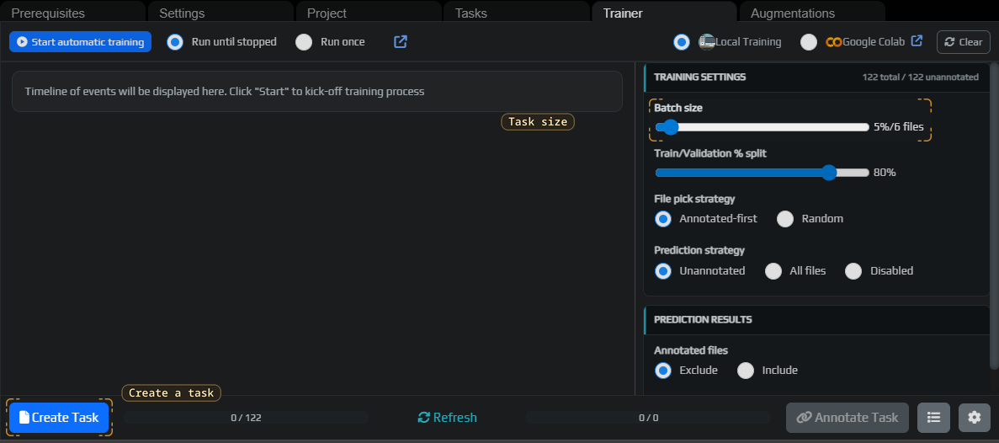

# Train your own reviewed detector and inspect its boxes

Here you train a one-class detector on your own images and look at its boxes on new images in EyeAuras.

You need **YoloEase 2 on Windows x64** with its managed training toolchain and project storage that you can write to and create symbolic links in. The steps follow source revision **946be263** and the **v2.0.90** release line. EyeAuras uses the model separately: it has its own OpenCV/ONNX Runtime, model parser and available provider. Training is not part of the main EyeAuras editor.

## Prepare independent images and complete a task

1. Prepare **20 of your own PNG images**. Some must show a clearly visible object, for example your own orange desk marker. Others must show a real empty background. Shoot independent scenes: change the position, lighting and background. Set aside **5 more independently taken images** outside the project for the final check, some with the object and some without. Do not split adjacent video frames, copies or variants of the same scene between training and validation.
2. In YoloEase click **New...** and save **OwnMarker.yeproj** in your own local folder. Keep the **OwnMarker** working folder next to it. In **Prerequisites**, click **Check all**, expand the errors, install the managed dependencies with **Install missing** and click **Check all** again. A CPU is enough. Installation may download Python, packages and weights, but it does not install a graphics driver. [Environment details](/en/YoloEase/prerequisites).
3. In **Settings** choose **Backend = Offline**. On **Project → Add label**, set **Label name = marker**, choose a colour and click **Add**. Drop only your 20 project PNGs onto **Drop folders, images, or videos here**. Individual images are copied into the project.
4. In **Trainer**, click **Refresh**, set **Batch size = 100%** and check that **20** unassigned files are selected. Click **Create Task**. In **Labels** select `marker`, press **N** and click two opposite corners around each object you want. Draw unrotated boxes and use the same rule for the object's edges everywhere. Look through every frame with **D/F** and fix classes and sizes. Do not draw boxes on reviewed empty frames.

   
5. When you have reviewed the whole task, click **Finish Job**. If you only close the editor, a new task is saved but not completed. Reopen it through **All tasks** and check that the boxes are still there. The dataset is built from completed annotations, not from model suggestions you did not accept. [Annotation editor](/en/YoloEase/features/annotation-editor).

## Train once and inspect the actual split

6. For the first run, leave all rows on **Augmentations** disabled so the frames stay clean. In v2.0.90 and in the source, the red original and cyan transformed contours are drawn into the pixels of the saved PNG, not just into the preview. Variants are also added before the split and can end up on both sides of train/validation. [Augmentation limits](/en/YoloEase/features/augmentations).
7. In **Settings → Training settings**, set the values from the table. Choose the Trainer controls separately.

| Setting | Value for this run |
| --- | --- |
| `Yolo8/10+ base model` | `yolo11s.pt`, a compatible detect checkpoint. Missing weights may be downloaded. |
| `Epochs` / `Model Size` | `50` / `640`. |
| `Additional arguments` | `device=cpu` to train on the CPU explicitly. |
| Trainer `Train/Validation % split` | `80%`. Check the actual image counts after conversion. |
| Trainer execution | **Local Training**, **Run once**, then **Start automatic training**. |

8. Look at the dataset stage and the **datasets/<run-id>/** folder. It should contain **data.yaml**, **train/images + train/labels** and **valid/images + valid/labels**. The converter splits the files in the order it received them. It does not shuffle them or balance them by class, so 80% does not guarantee balanced scenes and classes. Check that both groups have real positive examples and reviewed negatives, and that the scenes are independent. Keep the 5 set-aside images out of both groups. The `test` folders are created with a zero split and are not your set-aside images. If the split is not good, click **Stop automatic training**, wait for it to stop and fix the source selection or the annotation before the next run.
9. Read the training **output**, the validation metrics and the ONNX export result separately. **Cycle completed** also appears after an error or a cancellation. If training and export succeeded, click **open...** and find the result, normally under **datasets/<run-id>/runs/train/weights/**. Keep **best.pt**, **last.pt** and the exported **.onnx**. Look at misses and false positives, not only at loss/mAP. [Trainer](/en/YoloEase/features/trainer).

Local export requests `format=onnx` and **opset=17** from the selected checkpoint. EyeAuras does not load a `.pt` file. The wrapper does not set every Ultralytics export option explicitly. Check three things in the model:

- an NCHW input named **images** with fixed positive dimensions, normally **1×3×640×640**
- a supported detect output **1×(4 + class count)×candidates**
- `names` metadata with the correct `marker` index

Other layouts, embedded NMS, pose/OBB and arbitrary ONNX need a separate compatibility check. [Export contract](/en/YoloEase/features/yolo-onnx).

## Inspect boxes before adding any reaction

10. Open one of the five set-aside images in your own image viewer and keep its window visible. In EyeAuras create **RecipeMarker** through **Add new → New Aura** and add **Machine Learning(AI) Search** under **Triggers**. Do not add input actions. Click **Load from file...** and choose your exported ONNX. Wait for the model information and check the task, input and class names.
11. Under **Capture settings → Target Window**, select the viewer window. Set **Image Capture Rate = 1**. Open **Preview captured image** and use **Crop region** to keep only the image, without the viewer controls. Effects must give the same picture as in training and must not be applied twice. Under **Inference performance tuning → Provider**, choose **Cpu** if it is available.
12. Under **Trigger activation conditions → Search for**, select your `marker` class. Set **Confidence Threshold = 30%** and **IoU Threshold = 40%**. Click **Refresh Once** and enable **Bounding Boxes** and **Labels** in the preview. Look at where the box is and what its label says. Switch to a set-aside image without the object and refresh again. With no qualifying results the trigger is inactive. A result is kept only if its score is strictly above the confidence threshold.

Write down misses, wrong boxes and false positives on all five set-aside images. If there are errors, go back to the data and the annotation, and do not add a reaction yet. The parser stretches the input to the model size and maps the boxes back, so do not scale them a second time. [Model consumption](/en/YoloEase/use-in-eyeauras), [AI Search](/en/triggers/images/ai-search-trigger) and [capture settings](/en/triggers/images/imagecapturetriggers) explain where one part ends and the next begins.
