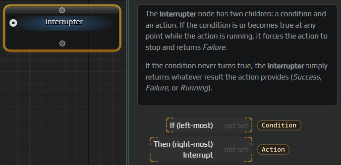

# Stop a pending wait on your next check

In this tree a separate stop signal can interrupt a two-second wait. If Stop is active on the next tick, Interrupter does not let the wait continue and resets it. Once Stop is cleared, the wait starts again with the full interval, not with what was left.

You need Behavior Tree templates **Interrupter**, **Aura Is Active**, **Wait**, **Sequence** and **Fixed Status**. You issue the ticks by hand, and Wait stays Running between them.

## Connect the stop check before the wait

1. Create **New Aura → Stop waiting** with **Triggers → Fixed Value → Is NOT Active** and no actions or overlays. Keep the aura loaded and enabled, and EyeAuras unpaused.
2. Create **New Behavior Tree**, select **My Tree**, enable **Activation → Is Loaded** and choose **Execution → When Activated → Do nothing**. Leave automatic activation links empty and repeat off.
3. Through **Add new Node**, build the tree below. Under Sequence, Interrupter comes first and the final Fixed Status second. Under Interrupter, the condition is on the left and Wait on the right. Keep all nodes enabled.

```text
My Tree
└─ Sequence
   ├─ Interrupter
   │  ├─ If: Aura Is Active — Stop waiting must be Active
   │  └─ Action: Wait — 2000 ms
   └─ Fixed Status — Success
```

4. In Aura Is Active, open **General → Links → Edit**, select only Stop waiting, require **must be Active** and choose **All must match (AND)**. Give this check no child. In Interrupter's **General**, check that **If** names this check and **Action** names Wait.

   

   In the screenshot the **Action** field is labelled Then Interrupt.
5. In Wait set **General → Delay = 2000 ms**. Randomization must be off, and there is no child. Set the last Fixed Status to **General → Status → Success**, also without a child.

## Interrupt and start a fresh interval

1. Make sure Stop waiting is **Not Active** and click the upper **Tick BT Once**. The stop check fails, so Wait starts. Wait, Interrupter and Sequence return **Running**. The final node is not reached.
2. Set Stop waiting to **Is Active**, wait until the aura becomes active and click the **same** tick button. Interrupter sees Success **before** resuming Wait, resets its wait and returns **Failure**. Sequence does not reach its final node. Continuation is rejected even if the old deadline passed between ticks.
3. Set Stop waiting back to **Is NOT Active**, wait for that state and tick. Wait starts a new full 2000 ms interval and returns Running. Wait more than two seconds and tick once more. Wait succeeds, the final Fixed Status runs and Sequence returns **Success**.
4. Stop ticking after completion: a new tick starts a new pass. To abandon a pending pass, unload your tree through **Is Loaded**, wait for cleanup and load it again. Clearing status colors does not reset execution.

[Interrupter](/en/behavior-trees/nodes/Interrupter) checks **If** first and lets **Action** run only on Failure. If If returns Success right away, Action is reset and not called. If If returns Running right away, the work is postponed without that reset. [Wait](/en/behavior-trees/nodes/wait) returns Running promptly and remembers its deadline. Nothing checks the condition every 100 ms between these calls.

It is different when the Action call itself is still awaiting asynchronous work. Then Interrupter checks the condition again and again with a **100 ms delay between completed condition samples**. It requests cooperative cancellation, waits for the work and its cleanup to finish, and only then returns Failure. Use the same manual entrypoint throughout this example. [Root](/en/behavior-trees/nodes/root) explains how it differs from automatic Main execution.
