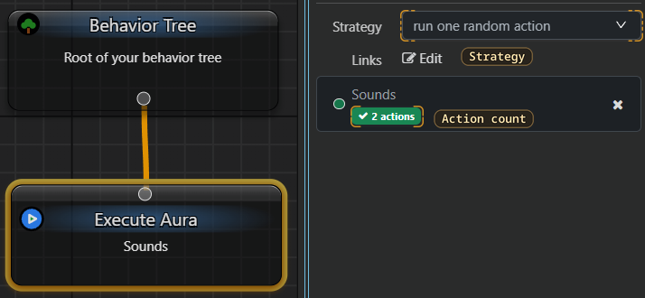

# Check readiness before calling a sound list

The tree plays one sound only if your readiness aura is active. You switch its state by hand. If the check fails, the Sequence ends without the notification.

You need the **Behavior Tree** editor, the **Sequence**, **Aura Is Active** and **Run Aura** templates, and an audio output you can hear. Use a separate configuration that has only sound in it. EyeAuras must not be paused.

## Prepare the condition and the reusable action

1. Create **New Aura → Ready state**. Add **Triggers → Fixed Value → Is NOT Active**, with no actions or overlays. The tree will check only this aura's state.
2. Create **New Aura → Ready cue**. Give it its own **Fixed Value → Is NOT Active** so the sound does not play on normal activation. Keep both auras loaded and enabled.
3. In Ready cue's **On Enter**, add one **Play Sound**: **Audio notification → Ping**, **Volume 50%**, **Play in background** off. Check the preview. Keep While Active and On Exit empty: the aura must have exactly one action. Being inactive does not stop it from being called separately through Run Aura.

## Build the guarded route

1. In the aura tree's creation menu choose **New Behavior Tree** and open it. Select **My Tree**, turn **Activation → Is Loaded** on and set **Execution → When Activated → Do nothing**. Add no automatic activation links.
2. Through **Add new Node**, add **Sequence**, **Aura Is Active** and **Run Aura**. Connect My Tree to Sequence, and Sequence to two children: Aura Is Active on the left and Run Aura on the right. Give these two nodes no children of their own.
3. Select Aura Is Active. In **General → Links → Edit**, select only Ready state, keep **must be Active** and choose **Operator → All must match (AND)**. Make sure the link is really there: an empty list does not check your readiness.
4. Select Run Aura. In **General → Auras → Links**, select only Ready cue. Check that it says **1 action** and choose **Strategy → run 1-by-1 in order of addition**.

   

```text
My Tree
└─ Sequence
   ├─ Aura Is Active: Ready state must be Active
   └─ Run Aura: Ready cue, ordered, 1 action
```

5. While Ready state is still **Is NOT Active**, click the upper **Tick BT Once**, not Run in an individual node's footer. The check should return **Failure** and there is no sound: the Sequence does not call its second child.
6. Change Ready state's Fixed Value to **Is Active** and wait until the aura shows Active. Go back to the same tree and click **Tick BT Once** again. The check succeeds, Ping plays once and the tree finishes with **Success**. Ready cue itself may stay inactive the whole time.
7. Set Ready state back to **Is NOT Active**, wait for that state and tick again. The check fails without a cue. Another tick while Ready state is Active would start a new attempt and could play the sound again.

[Sequence](/en/behavior-trees/nodes/sequence) stops the route after a failed check. [Aura Is Active](/en/behavior-trees/nodes/aura-is-active) reads the state of your aura. [Run Aura](/en/behavior-trees/nodes/execute-aura) calls its target's action lists. Success/Failure/Running are node results, not the aura states Active/Not Active/Unknown. If the check shows Unknown, look into the error.

Continue an unfinished route through the same entrypoint and wait for the call to finish. The check here has no Running child. If you add long work later, Sequence will not keep rechecking conditions that already passed. [Root](/en/behavior-trees/nodes/root) explains manual and automatic Main execution, and [the first tree guide](/en/behavior-trees/gettings-started) explains connections.
