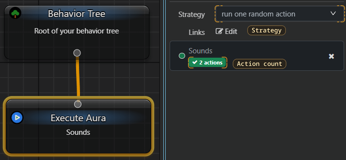

# Hear which alternative was selected

The tree plays Ping if the preferred check succeeds, otherwise Bell if the fallback check succeeds. If neither succeeds, there is no sound. Here you set the check results yourself, so the choice is clear before you connect a real sensor.

You need Behavior Tree templates **Selector**, **Sequence**, **Fixed Status** and **Run Aura**, and an audio output you can hear. Create a separate set that has only sound in it. EyeAuras must not be paused.

## Prepare two distinct cues

1. Create **New Aura → Preferred cue**. Add **Triggers → Fixed Value → Is NOT Active**. In **On Enter**, add exactly one **Play Sound**: **Audio notification → Ping**, **Volume 50%**, **Play in background** off. Check the preview. Keep While Active, On Exit and Overlays empty.
2. Create **Fallback cue** the same way, but choose **Bell**. Keep both auras loaded, enabled and inactive: the tree calls their actions separately.
3. Create **New Behavior Tree**, select **My Tree**, enable **Activation → Is Loaded** and choose **Execution → When Activated → Do nothing**. Do not add automatic activation and do not start repeat.
4. Through **Add new Node**, build the tree below. Selector has two Sequence children, with Preferred on the left. In each Sequence the check comes first and Run Aura second. All nodes are enabled, and the leaves have no children.

```text
My Tree
└─ Selector
   ├─ Preferred: Sequence
   │  ├─ Fixed Status: Failure
   │  └─ Run Aura: Preferred cue, ordered, 1 action
   └─ Fallback: Sequence
      ├─ Fixed Status: Success
      └─ Run Aura: Fallback cue, ordered, 1 action
```

5. Set each Fixed Status through **General → Status** to the value shown in the diagram. For each Run Aura, open **General → Auras → Links**, select only its cue, check that it says **1 action** and choose **Strategy → run 1-by-1 in order of addition**.

   

## Change the eligible branch

1. Click the upper **Tick BT Once**. Preferred's check fails and its Ping is skipped. Fallback's check succeeds, Bell plays and Selector returns **Success**.
2. Set Preferred's Fixed Status to **Success** and tick again. Ping plays. Selector stops at that successful Sequence and does not play Bell.
3. Set both checks to **Failure** and tick. Selector returns **Failure** and neither cue plays. To get the first result again, set Preferred back to Failure and Fallback to Success. Do not switch the cue auras' triggers: they must stay inactive.

| Choice | Why it is needed |
| --- | --- |
| Sequence around each check and cue | A check placed directly under Selector would end the choice on success, before its separate cue |
| Left-to-right order | Decides which eligible alternative is tried first |
| Manual tick after a terminal result | Starts another pass, so the sound can play again |

[Selector](/en/behavior-trees/nodes/selector) tries the next child after Failure. [Sequence](/en/behavior-trees/nodes/sequence) stops on Failure before reaching its cue. [Fixed Status](/en/behavior-trees/nodes/fixed-status) returns the result you set. [Run Aura](/en/behavior-trees/nodes/execute-aura) calls the prepared action lists and does not change their auras' activity.

If a branch returns Running, Selector continues that same branch on the next tick. It does not switch by itself, even if an earlier alternative has changed. Effects that already happened are not rolled back. Later you can replace a check with a childless [Aura Is Active](/en/behavior-trees/nodes/aura-is-active): explicitly select your tested aura and its expected state. Unknown and errors are not a normal failure of the preferred branch.
