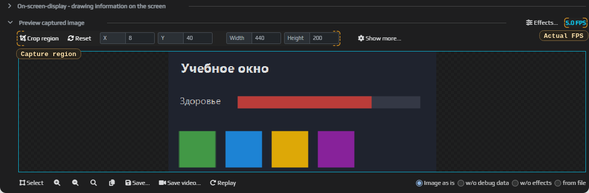

# Keep a half-full indication meaningful at two sizes

You have two bars of different sizes, and you want a reminder for each when it is about half full. Turn each bar into a black-and-white mask and look at the mask's average color.

What to prepare:

- Six PNGs made in your own image editor: bars **200 × 20** and **400 × 40** pixels, each one empty, half full and full.
- Empty pixels are pure black **RGB(0,0,0)**. Filled pixels are solid green **RGB(0,204,0)**. In the half images, exactly the left half is green.
- No text, borders, rounded corners, gradients or antialiasing.
- Two image-viewer windows of your own that are easy to tell apart: the small bar in one, the large bar in the other, both at 100% scale. Each window must switch among its three images without the bar moving.
- Working capture and Color Search with **Color Replacement - HSV Range**.

## Capture the whole bar, then make a binary mask

1. Create **New Aura → Small bar** with only **Color Search**. Under **Capture settings → Target Window**, pick the small-bar viewer and set **Image Capture Rate = 5**. In **Preview captured image**, check that you see the right current image. If the frame is black, stale or from another window, pick the correct source first.
2. Set **Crop region → X/Y/Width/Height** to exactly the whole interior of the small bar: both the filled and the empty part, without the viewer or borders. The frame must come out 200 × 20. Use the same crop for all three states. The coordinates are counted from the source image, not from the desktop.

   
3. Open **Effects... → Add → Color Replacement - HSV Range**. It must be the only effect, applied to the whole cropped frame: no resize, blur or other transforms. Set the inclusive ranges **H 55–65**, **S 200–255**, **V 150–255**. Enable **both** replacement checkboxes: the matching color is white **RGB(255,255,255)**, the nonmatching color is black **RGB(0,0,0)**. Keep **Invert** off if it is shown. H uses the editor's 0–180 scale, S and V use 0–255.
4. In **Image as is**, check the result: the green part is now exact white, and the empty black part is still black. Compare with **w/o effects**, then return to Image as is. If the mask has gray, another color or extra content, fix the source, range or crop before you measure anything.
5. Configure Color Search as in the table. Enter white in Target Color by hand. Do **not** copy the average color of a half-full frame as the target.

| Setting | Value |
| --- | --- |
| Comparison Granularity | Aggregate Average Color of Entire Area |
| Comparison Method | Mathematical |
| Target Color | White, #FFFFFF |
| Match Threshold → Min enabled | Min 45%, Max 55%, inclusive |

6. Create a separate **Large bar** aura with Color Search and set it up the same way for the second viewer. The crop is the whole 400 × 40 bar, and the replacement and comparison settings are the same. Check that the two auras do not look at the same window by accident.

## Compare known states before displaying the answer

1. Switch both viewers to the empty images: the mask should be all black and Similarity near 0%. Switch to the half images: about 50%. Switch to the full images: near 100%. For the same fraction, the small and the large bar should score about the same, even though they have different numbers of white pixels. The average color is rounded to a byte, so the half value can shift a little.
2. Only after this check, add **Text** to each aura: **Content** `Small bar near half` or `Large bar near half`, **Font 24**, **Size to fit** off. Stay in Overlay mode, place the texts in separate rectangles and enable **Locked**. Leave actions empty. To see normal visibility, select another item and leave the editor.
3. With half-filled bars, within 45–55%, both reminders should be visible. With empty and full bars they are hidden. Switch both back to half and the reminders should appear again. If the bar moved when you changed the image, fix the crop and check all three states again.

[Effects](/en/triggers/images/effects) makes the exact two-color mask, [Color Search](/en/triggers/images/color-search) compares its average color with white, and [Text](/en/overlays/text) shows the message you typed yourself.

For an ideal mask like this, the average color gets closer to white in proportion to the share of white pixels. This stops working if the image is different, the colors are mixed, there is padding or glow, the image is resampled, or the crop covers more or less from frame to frame. Do not widen the threshold just to hide a failed check.

If capture is missing, you can get Unknown instead of a confirmed empty bar. Check the capture with the [capture guide](/en/triggers/images/imagecapturetriggers).
