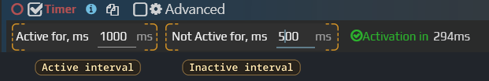

# Follow a pulse in the overlay and event messages

The aura shows the text **Pulse active** for about a second, then hides it for about a second. You will compare this with the state records for the same aura in the event log. If you disable the aura and enable it again, you will see that a new cycle starts and the old phase does not continue.

Create a separate display-only aura. EyeAuras must not be paused. You do not need an external window, a script or actions. Keep **both** Timer values equal.

## Prepare the display and event collection

1. Create **New Aura → Pulse check**. Add only **Triggers → Timer**. Set **Active for = 1000** and **Not Active for = 1000**, both in **ms**. Turn off inversion and the extra activation and deactivation delays. Leave the action lists empty.

   
2. Under **Overlays**, add **Text**: **Content** `Pulse active`, **Font 24**, **Size to fit** off. Keep **Window → Mode → Overlay**. Unlock the overlay, place the rectangle so the text is readable, then enable **Locked**. Select another aura while you watch. Otherwise the editor preview keeps the text on screen.
3. Click **Show event log** in the main window to open **Event Viewer** before you start a new cycle. Show its filters, enable **Auras**, set **Level → Info**, clear the text filter and unpause the panel. Do not collapse it.
4. Disable Pulse check with its aura switch, then enable it again. The new cycle starts Inactive: the text is hidden at first, appears after about a second, hides after about another second, and so on.
5. In Event Viewer, enter `Aura state changed to` in the text filter. Find the entries whose **context** is Pulse check and compare their timestamps with what you saw on screen. The message reports the aura's combined state, not a separate Timer action. Other auras can write the same text, so the message alone is not enough without the context.

| Observation | Meaning |
| --- | --- |
| Inactive wait first, then Text is visible and hidden in turn | A Timer with equal durations controls normal overlay visibility |
| State-change records for Pulse check | The aura model reported its transitions |
| Trigger disabled or state unavailable/null | Work is stopped or unavailable. This is not another ordinary Inactive phase |
| Aura re-enabled | A fresh inactive wait, not the rest of the old phase |

Disable the aura again: the text should stop appearing. If the preview is still visible, select another item and leave the editor. Enable the aura to start a new cycle.

A full repeat takes about two seconds plus scheduling overhead. Changing a duration also restarts the cycle. Values below 100 ms are raised to that minimum, and zero does not turn a phase off.

[Timer](/en/triggers/timer) supplies the condition, [Text](/en/overlays/text) and [common options](/en/overlays/common-options) make it visible, and [Event Viewer](/en/features/event-viewer) shows the transitions the aura reported.

The text filter searches messages, not context names. The panel keeps only 250 accepted entries and misses events while it is paused, collapsed or the category is turned off. If the history is empty, clear the filters and repeat with the panel open.

[Wait](/en/behavior-trees/nodes/wait) does not fit here: it would delay one tree route, not create this periodic aura pulse.
