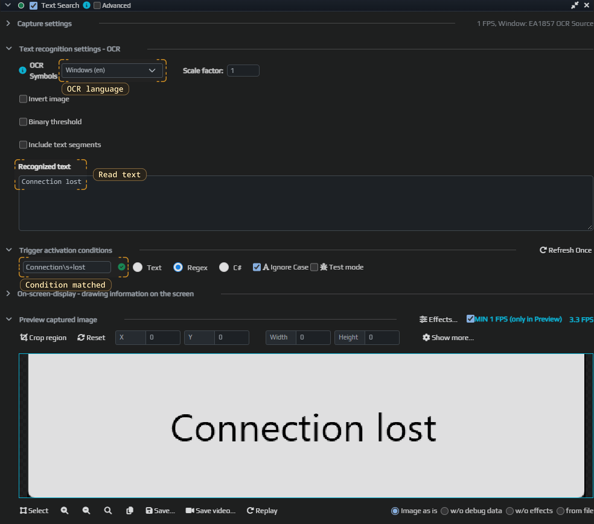

# Turn your visible status line into a reminder

The aura reads the line **Status READY** in your open document and shows the reminder **Review the ready document**. When the line changes to **Status WAITING**, the reminder hides. OCR reads the pixels on screen, not the saved file or the application's hidden state.

What to prepare:

- One non-sensitive document in your own text editor. Show those English phrases in it one at a time in large, clear letters, for example font size 32, dark text on a light background.
- The window is not minimized, and the text is readable in capture.
- An English OCR engine is available in **OCR Symbols**. For example, **Windows (en)** with its Windows OCR language capability installed, or **Tesseract (eng)** with compatible, loadable language data. A saved engine name alone is not enough.

If there is no English entry, first prepare the language and engine as described in [Text Search](/en/triggers/images/text-search) and restart EyeAuras. You do not need an API key or a paid service.

## Check the recognized words before the condition

1. Create **New Aura → Document ready** from the tree's creation menu. In **Triggers**, click **+** and add **Text Search**. Under **Capture settings → Target Window**, pick your document window and check the selected-window information.
2. Set **Image Capture Rate 1 FPS**. Open **Preview captured image** and use **Crop region** to keep just the status line, with a margin around the letters so they fit whole. The window title and other document text must stay outside the crop. Leave the effects list empty for now.
3. Under **Text recognition settings - OCR**, choose your available English **OCR Symbols** entry. Set **Scale factor 1** and turn off **Invert image**, **Binary threshold** and **Include text segments**.
4. Show Status READY, click **Refresh Once** and look at **Recognized text**. It must contain the right words. Fix wrong letters, a blank capture or language errors before you set up the condition.

   

| Setting | Starting value |
| --- | --- |
| Image Capture Rate | 1 FPS |
| Scale factor | 1 |
| OCR Symbols | Your available English engine |
| Invert image / Binary threshold | Off |
| Include text segments | Off for the first match |

## Filter and display the result

1. In **Trigger activation conditions**, choose **Regex** and enter `READY` as is, without quotes or outer slashes. Enable **Ignore Case** and keep **Test mode** off. Regex looks for this fragment anywhere in the recognized string. **Text** mode would require the whole string, other words included, to equal the expression.
2. Refresh with Status READY: you should get **Active**. Change the line on screen to Status WAITING and refresh: if WAITING is recognized correctly, you should get **Not Active**. Bring READY back and check that the match returns.
3. Add **Overlays → + → Text**: **Content** `Review the ready document`, **Font 24**, **Size to fit** off, **Window → Mode → Overlay**. Unlock the overlay and place a 500 × 80 area, then enable **Locked** and **Clickthrough**. Leave actions empty.
4. Keep the aura enabled and EyeAuras unpaused. Select another aura and leave the editor. With READY the reminder should be visible. With WAITING it should hide as soon as a fresh recognition result arrives.

For a stricter rule, replace `READY` in Regex with `Status\s+READY` and repeat both checks. This expression accepts spaces or a line break between the words. If the text is recognized correctly and the mistake is in the expression, leave the recognition settings alone.

To see the word regions, enable **Include text segments**, refresh and open the annotated preview. Right now Windows and Tesseract give regions for separate words, not one tight box around the matching phrase. Windows word scores here are 1, and Tesseract gives its own confidence.

[Capture](/en/triggers/images/imagecapturetriggers), [Text Search](/en/triggers/images/text-search), [text matching](/en/features/text-match-expressions) and [Text](/en/overlays/text) each handle a different part of the result. Keep Scale factor 1 to start with: word coordinates are counted from the image OCR processed, not from points on the desktop. If the letters need preprocessing, change one [effect](/en/triggers/images/effects) at a time and check Recognized text again each time. With Unknown or an empty OCR result, check the source and the engine first.
