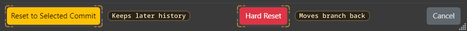

# Preserve the failed state before returning to a usable one

First save everything you need to investigate the failure, and only then roll the configuration back. You end up with a local report archive, an export of the set, and a profile restored from the snapshot you chose. Saving a report does not send it anywhere.

Work in your own test profile with no unrelated unsaved changes. You need:

- file-based configuration saving and **File system version control** enabled;
- a known usable snapshot;
- a backup directory **outside the profile's config directory**.

Restoring changes the whole profile configuration and restarts EyeAuras. If there is no suitable snapshot, stop after saving the data: there is no server-side recovery here.

## Save the affected run before changing it

1. Note the failure time, the EyeAuras version and profile, and the affected folder. Describe the steps, the actual result and the expected result in your own words. Do not invent a cause. Do not repeat harmful actions just to get a report.
2. In the title bar click **Report a problem**. In **Error Report**, enter the description. Select the logs from the affected run. If you have restarted since the failure, you need an earlier log. Review the screenshots. Add aura configuration only if it is relevant.
3. Click **Save...**, choose your backup directory and wait for the `.7z` file. Open the archive and check **comment.txt**, the selected logs and the attachments. Required system and application details can be in the archive even without aura configuration. Before you share it with anyone, check it for private paths, images and settings. Close the dialog without clicking **Send**.
4. Select the affected folder and open **Share/Export**. In **Content**, check what is included and look for **Missing linked objects detected**. Before you add dependencies, look at what **Add linked objects** offers. Use **Destination → Local export → Save to file...** to save the JSON next to the report. This exports the selected set, not the whole profile history and not external files.
5. Write down both filenames. Make sure they are outside config: restoring can delete untracked files there. Save any other newer settings you need separately before you continue. Export does not remove secrets from fields.

## Select the exact snapshot and restore intentionally

1. Click **Version history** in the main window. If the snapshot you need is hidden by the period filter, choose **All-time → Refresh**. Find it by **Commit ID**, time and description. Do not just take the top row.
2. If the date or scope is wrong, click **Cancel**. Refresh only reloads the list. It does not save a new snapshot of your edits.
3. For the right snapshot, click **Reset to Selected Commit**, check the date in the confirmation, and confirm. Go by the command you chose, even if the confirmation title says Hard-reset. This route flushes pending writes, restores the snapshot files, keeps the history and creates a restoration commit. **Hard Reset** is a different operation: it removes later branch states from the normal list.

   
4. After the restart, check a setting that was definitely in the snapshot, such as your folder's earlier name. Check the local behavior you wanted to keep separately. Do not delete the report and the export.

| Kept item | Purpose |
| --- | --- |
| Report archive from the affected run | Logs, description and selected diagnostic attachments |
| Exported JSON | The selected current set with the included dependencies |
| Version-history snapshot | The profile configuration state you are returning to |

For diagnostics, read [Reporting](/en/report-a-problem) and [archive contents](/en/features/problem-reports). For the selected set, read [Export/Import](/en/features/export-import). For what gets replaced and the restart, read [Version history](/en/features/config-rollback).
