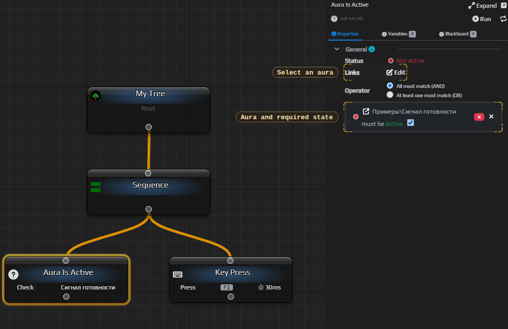

# Retry readiness, then finish one controlled pass

The tree stays at your readiness check until it succeeds, then plays a cue. After that you stop giving ticks. You get one cue **per deliberately completed pass**.

You need the Behavior Tree editor with **Sequence**, **Until Success**, **Aura Is Active** and **Run Aura**, plus audio output you can hear. The readiness source is a state you switch by hand.

## Prepare an explicit source and sound

1. Create a root **New Aura → Retry ready**. In Triggers add **Fixed Value → Is NOT Active**, with no actions or overlays. Keep the aura loaded and enabled.
2. Create a second aura, **Retry cue**, also loaded and enabled, with **Fixed Value → Is NOT Active**. In **On Enter**, add exactly one **Play Sound**: **Audio notification → Ping**, **Volume 50%**, **Play in background** off. Preview the sound. Leave While Active, On Exit and Overlays empty. Do not change Retry cue's Fixed Value during the exercise.
3. Create **New Behavior Tree**. Select My Tree, enable **Activation → Is Loaded** and choose **Execution → When Activated → Do nothing**. Leave the automatic activation conditions empty. Do not click the repeat button: every attempt below is started by the same upper Tick BT Once button.

## Connect the retry before the cue

1. Through **Add new Node**, add Sequence, Until Success, Aura Is Active and Run Aura. Connect them as in the diagram below. Sequence has two enabled children, left to right: Until Success and Run Aura. Until Success has one child, Aura Is Active.
2. In Aura Is Active, use **General → Links → Edit** to select only Retry ready, choose **must be Active** and set **Operator → All must match (AND)**. Do not give this check a child.

   
3. In Until Success, check **General → Child**: it should show that check. In Run Aura, choose **General → Auras → Links → Retry cue**, check that it says **1 action**, and set **Strategy → run 1-by-1 in order of addition**.

```text
My Tree
└─ Sequence
   ├─ Until Success
   │  └─ Aura Is Active: Retry ready must be Active
   └─ Run Aura: Retry cue, ordered, 1 action
```

4. Make sure Retry ready is **Not Active** and click the upper **Tick BT Once**. The check returns Failure, but Until Success and Sequence stay **Running**. There should be no cue.
5. While the source is still Not Active, click the **same** upper button again. You get one more check attempt and Running again, with no cue. Until Success has no internal polling loop and no pause of its own between attempts.
6. Switch Retry ready to **Is Active** and wait until the aura shows Active. Go back to the same selected tree and click the same Tick BT Once. The check succeeds, Sequence reaches Run Aura, one Ping plays and the pass ends with **Success**. Stop clicking now: with Do nothing selected, no new cue should play on its own.

| Operation | Expected result |
| --- | --- |
| Manual tick while readiness is definitely false | One failed check attempt, parent Running, no cue |
| Next manual tick after readiness becomes Active | Check succeeds, one cue, pass completed |
| No more manual ticks, Do nothing selected | No new pass is requested |
| Another tick after Success | A new pass starts. If the condition still matches, the sound plays again |

To repeat on purpose, first set Retry ready back to **Is NOT Active**, wait for that state, then start the next pass with Tick BT Once.

To drop a pass that is held in Running, unload **your own tree** through **Is Loaded**, wait until it finishes its work and cleans up, and load it again before a new run. **Reset node status** only clears the displayed result and does not reset execution. Do not start a single node through Run while the earlier route still holds its continuation.

[Until Success](/en/behavior-trees/nodes/until-success) turns each normal child Failure into Running. [Sequence](/en/behavior-trees/nodes/sequence) remembers that stage and lets [Run Aura](/en/behavior-trees/nodes/execute-aura) run only after success. The [aura-state node](/en/behavior-trees/nodes/aura-is-active) reads your source and does not change it. Unknown, errors and cancellation do not count as ordinary retries.

For automatic work, **Tick every** on [Root](/en/behavior-trees/nodes/root) is set in **ms**. It is a pause after a periodic traversal. **Run once** gives one activation tick and does not have to finish Running work. **Run periodically** can start the next pass after completion and play the sound again. If you want one deliberate completion, keep the manual route from this recipe.
