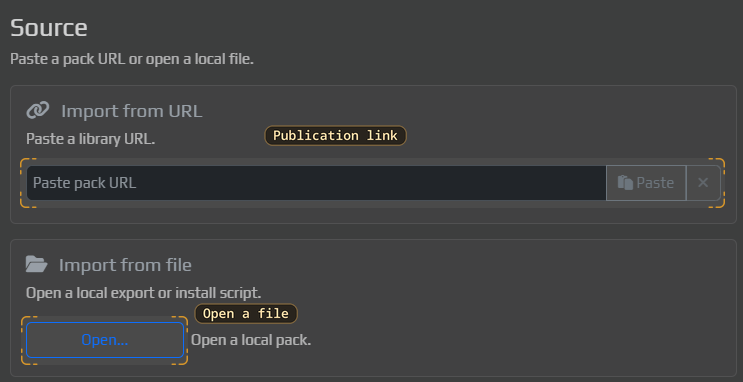

# Decide whether a pack is ready for your own setup

Go through the pack before you import it into a working tree. At the end you should have a clear decision: the pack fits your prepared environment, needs specific configuration, or has to wait for missing information.

You need your own test profile without personal data and a pack file you are allowed to inspect. It is easiest to start with a small pack of your own. For a publication, have its normal link and the author's requirements at hand. You do not need to change your account or run anything. Private content can get in the way of a complete review.

## Inspect before applying

1. Open **Import → Source → Import from file → Open...** and choose your prepared JSON. For a publication you already have access to, paste its normal link in **Source**, check the author and name, then click **Download** to get **Preview**.

   
2. For a publication, look at **Overview** and **Pack Options**. Write down the author, the displayed **rev.**, the required client version and the windows, language, files, resources and optional modules the author lists. A local JSON without publication metadata has no author revision and no update subscription. Compare it with the requirements you were given separately.
3. In **Preview**, expand the folders and select each aura or folder that matters for your task. Look at the visible Enabling Conditions, Triggers, actions and overlays. Note unloaded items, scripts, image and audio data, and external paths. Read scripts and resource declarations where you can. The preview may not show every dependency. If you see **Item is not browsable**, requirements are missing or code is unavailable, stop and ask the author through your normal process.
4. Do not confuse folder permissions with execution. **Read-Only** does not stop configured logic from running, and **Private Content** can hide it. Take inherited restrictions into account. A pack being listed in the library, being downloadable, being editable and needing a license are four separate facts. Do not unlock the pack or change its owner just to finish the review.
5. In **Import Options**, look at the update, subscription and conflict choices. **Copy** keeps existing objects, and the copies get separate IDs. **Replace** replaces whole conflicting objects, not individual fields. **Ignore Conflicts** can leave the set incomplete. A subscription also applies the current publication. While the requirements are unclear, do not click Import or any button that applies a conflict resolution.

## Turn the review into a decision

Write a short note for the chosen file or revision:

| Check | What you must identify |
| --- | --- |
| Condition and reaction | The real data source, the enabling permission, On Enter/While Active/On Exit work and any automatic tree/macro entry |
| References and resources | Included and external aura links, property-binding sources, embedded resources, files, optional models/providers and whether they are available |
| Target defaults | The intended Target Window and which capture/action properties inherit it and which have their own value |
| Access and version | Which contents you can inspect, which settings are permitted, whether the client and components match, which license requirements are stated |

If something you need is hidden or unavailable, choose **defer** and close the dialog. The working tree has not changed, because the import was not applied.

If the requirements are clear, the result is a concrete configuration plan. For example: “set folder Target Window to my document; verify both capture bindings; keep the prepared reaction disabled until checked.” A selected destination folder does not override imported paths. And do not count on Import having a universal safe or disabled mode.

When you decide to go ahead, apply the chosen conflict and update policy only in your own test profile. Check loading and enabling before any reactions.

What to read:

- [Export/Import](/en/features/export-import) — how the set is applied.
- [Defaults](/en/features/default-properties) and [Bindings](/en/features/bindings) — how a value gets from source to target.
- [Enabling Conditions](/en/features/enabling-conditions) — what gives permission to work.
- [Aura Library](/en/aura-library) — where to find a publication.
- [Permissions](/en/features/permission-model) — who can view and edit.
