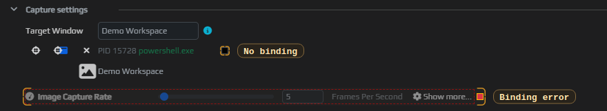

# Change two capture sources in one place

You choose a window once in a folder, and both visual checks start looking at it. This is handy when one application needs several recognizers: each keeps its own search settings, and the window is set in one place.

Open two separate windows of your own text editor. Write **SOURCE A** in large letters in one and **SOURCE B** in the other. Both windows must be visible and not minimized, and the capture method must show their current picture.

## Make the folder own the choice

1. Right-click an empty area of the tree, create **New folder** and name it **Shared visual source**. Open its **Triggers/Actions/Overlays Defaults** section.
2. Enable the **Target Window** checkbox. Use **Click to select Window** to pick SOURCE A, then check the information about the window that was actually found. If a window is closed and opened again, its handle can change, so keep both windows open during the exercise.
3. Inside the folder, create **New Aura → Icon check** and add **Triggers → + → Image Search**. Create a second child aura, **Color check**, with **Color Search**. Leave the action lists empty.
4. In **Capture settings → Target Window** of Icon check, right-click the small binding indicator beside the field and choose **Bind to Default**. Do the same for Color check. This connects each field to the folder value explicitly, even if a new component already got that binding by itself.

   Right-click the black square beside **Target Window**. The red indicator below belongs to another field, **Image Capture Rate**.

   

| Connection | Direction |
| --- | --- |
| Folder default Target Window | Supplies the window-matching expression |
| Icon check → capture Target Window | Gets that value through Bind to Default |
| Color check → capture Target Window | Gets the same value through its own binding |

5. Set **Image Capture Rate 5 FPS** in both triggers, leave effects empty and start with the full source: **Crop region → Reset**. Open each **Preview captured image** in turn. Both previews and both selected-window displays should show SOURCE A.
6. Go back to the folder and use the picker to change only its enabled **Target Window** to SOURCE B. Look at both triggers again: they should show SOURCE B, although you did not touch their fields. Keep the auras loaded and enabled and EyeAuras unpaused while you do this.
7. Set the folder back to SOURCE A. Both previews should return to it. If only one switched, check the binding of the other field: it may have a manual value, another source or an error. An Image Search with no template may have no usable match result even when its frame is captured correctly.

[Default Properties](/en/features/default-properties) holds the shared choice, [Bindings](/en/features/bindings) connects the source to the destination, and [capture](/en/triggers/images/imagecapturetriggers) supplies the pixels you see in the preview. This property takes a window-matching expression. A found rectangle or plain status text is not a substitute for a compatible type. Do not create a reverse binding from a trigger into the folder.

To give one check its own window, choose **Un-bind** on its indicator and enter a separate Target Window. After that, editing the unbound field should not affect the other check. You do not need **Apply to All** here: it can replace other checked defaults and existing descendant bindings.

For lasting use, set a stable [matching expression](/en/features/window-matching-expressions) and recheck the resolved window after it is reopened. The recognizer itself is set up separately with [Image Search](/en/triggers/images/image-search) or [Color Search](/en/triggers/images/color-search).

If you add an input action later, it may have its own or an inherited binding. Check separately where it actually aims, how the input is delivered and whether it needs focus.
