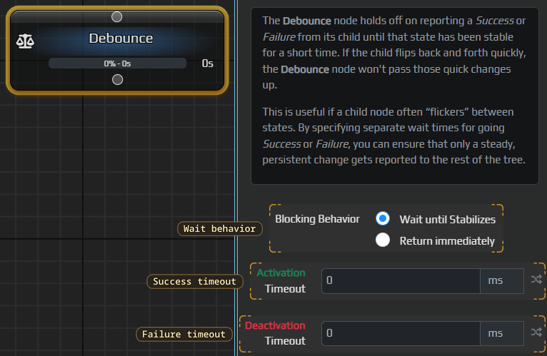

# Delay a warning you have actually checked

The warning has to hold for one second before Ping plays. If the check sees a false result during that time, the second starts over.

You need the Behavior Tree editor with Debounce, Sequence, Aura Is Active and Run Aura, plus audio output you can hear. Use a separate set that only plays a sound. EyeAuras must not be paused.

## Prepare the warning and its cue

1. Create **New Aura → Warning source** at the root. Add **Triggers → Fixed Value → Is NOT Active**, with no actions or overlays. Keep the aura loaded and enabled.
2. Create a second loaded aura, **Warning cue**, also with **Fixed Value → Is NOT Active**. In **On Enter**, add exactly one **Play Sound**: **Audio notification → Ping**, **Volume 50%**, **Play in background** off. Preview the sound. Leave While Active, On Exit and Overlays empty. Do not activate the cue aura itself during the exercise.
3. Create **New Behavior Tree**. Select **My Tree**, enable **Activation → Is Loaded** and choose **Execution → When Activated → Do nothing**. Do not add automatic activation and do not click the repeat button.
4. Through **Add new Node**, connect the nodes as in the diagram. Sequence's children go left to right. Aura Is Active has no child of its own.

```text
My Tree
└─ Sequence
   ├─ Debounce
   │  └─ Aura Is Active: Warning source must be Active
   └─ Run Aura: Warning cue, ordered, 1 action
```

5. In Aura Is Active, use **General → Links → Edit** to select only Warning source, choose **must be Active** and set **All must match (AND)**. In Run Aura, choose **General → Auras → Links → Warning cue**, check that it says **1 action**, and set **run 1-by-1 in order of addition**.
6. Configure Debounce as in the table. Turn randomization off for both timeouts. The **Child** field should point to your aura check.

| Debounce setting | Value |
| --- | --- |
| General → Behavior | Wait until Stabilizes |
| Activation Timeout | 1000 ms |
| Deactivation Timeout | 1000 ms |



## Observe admission, rejection and re-entry

1. Set the source to **Is Active**, wait until it is definitely Active, then click the upper **Tick BT Once**. Debounce and Sequence return **Running**, and Ping does not play.
2. Set the source to **Is NOT Active**, wait for that state and click the **same** upper button. Debounce sees Failure, drops the pending activation and starts the deactivation countdown. It returns Running. Wait more than a second and tick once more while the source is still false: you get **Failure**, with no sound.
3. Set the source to Active again and tick. A new activation countdown starts, and the result is Running. Leave the source Active, wait more than a second and tick again. Debounce succeeds, one Ping plays and Sequence returns **Success**. Do not give any more ticks.

To repeat on purpose, first set the source to Not Active and **tick so that Debounce sees it**. Then set it back to Active and repeat the wait.

A successful finish does not reset Debounce's elapsed timer. So an extra tick while the source is still Active can play the sound right away. If you need a full reset, unload your own tree, wait for cleanup and load it again. **Reset node status** only clears the display.

[Debounce](/en/behavior-trees/nodes/Debounce) filters the results it saw, [Aura Is Active](/en/behavior-trees/nodes/aura-is-active) reads your source, and [Sequence](/en/behavior-trees/nodes/sequence) lets [Run Aura](/en/behavior-trees/nodes/execute-aura) run after Success.

- Do not give the check a child: Running passes through Debounce without resetting its timers.
- Debounce does not see a change that happened between ticks and was not caught by any of them.
- There is another mode, Return immediately: until the timeout runs out, it returns the opposite terminal result.
