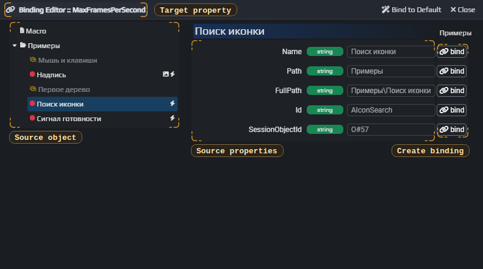

# Find why a linked reminder is missing

A reminder can go missing for four different reasons: it is not permitted to work, its condition is not met, the source of its text is broken, or the overlay is not visible. First build a small set where everything is known. Then change one thing at a time, and you will see where to look for a similar problem in your own configuration.

You need Text, Fixed Value, the Aura Is Active trigger, Dependencies Viewer and Binding editor. Use your own display-only auras, loaded and enabled. EyeAuras must not be paused. If you plan to experiment on an important existing set, save an [export](/en/features/export-import) first.

## Build a known dependency and text binding

1. Create a root **New Aura → Message source** with **Fixed Value → Is Active** and a **Text** overlay. Set **Content** to `Review notes`, **Font 24**, **Size to fit** off. Unlock the overlay, place the rectangle so the text is readable, then enable **Locked**. Leave actions empty.
2. Create a root **New folder → Reminder group**. In its **Enabling Conditions**, add only **Fixed Value → Is Active**. Inside it create the aura **Linked reminder** with an ordinary **Triggers → Aura Is Active**. In **Links**, select only Message source, choose **Active** and set **Logical operator → All must match (AND)**.
3. Add Text to Linked reminder with Font 24 and Size to fit off. Click the binding indicator next to **Content**. In **Binding editor**, select Message source on the left, expand **Overlays → Text → Content** on the right and click **bind**. The string goes from the source to the destination, not the other way. Place this overlay away from the source one and lock it.

   

4. Outside Reminder group, create the aura **Graph** with **Fixed Value → Is Active** and a **Dependencies Viewer** overlay. In the overlay's **Graph → Auras → Links**, select Linked reminder. Enable **Show dependencies** and **Show connections**, and place the graph away from the text. The graph edge shows the aura-state dependency, not the Content binding.
5. Before you change anything, open **Show event log → Event Viewer**. Show the filters, enable **Auras**, set **Level → Info**, clear the text filter and unpause the panel.

## Isolate one layer at a time

1. Change Message source's **Content** to `Review complete`. Both Text overlays on screen should update. If only the source one changed, check the binding indicator on the destination and which property is selected as the source. Deal with a red indicator or a conversion error separately.
2. Set Message source's Fixed Value to **Is NOT Active**. Select an aura outside the group and leave the editor. Linked reminder should hide, and come back when you restore **Is Active**. The graph edge stays: it shows structure. Look at the trigger's state and at the messages with context in Event Viewer, not at the graph colors.
3. Set Reminder group's **Enabling Conditions → Fixed Value → Is NOT Active**. Again select another item and leave the editor. The child is not permitted to work, even though Message source is Active. Set the folder back to **Is Active**.
4. If a reminder should be hidden but stays on screen, check **Locked** and which item is selected in the editor. For normal observation you need **Window → Mode → Overlay**, **Opacity 100%**, a visible position and Locked on. An unlocked overlay or the preview of a selected aura can be visible regardless of the normal condition.

| Symptom | Inspect first |
| --- | --- |
| Child is unloaded or not permitted to work | Loading, parent permission and pause. Look at ordinary triggers after that |
| Child is loaded and allowed, but the condition is false or Unknown | Aura Is Active's actual Links, the expected state and the source aura |
| Condition is correct but the words do not follow the source | Content's source→target direction and a compatible string type |
| Text and state are correct but the reminder is missing or misleading | Position, opacity, locking and the preview of a selected aura |

[Enabling Conditions](/en/features/enabling-conditions), [Bindings](/en/features/bindings) and [common overlay options](/en/overlays/common-options) control different layers. [Dependencies Viewer](/en/overlays/dependencies-viewer) shows structure. [Event Viewer](/en/features/event-viewer) shows only the messages the panel accepted while it was open and enabled.

At the end, leave the permission and the source Active: there should be two matching reminders on screen.
