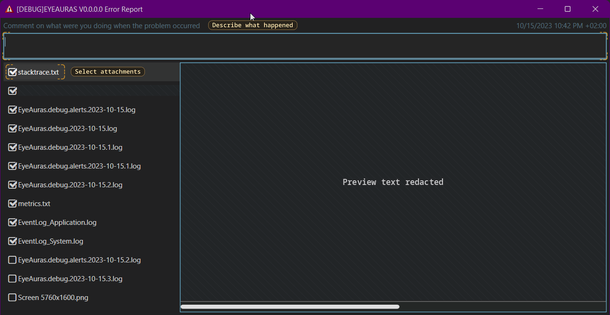

# Save diagnostic data and choose how to share it

A trigger did not fire, or an action did something you did not expect? Collect the description and logs from that run with **Report a problem**. You can save the archive locally and look through it before sending anything.

## If EyeAuras is still running

1. Click **Report a problem** in the EyeAuras title bar. In a mini-app, its author may add a button of their own. **Error Report** opens.
2. Write what you did, what you got and what you expected. Add the name of the pack or feature and the version. For example: “I selected my window, but Preview stayed empty; I expected its image.” Write what you saw, not what you think the cause is.
3. Select the logs from the affected run and look through the attachments. If the failure happened before a restart, find the earlier log too. Add the configuration if the problem cannot be reproduced without it.

   
4. Click **Save...**, choose your own folder and wait for the `.7z` file to appear. Open the archive and check the comment and the selected files. A saved file has not been sent anywhere yet.
5. To send the report to support, click **Send** and wait for the confirmation with an ID. If a pack author asked for the file directly, pass on the saved archive through an agreed [contact](/en/contacts).

| Control or status | Result |
| --- | --- |
| Save... | Packs the selected data into an archive on your disk and opens its folder. |
| Send | Passes the archive to the configured handler. In the normal client that is the EyeAuras server. A mini-app can set its own. Without a handler, sending is unavailable. |
| Compressing report... / Sending report... | Work is still in progress. Delivery is not confirmed yet. |
| Report sent / Report sent successfully | The handler returned an ID. Keep it for support. |
| Copy | Copies the sent report ID or the current status text. |
| Closing the dialog | Opening or closing the dialog does not send a report. |

You can edit or clear a prefilled comment. The data is collected for that one report dialog. If something has changed since then and you need a fresh snapshot, open a new dialog.

## Review what is included

| Data | Inclusion |
| --- | --- |
| systemInfo.txt | System, process, path and command-line information. Collected automatically. |
| applicationInfo.txt | Current clients add app, sender, license and startup details, tree statistics and subscriptions on their own. Older archives may not have this file. |
| stacktrace.txt | Available exception details. A report opened manually may have no exception. |
| Logs and application-window screenshots | Recent logs and available app-window captures are normally already selected. Check the list. |
| Desktop screenshots and aura configuration | Not selected by default. Add them when needed. |

Logs, images, paths and settings can contain private information. If you deselect aura configuration, the required account and subscription details stay in. The full contents, the format and the route for authors are described in [Problem reports and receiving archives](/en/features/problem-reports). Sending to EyeAuras does not forward the archive separately to every subscribed pack author.

## If the application has closed

| Situation | What to preserve |
| --- | --- |
| Error Report appeared | A description of your last steps and that failure's attachments. Whether the application closes afterwards depends on the error. |
| The process disappeared without a dialog | The failure time, the version and the logs from that run. Once the application starts again, open Report a problem and select them. |
| It keeps failing before the interface opens | A copy of the data directory and the logs. What to do with them is in the section below. |

When the interface never opens

1. Close any remaining EyeAuras instance and find its data directory. For the ordinary release profile it is `%appdata%\EyeAuras\release`. A different profile or a portable installation has its own path.
2. Copy the **whole directory** to a safe location. It can include `config.cfg`, `backups`, separate aura storage and history. `config.cfg` alone is not enough.
3. Note the time of the last failure and keep the `logs` folder. Write to [Contacts](/en/contacts) and agree which files are needed. An archive of the whole profile can contain confidential settings, so do not post it straight into a public chat.
4. If the application offers to load a backup or reset the configuration, save your copy first. Restoring changes the working state. See [Configuration history](/en/features/config-rollback).

The earlier advice was to delete `config.cfg` and start with empty settings. With separate aura storage that is not a complete reset. To test on clean data, use a separate profile agreed with support. Do not delete the original directory.

