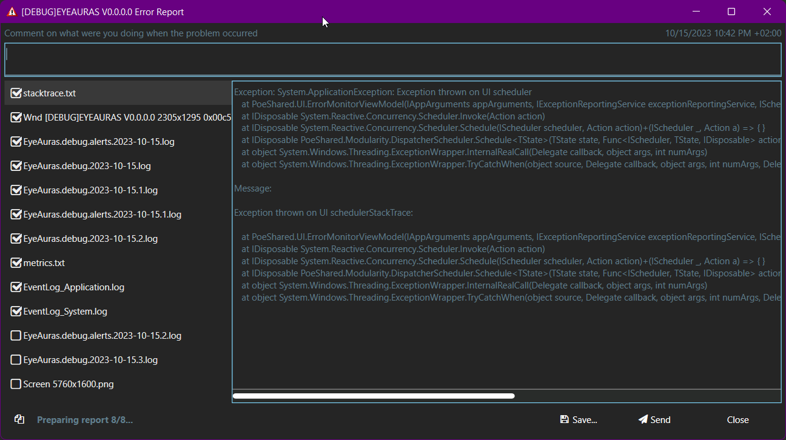

# Save diagnostic data and choose how to share it

When a trigger or action behaves differently from expected, preserve the description and logs from that run through **Report a problem**. You can save and inspect an archive locally before sending anything.

## If EyeAuras is still running

1. Click **Report a problem** in the EyeAuras title bar to open **Error Report**. A mini-app may provide its own reporting button.
2. Describe your steps, actual result and expected result. Include the feature or pack and version. For example: “I selected my window, but Preview stayed empty; I expected its image.” Report observations rather than a guessed cause.
3. Review the attachments and select logs from the affected run. Include earlier logs if the failure happened before a restart, and configuration when it is needed to reproduce the problem.
4. Click **Save...**, choose your own directory and wait for the `.7z` archive. Open it for reading and check the comment and selected files. Saving alone does not send it.
5. To submit to normal EyeAuras support, use **Send** and wait for the confirmation ID. If a pack author requested a file directly, share the saved archive through an agreed [contact](/en/contacts).

| Control or status | Result |
| --- | --- |
| Save... | Packs selected data into a local archive and opens its location |
| Send | Passes the archive to the configured handler: the EyeAuras server in the normal client. A mini-app can supply a different handler; without one, sending is unavailable |
| Compressing report... / Sending report... | Work is still in progress; delivery is not confirmed |
| Report sent / Report sent successfully | The handler returned an ID. Keep it for support; it does not mean someone has read the report |
| Copy | Copies the sent report ID or current status text, not the archive |
| Closing the dialog | Does not itself submit a report |

You can edit or clear a prefilled comment; an empty comment is omitted. Data is prepared for that report dialog. Open a new dialog if you need a fresh snapshot after changing the application state.

## Review what is included

| Data | Inclusion |
| --- | --- |
| systemInfo.txt | Automatically collected system, process, path and command-line information |
| applicationInfo.txt | Current clients automatically include app/sender/license/startup context, tree statistics and subscriptions. Older archives may not contain it |
| stacktrace.txt | Available exception details; a manually opened report need not contain an exception |
| Logs and application-window screenshots | Recent logs and available app-window captures are normally selected; review the list |
| Desktop screenshots and aura configuration | Not selected by default; add when needed |

Logs, images, paths and settings can contain private information. Deselecting aura configuration does not remove required account or subscription context. There is no automatic guarantee that secrets are redacted. [Problem reports and receiving archives](/en/features/problem-reports) explains the payload, format, example and author-side route. Submitting to EyeAuras does not separately forward the archive to every subscribed pack author.

## If the application has closed

| Situation | What to preserve |
| --- | --- |
| Error Report appeared | The last steps and that failure's attachments. Whether the process exits afterwards depends on the error; not every report means shutdown |
| The process disappeared without a dialog | Failure time, version and logs from that run. Select those earlier logs after a successful restart |
| It fails before the interface opens | A copy of the data directory and logs for the agreed diagnosis below |

A disappearing process does not establish the cause. Native failure or external termination needs Windows diagnostics and context. Historical anti-cheat compatibility lists are not present guarantees, and antivirus exclusions are not a universal repair.

When the interface never opens

1. Close any remaining EyeAuras instance and identify its data directory. The ordinary release profile uses `%appdata%\EyeAuras\release`; a different profile or portable installation uses its own path.
2. Copy the **whole directory** to a safe location. It can include `config.cfg`, `backups`, separate aura storage and history. A copy of `config.cfg` alone is not a complete backup of those stores.
3. Preserve the failure time and `logs` folder, then use [Contacts](/en/contacts) to agree which files are needed. A whole-profile archive can contain confidential settings; do not immediately post it in a public chat.
4. If the application offers a backup or reset, keep your copy first. Restoring changes the working state; see [Configuration history](/en/features/config-rollback).

Deleting `config.cfg` is not a complete reset when auras use separate storage. For a clean-data comparison, agree a separate profile with support and preserve the original directory. Restore only the agreed backup after diagnosis rather than replacing unrelated current data.

