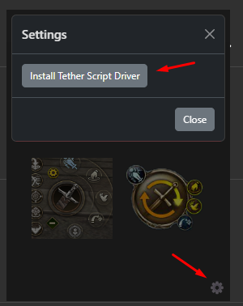

# Подготовить возврат на флаги в Lineage 2 Essence

Набор **Essence auto flags** возвращает персонажа на флаги, нажимая клавиши клиента. По описанию автора он выбирает среди **F8–F12**, поэтому флаги нужно заранее назначить на эти клавиши в самой игре. Сама EyeAuras не знает, где стоят ваши флаги.

[Публикация набора](https://eu.eyeauras.net/share/S20240325120506y5CPVmuwLvC3) — редакция **3** от **28 марта 2024 года**, собрана в **EyeAuras 1.4.6657.0**. Вам нужны совместимое с набором окружение, своё окно Lineage 2 Essence и проверенные назначения клавиш. На любом сервере и с нынешним клиентом набор может и не заработать.

## Сопоставить набор со своими клавишами

1. Скачайте EyeAuras с [официальной страницы](https://eu.eyeauras.net/download). Если нужно, войдите в [свой аккаунт](https://eu.eyeauras.net/login). Доступ к функциям и лицензию проверяйте для той поставки, которую выбрали.
2. Откройте публикацию **Essence auto flags** автора **linqse**. В EyeAuras выберите **Import → Source**, вставьте ссылку и нажмите **Download**. До добавления набора проверьте **Preview** и параметры импорта. [Описание режимов импорта](/ru/features/export-import) поможет не заменить уже существующую копию.
3. Назначьте флаги на **F8–F12** в своём клиенте. Если флаг один, автор разрешает назначить его на каждую из этих кнопок. Это настройка клиента: объекта «флаг» в EyeAuras нет.
4. В настройках набора проверьте, в какое окно идёт ввод. Перед включением убедитесь, что **Insert** не занят другим вашим меню, а **Shift+Alt+Z** — другой автоматизацией.
5. В совместимом окружении **Insert** открывает меню набора, а **Shift+Alt+Z** включает и выключает его работу. Первым вы должны увидеть меню с настройками этой редакции. Возврат должен идти по клавишам, которые назначили вы, а не по примеру из чужой конфигурации.

| Настройка или условие | Что проверить |
|---|---|
| `Insert` | Открывает меню этого набора, а не общее меню всех аур EyeAuras. |
| `Shift+Alt+Z` | По описанию автора включает и выключает работу. Сначала проверьте окно и действия. |
| `F8–F12` | Клавиши с флагами. Набор может выбирать разные клавиши из этого диапазона. |
| Один флаг | Назначьте его на каждую используемую клавишу, если клиент это разрешает. |
| Ввод | Дойдёт ли нажатие, зависит от клиента, фокуса, выбранного механизма и окружения. |

Для обычных способов ввода действуют [общие ограничения](/ru/actions/sendinput/options). Старый способ с [HVDK Standard 2.1](https://s3.eyeauras.net/media/2024/10/HVDK%20Standard%202.1.exe) нужно проверять на совместимость. Кнопка установки TetherScript не настраивает игру в один клик. Как подготовить драйвер, написано в статье [TetherScript Driver](/ru/actions/sendinput/tetherscript).

На снимке из прежнего руководства — панель **Settings** с кнопкой **Install Tether Script Driver**. Стрелки указывают на эту кнопку и на значок настроек.

Если в старом клиенте камера вращается сама, советовали отключить `Enable Controller` в `Settings → Configuration`. Путь `C:\Program Files (x86)\ControlMyJoystick 5.5.78.50\Driver\Joystick` относится к одной старой установке. Не удаляйте по нему устройства на другом компьютере.

Видео прежнего процесса установки и импорта

Первое видео показывает установку того времени. Версии драйверов и вид интерфейса сверяйте с текущей поставкой.

[EyeSquad — Установка EyeAuras шаг-за-шагом](https://www.youtube.com/watch?v=bNJ4rGeqNoE)

Второе видео — про импорт скриптов возврата на флаги. По нему удобно сравнить набор с прежним интерфейсом.

[EyeSquad — Установка набора аур из библиотеки EyeAuras Essence](https://www.youtube.com/watch?v=S1lQF56-AIA)

