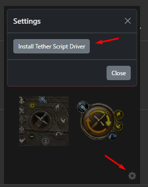

# Подготовить возврат на флаги в Lineage 2 Essence

Набор **Essence auto flags** предназначен для простого возврата на флаги через клавиши клиента. По описанию автора он выбирает среди **F8–F12**; нужные флаги должны быть заранее назначены этим клавишам в самой игре. EyeAuras не узнаёт расположение флагов из внутренних данных клиента автоматически.

[Публикация набора](https://eu.eyeauras.net/share/S20240325120506y5CPVmuwLvC3) содержит редакцию **3** от **28 марта 2024 года**, подготовленную в **EyeAuras 1.4.6657.0**. Для повторения нужны совместимое с набором окружение, своё окно Lineage 2 Essence и проверенные назначения клавиш. Редакция и название игры не гарантируют поддержку любого сервера или нынешнего клиента.

## Сопоставить набор со своими клавишами

1. Получите EyeAuras с [официальной страницы](https://eu.eyeauras.net/download). При необходимости войдите в [свой аккаунт](https://eu.eyeauras.net/login). Доступ к функциям и лицензии проверяйте для выбранной поставки.
2. Откройте публикацию **Essence auto flags** автора **linqse**. В EyeAuras выберите **Import → Source**, вставьте ссылку и нажмите **Download**. Проверьте **Preview** и параметры импорта до добавления набора; [описание режимов](/ru/features/export-import) поможет не заменить существующую копию.
3. Подготовьте назначения **F8–F12** в своём клиенте. Если нужен один флаг, автор допускает назначить его на каждую из этих кнопок. Это подготовка клиента, а не выбор встроенного объекта «флаг» в EyeAuras.
4. Проверьте адресат ввода и окно в доступных настройках набора. Перед включением убедитесь, что **Insert** не конфликтует с вашим другим меню, а **Shift+Alt+Z** — с другой автоматизацией.
5. В совместимом окружении **Insert** открывает меню набора, а **Shift+Alt+Z** переключает его работу. Первым наблюдаемым результатом должно стать меню с настройками этой редакции; возврат должен соответствовать назначенным вами клавишам, а не случайному примеру из другой конфигурации.

Снимок относится к прежнему руководству по этому набору; сочетания и назначения сначала сверяйте с описанием своей редакции.

| Настройка или условие | Что проверить |
|---|---|
| `Insert` | Открывает меню опубликованного набора. Это не общее меню всех аур EyeAuras. |
| `Shift+Alt+Z` | Переключает работу по описанию автора; сначала проверьте окно и действия. |
| `F8–F12` | Клавиши подготовленных флагов; набор может выбирать разные клавиши из этого диапазона. |
| Один флаг | Назначьте его каждой используемой клавише, если это допускает ваш клиент. |
| Ввод | Приём зависит от клиента, фокуса, выбранного механизма и окружения. |

Для обычных способов ввода действуют [общие ограничения](/ru/actions/sendinput/options). Исторический путь с [HVDK Standard 2.1](https://s3.eyeauras.net/media/2024/10/HVDK%20Standard%202.1.exe) требует проверки совместимости; кнопка установки TetherScript не является универсальным способом настройки игры в один клик. Подготовка описана отдельно в [TetherScript Driver](/ru/actions/sendinput/tetherscript).

В старых клиентах с самопроизвольным вращением камеры рекомендовалось отключить `Enable Controller` в `Settings → Configuration`. Путь `C:\Program Files (x86)\ControlMyJoystick 5.5.78.50\Driver\Joystick` относится к конкретной старой установке: не используйте его как команду удаления устройств на любом компьютере.

Видео прежнего процесса установки и импорта

Первое видео показывает установку в окружении своего времени. Версии драйверов и внешний вид интерфейса сверяйте с текущей поставкой.

[EyeSquad — Установка EyeAuras шаг-за-шагом](https://www.youtube.com/watch?v=bNJ4rGeqNoE)

Второе видео посвящено импорту скриптов возврата на флаги и помогает сопоставить опубликованный набор с прежним интерфейсом.

[EyeSquad — Установка набора аур из библиотеки EyeAuras Essence](https://www.youtube.com/watch?v=S1lQF56-AIA)

