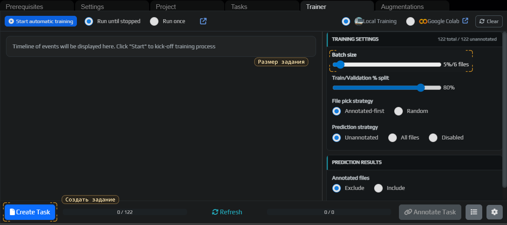
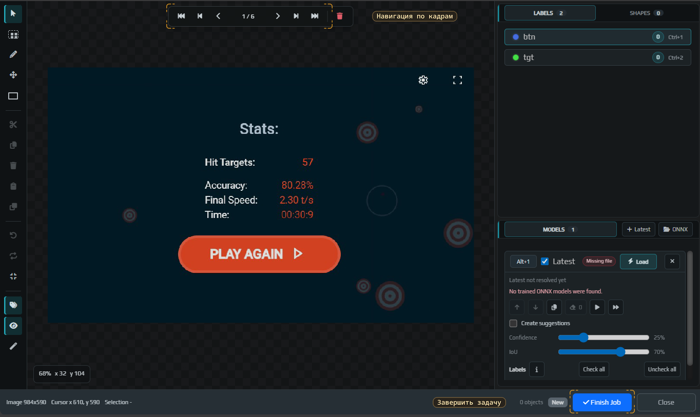
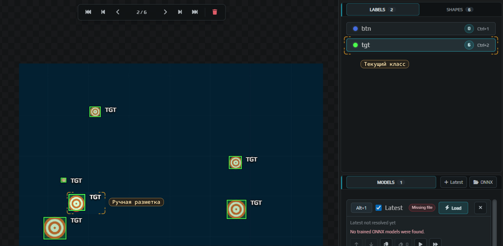
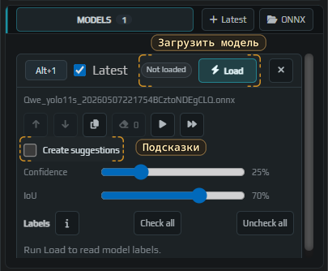
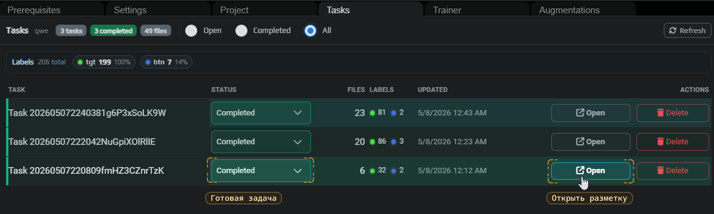
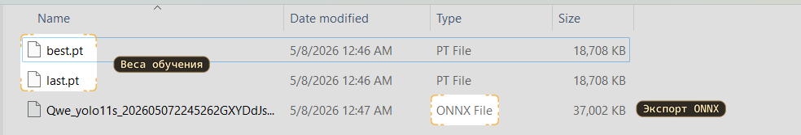

# От ручной разметки к следующему поколению модели

Здесь один полный круг: размечаете вручную пять кадров, обучаете первую модель, она предлагает рамки на следующей партии, вы их исправляете и обучаете снова. YoloEase выбирает кадры и хранит данные, а правильность рамок проверяете вы.

Нужны [подготовленный проект](/ru/YoloEase/prepare-data) с реальными кадрами и классами `tgt`/`btn` и [установленные компоненты](/ru/YoloEase/prerequisites). Обучаем через **Local Training**: оно идёт на вашем компьютере и может скачать базовые веса.

## Завершить первую задачу

1. Откройте **Trainer**. Уменьшите **Batch size**, чтобы в партии было 5 кадров — число файлов показано рядом с процентом. Нажмите **Create Task**. Модели пока нет, поэтому шаг предсказаний пропускается и готовой разметки не будет.

На снимке другой проект из 122 файлов: при 5% Trainer предлагает 6 файлов.

2. В редакторе, который откроется отдельным окном, выберите `tgt`, нажмите `N` и двумя щелчками нарисуйте рамку. Пройдите все кадры, кнопку обведите классом `btn`. На каждом кадре должны быть размечены все нужные видимые объекты.

3. Нажмите **Finish Job**. Окно сохранит разметку и закроется, задача станет завершённой. Обычный Close тоже сохраняет правки, но новую задачу не завершает. [Подробнее о редакторе](/ru/YoloEase/features/annotation-editor).

## Получить первую модель

4. В **Settings → Training settings** оставьте исходные `yolo11s.pt`, 50 эпох и размер 640. В **Trainer** выберите **Local Training**, **Run once** и нажмите **Start automatic training**.
5. Следите за лентой. Этапы идут так: обновление проекта, предсказания (если модель уже есть), аугментации (если включены), сборка набора, обучение, экспорт ONNX. Видны этап, эпохи и вывод команды. Если цикл завершился с ошибкой, готовой модели ещё нет.

6. Когда обучение закончится успешно, посмотрите график и файл результата. Качество проверяйте на других кадрах, а не только на тех, что размечали. На маленькой выборке метрики могут сильно колебаться.

В итоге у вас есть экспортированный `.onnx`. Время, loss/mAP и вид графика на картинке — из старой демонстрации, у вас они будут другими.

## Использовать модель на следующей партии

7. Когда модель появилась, Trainer может показать предсказания по оставшимся изображениям. Посмотрите разные случаи: цель, кнопку, пустой фон. Предсказания помогают выбрать следующую партию, но это ещё не принятая разметка.

8. Нажмите **Create Task** для новой партии. В редакторе откройте **Models → Latest → Load** и проверьте, что классы модели совпадают с классами проекта. Включите **Create suggestions**, нажмите **Run current**, а потом, если нужно, **Run all**.

9. С включённым **Create suggestions** правильные рамки примите через **Accept**/**Accept all**, остальные исправьте. Непринятые предложения остаются временными. Если режим выключен, рамки добавляются сразу — проверять их всё равно нужно.

10. Лишний объект выделите и удалите клавишей `Q`, `Delete` или `Backspace`. Недостающие добавьте вручную, неверный класс поменяйте через Labels. Затем нажмите Finish Job — только после этого задача попадёт в следующую обучающую выборку.

11. Снова запустите **Run once → Start automatic training**. Сравните новую модель на отложенных кадрах. Новое поколение не обязательно лучше: принятые плохие рамки тоже попадают в обучение.

Завершённую задачу можно открыть снова: в списке задач Trainer выберите **All tasks**. Исправьте рамку и сохраните или завершите задачу до следующего запуска.

## Забрать подходящий результат

12. У завершённого шага обучения нажмите **open...**. Из папки результата возьмите экспортированный ONNX, а PyTorch-веса оставьте для дальнейшего обучения. Файл не обязательно называется `best.onnx`: в имени могут быть проект, базовая модель и идентификатор запуска.

| Следующий выбор | Что он меняет |
| --- | --- |
| Размер следующей задачи | Сначала 5 кадров. Берите больше, когда предложения модели уже экономят ручную работу. Смотрите на число файлов, а не только на процент. |
| `Run once` / `Run until stopped` | Один цикл или повтор, пока не нажмёте **Stop automatic training**. Без новых данных непрерывный режим может ждать изменений и не обучать заново. |
| Аугментации | Дополнительные преобразования обучающих изображений. Включаются отдельно. [Как настроить аугментации](/ru/YoloEase/features/augmentations). |
| `.pt` / `.onnx` | `.pt` — для дообучения, `.onnx` — для распознавания в совместимой программе. [Чем отличаются форматы](/ru/YoloEase/features/yolo-onnx). |

Параметры, стратегии выбора и файлы описаны в [Trainer](/ru/YoloEase/features/trainer). Готовую модель сначала проверьте [в EyeAuras без ввода](/ru/YoloEase/use-in-eyeauras). Если появилась ошибка, смотрите, на каком этапе она возникла — поможет [диагностика](/ru/YoloEase/features/diagnostics).
