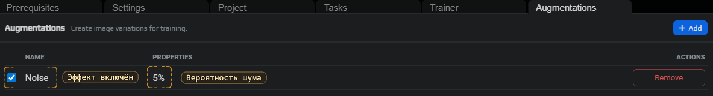

# Аугментации

Аугментации — это изменённые копии уже размеченных кадров: слегка размытые, с шумом, повёрнутые. Они настраиваются на вкладке `Augmentations`. Подробная инструкция — [Аугментации в разделе возможностей](/ru/YoloEase/features/augmentations). Эта страница помогает решить, нужны ли они вам.

## Решить, нужен ли эффект

Начинайте, когда в проекте уже есть завершённая задача с разметкой и результат первого обучения.

1. Посмотрите, где модель ошибается на новых реальных кадрах. Если не хватает самих объектов или состояний окна, сначала добавьте такие кадры через [редактор разметки](/ru/YoloEase/features/annotation-editor).
2. Если дело именно в изменении пикселей, откройте `Augmentations` и добавьте один небольшой эффект по [подробной инструкции](/ru/YoloEase/features/augmentations). Например, `Box Blur → Radius: 1px`, если источник и правда бывает размытым.
3. Перед следующим запуском [Trainer](/ru/YoloEase/features/trainer) проверьте, какие строки включены. Снятая галочка убирает эффект из следующей сборки, но настройку не удаляет.

   

Добавленная строка сама изображения не меняет. Новые файлы создаются при сборке набора перед обучением, исходная разметка сохраняется.

| Ситуация | Что выбрать |
| --- | --- |
| Модель ещё не обучалась | Оставьте список пустым — так будет с чем сравнивать |
| Нужны варианты уже размеченных кадров | Настройте эффекты и прочитайте об ограничениях генератора на подробной странице |
| Нужно всегда менять картинку перед распознаванием | Это [эффекты EyeAuras](/ru/triggers/images/effects). Настройте их одинаково для записи данных и для поиска |

После обучения понадобится экспортированная модель. Чем отличаются `.pt` и `.onnx`, описано в [руководстве по YOLO ONNX](/ru/YoloEase/features/yolo-onnx).
