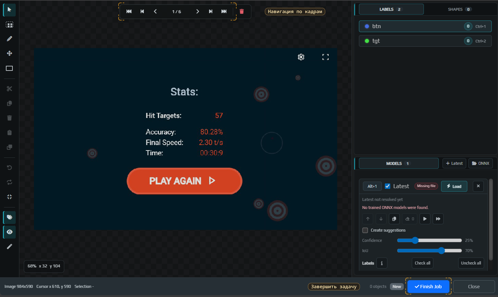
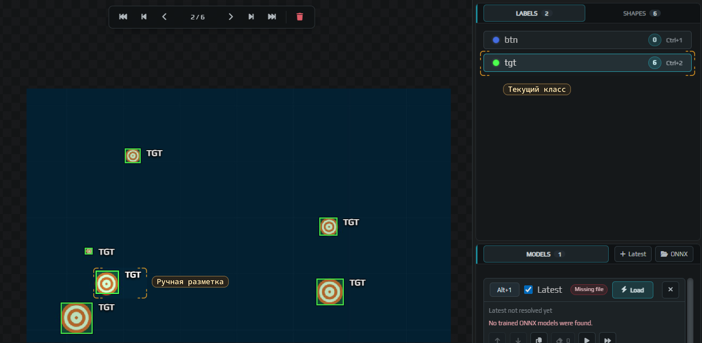
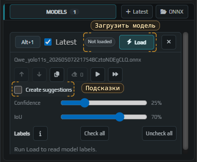

# Разметить задачу и сохранить её для обучения

В редакторе вы обводите объекты прямоугольниками, назначаете им классы и завершаете задачу кнопкой **Finish Job**. В обучение попадают только сохранённые рамки из завершённых задач. Предложения модели сами разметкой не становятся.

Нужны проект YoloEase 2 с классами (например, `tgt` и `btn`), реальные кадры и задача, созданная через **Trainer → Create Task**. Редактор открывается отдельным окном. Для ручной разметки модель не нужна.

## Обвести объекты вручную

1. Откройте задачу через Create Task или из списка задач Trainer. Справа в **Labels** выберите `tgt`. Нажмите `N`: первый щелчок ставит угол, дальше рамка тянется за мышью, второй щелчок сохраняет её. Минимальный размер рамки — 4 пикселя изображения.
2. Обведите все видимые цели на кадре. Рамка должна охватывать объект, а не большой кусок фона. Затем выберите `btn` и обведите кнопку, если она есть на кадре.

3. Чтобы поправить рамку, выберите её и перетащите или потяните за маркеры размера. Класс меняется через Labels или `Ctrl+1..9` — перерисовывать не нужно. Неверную рамку удалите клавишей `Delete`, ошибочную правку отмените через `Ctrl+Z`.
4. По кадрам переходите клавишами `D`/`F`. Размечайте все одинаковые объекты на кадре, не пропускайте. Если цели нет, оставьте кадр без рамок — не рисуйте условный объект.
5. Следите за нижней строкой: **Unsaved changes → Saving... → Saved**. Правки сохраняются сами примерно раз в 5 секунд, если вы в этот момент не рисуете, не переносите рамку и не запускаете модель. **Close** сохраняет правки сразу, но обычную незавершённую задачу не завершает.
6. Когда проверили все кадры, нажмите **Finish Job**. Редактор сохранит разметку, пометит задачу завершённой и закроется. Теперь Trainer возьмёт её в следующую сборку обучающих данных. Чтобы убедиться, что всё сохранилось, откройте задачу снова из списка и посмотрите на рамки.

| Зона | Для чего |
| --- | --- |
| Панель слева | Рисование, выделение, удаление, копирование, отмена, масштаб, видимость рамок и работа с предложениями. |
| `Labels` / `Shapes` | Классы и рамки текущего кадра. Команды действуют на выбранные рамки, а при наведении — ещё и на рамку под указателем. |
| `Models` | Загрузка и запуск ONNX-модели, которая помогает размечать. |
| Нижняя строка | Размер изображения, координаты, число объектов, состояние сохранения и задачи. |

Разметка хранится в XML формата, похожего на CVAT, внутри `assets/training`: `annotations.project.{projectId}.task.{taskId}.xml`. Это внутренний файл проекта, подключать сервер CVAT не нужно. Поворот прямоугольника в XML сохраняется, но обычный detect-конвертер берёт границы без поворота. Для первой модели рамки не поворачивайте.

## Добавить помощь своей модели

После [первого обучения](/ru/YoloEase/annotate-and-train) откройте следующую задачу.

7. В Models добавьте **Latest** или свой ONNX кнопкой добавления файла. Latest — это самая новая обученная ONNX-модель проекта. Если такой модели нет, в строке будет видно, что файл отсутствует.

8. Нажмите **Load**. Модель не загружается и не запускается сама при открытии окна. Проверьте таблицу **Labels** этой модели: каждый включённый класс должен соответствовать классу проекта. Отключённые классы пропускаются.
9. Включите **Create suggestions**, задайте Confidence/IoU и нажмите **Run current**. Для всей партии нажмите **Run all** и дождитесь результата или сообщения об ошибке.

10. Правильные предложения примите через **Accept** или **Accept all**, лишние удалите. Непринятое предложение временное: оно не сохраняется в разметку и не участвует в обучении. Если Create suggestions выключено, результаты сразу добавляются как рамки — проверить их всё равно нужно.

11. Исправьте размеры и классы и нажмите Finish Job. Рамка модели, которую вы поправили вручную, становится ручной. Повторный запуск той же записи модели заменяет только её собственные рамки на успешно обработанном кадре. Правки других источников не должны становиться её результатом автоматически.

| Настройка модели | Что означает |
| --- | --- |
| `Confidence` | Порог оценки 0…100%, исходно 25%. Чем выше, тем больше слабых предсказаний отбрасывается, но пропусков может стать больше. |
| `IoU` | Порог перекрытия рамок, исходно 70%. Это не уверенность в классе. |
| `Create suggestions` | Включено — модель создаёт временные предложения, которые нужно принять. Выключено — найденные рамки добавляются сразу. |
| Сопоставление `Labels` | Связь классов модели с классами проекта. Не рассчитывайте, что числовые индексы совпадут сами. |

Обучение идёт через PyTorch, а авторазметка в редакторе — через YoloDotNet на CPU. Это разные пути. Пока работает авторазметка, сохранение и смена кадра приостановлены. **Cancel** отменяет текущий запуск, а уже добавленные результаты можно откатить через отмену. Свои ONNX-файлы копируются в `models/auto-annotation/хэш`. Если модель работает в редакторе, это ещё не значит, что она совместима с EyeAuras.

Горячие клавиши и групповые операции

| Клавиши | Действие |
| --- | --- |
| `N` | Начать прямоугольник. |
| `M` / `L` | Прямоугольное / свободное выделение. |
| `Escape` | Отменить текущую операцию и снять выделение. |
| `Q`, `Delete`, `Backspace` | Удалить активные рамки или предложения. |
| `Ctrl+A` / `Ctrl+click` | Выбрать все рамки кадра / добавить или убрать одну рамку из группы. |
| `Ctrl+C`, `Ctrl+X`, `Ctrl+V` | Скопировать, вырезать, вставить рамки. После вставки рамки следуют за мышью: левый щелчок подтверждает, Escape отменяет. Буфер работает только внутри окна задачи. |
| `Ctrl+B` | Скопировать рамки предыдущего кадра в текущий как ручные. Потом поправьте смещение и удалите исчезнувшие объекты. |
| `Ctrl+1..9` / `Ctrl+N` | Выбрать класс или сменить его у активных объектов / следующий класс. |
| `Ctrl+Z` | Отменить правку. |
| `Ctrl+Y`, `Shift+Ctrl+Z` | Вернуть отменённую правку. |
| `D`, `F` / `C`, `V` | Соседний кадр / переход на настроенный шаг. |
| `R` | Сбросить масштаб и сдвиг. Колесо масштабирует около курсора, перетаскивание пустого холста сдвигает его. |
| `Shift` при изменении размера/повороте | Сохранить пропорции / поворачивать с шагом 15°. Группа меняется относительно общих границ. |
| `Alt+N` / `Shift+Alt+N` | Запустить первую доступную модель: на текущем кадре / на всей задаче. |
| `Alt+1..9` / `Shift+Alt+1..9` | Запустить выбранную запись модели: на текущем кадре / на всей задаче. |

Удаление рамки можно отменить. Удаление самого изображения из задачи — другая операция с подтверждением, и редакторский Undo её не возвращает. Не путайте её с Delete для рамки.

Чтобы разметка помогала, а не противоречила себе

Один класс размечайте всегда одинаково. Выберите одно правило — только видимая часть объекта, полная рамка или отдельный случай для перекрытий — и держитесь его. Если одинаковое пятно то цель, то фон, и отличить их не по чему, модели нечему научиться.

Для похожего объекта с другим назначением заведите отдельный класс, например `btn`, или всегда оставляйте его фоном. Пустые кадры с меню, паузой и похожими цветами полезны: это реальные примеры, где цели нет. Для маленьких объектов проверьте, сколько пикселей от них остаётся после уменьшения кадра до размера модели. Если мало, можно записать более точную область, изменить размер обучения или [эффекты входа](/ru/YoloEase/features/eyeauras-integration).

Не обучайте модель на предложениях, которые приняли не глядя. Проверенные рамки и Finish Job важнее числа автоматически созданных объектов. Настройки следующего запуска — в [Trainer](/ru/YoloEase/features/trainer), файлы модели — в [YOLO ONNX](/ru/YoloEase/features/yolo-onnx).

