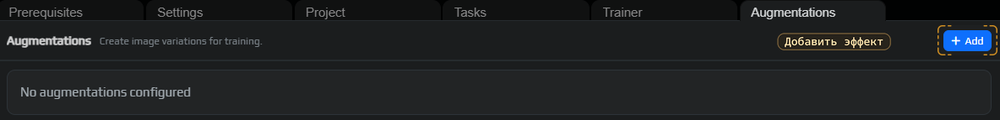
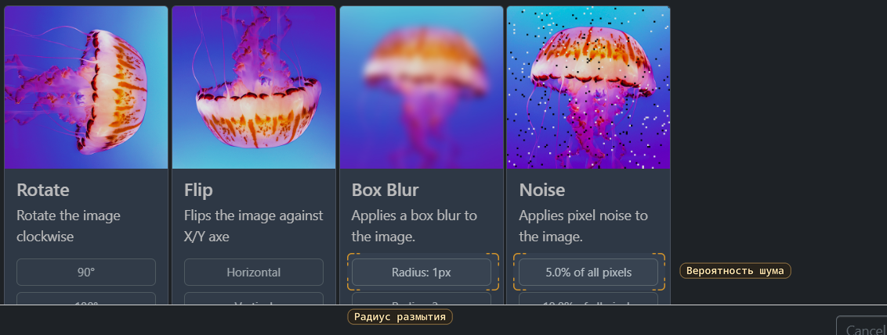
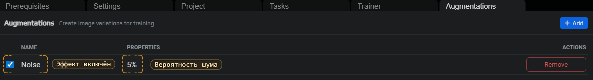

# Аугментации

Аугментации добавляют в обучение варианты уже размеченных кадров. Они настраиваются на вкладке `Augmentations`. При сборке набора YoloEase меняет копии изображений, а для поворота и отражения пересчитывает прямоугольные рамки. Пользы от этого столько, сколько таких изменений бывает у вашего источника: повёрнутая надпись не заменит обычную кнопку.

Сначала обучите модель без эффектов. Дальше понадобятся свой проект, завершённые задачи с прямоугольной разметкой и готовое окружение из [Prerequisites](/ru/YoloEase/prerequisites).

**Ограничение генератора:** в YoloEase 2.0.90 изменённый PNG сохраняется с нарисованными рамками — красными исходными и голубыми пересчитанными. Они записаны прямо в пиксели, это не слой предпросмотра. Модель может принять такие контуры за подсказку. Для обычных чистых кадров держите аугментации выключенными, пока не убедитесь, что полученные изображения годятся.

## Добавить один вариант

1. Откройте `Augmentations`. В пустом списке написано `No augmentations configured`.

2. Нажмите `Add`. В окне `Add new Augmentation` выберите `Box Blur → Radius: 1px`. В списке появится строка эффекта. Вторую строку с точно такой же настройкой добавить нельзя.

3. Проверьте галочку слева от строки и значение в `Properties`. Чтобы заменить параметр, удалите строку через `Remove` (спросит подтверждение) и добавьте нужный вариант заново. Галочкой эффект можно временно выключить.

4. Если хотите посмотреть на сгенерированные данные, в `Trainer` выберите `Local Training`, затем `Run once` и нажмите `Start automatic training`. Во время сборки появится сообщение `Applying … augmentation…`, а за ним количество изображений `Dataset: …`. Сам эффект обучение не запускает, но `Start automatic training` с этими настройками проходит весь цикл до конца.
5. В хранилище проекта загляните в `augmentations/<идентификатор>/` и `assets/training_with_effects/`. Откройте изменённый PNG и его XML с суффиксом `_augmented`, сравните положение объекта с записанной рамкой. Если видимые контуры или само изменение не похожи на реальный вход, снимите галочку перед следующим обычным обучением.

## Доступные изменения

| Эффект | Параметры и смысл |
| --- | --- |
| Rotate | `90°`, `180°`, `270°` по часовой стрелке. При 90° и 270° ширина и высота изображения и рамки меняются местами |
| Flip | `Horizontal` отражает слева направо, `Vertical` — сверху вниз. Метка класса сохраняется |
| Box Blur | `Radius: 1px`, `3px`, `5px`, `10px`. Рамки не меняются. Сильное размытие может скрыть маленький объект |
| Noise | `5`, `10`, `20`, `50%` — вероятность изменить каждый пиксель, а не доля кадров. К RGB добавляется небольшой случайный шум. Рамка и прозрачность сохраняются |
| Галочка строки | Включает вариант при следующей сборке. Общей настройки «применять эффект к кадру с такой-то вероятностью» нет |
| Remove | Удаляет настройку после подтверждения. Чтобы выключить на время, хватит галочки |

## Сколько вариантов получится

Каждый включённый эффект применяется к исходному изображению отдельно. Если размеченных кадров `N`, а эффектов `K`, получится `N × K` дополнительных вариантов плюс оригиналы. `Noise` и `Box Blur` дают две разные копии — цепочки `Noise + Blur` нет.

Оригинальные файлы и XML не переписываются. Изменённые PNG кешируются в `assets/training_with_effects/`, промежуточные ссылки и XML лежат в `augmentations/`. Для символических ссылок нужны соответствующие права Windows. Шум с теми же настройками может взяться из кеша, поэтому в новом цикле рисунок шума не обязательно новый.

Рамки, классы и разбиение набора

| Часть подготовки | Что происходит |
| --- | --- |
| Поворот и отражение | Координаты прямоугольника пересчитываются под изменённый кадр. Название класса не меняется |
| Размытие и шум | Координаты остаются прежними |
| Преобразование в YOLO | Координаты обрезаются по границам кадра и нормируются. Рамки, у которых после обрезки нулевая площадь, пропускаются |
| Имена классов | Попадают в `data.yaml`. Числовые индексы назначаются при преобразовании. Не подставляйте вместо них внутренние ID меток проекта |
| Train/Validation % split | Применяется после добавления вариантов. Аугментации попадают не только в `train`: похожие кадры могут оказаться и в `valid` |

Если в проверочном наборе лежат почти копии обучающих кадров, его оценке нельзя доверять как независимой. Проверяйте отдельно на новом реальном захвате. Аугментации рассчитаны на прямоугольную разметку: произвольные повёрнутые фигуры они не превращают в поддерживаемые ориентированные рамки.

Если нужны новые состояния объекта, сначала [добавьте реальные данные](/ru/YoloEase/features/data-sources). Перед применением модели сверьте [вход EyeAuras](/ru/YoloEase/features/eyeauras-integration) — область и эффекты. Отличить ошибку сборки от ошибки распознавания поможет [диагностика](/ru/YoloEase/features/diagnostics).
