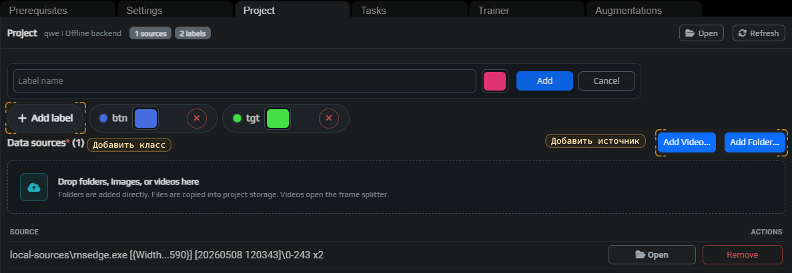
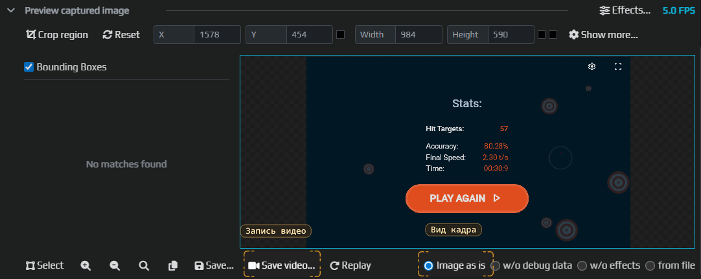

# Добавить свои кадры и знать, где они хранятся

Источник — это место, откуда YoloEase берёт изображения, например папка с PNG. Рабочие копии и разметка лежат отдельно, в папке проекта. Ниже — как подключить папку, обновить проект и проверить, какие файлы доступны для задач.

Нужны сохранённый `.yeproj` в YoloEase 2 и изображения, которые читаются. Для предсказаний и обучения понадобится ещё [готовое окружение](/ru/YoloEase/prerequisites).

## Подключить папку

1. В проекте откройте **Project → Add Folder...** и выберите папку с PNG/JPG/BMP. Её путь появится в списке **Data sources**.
2. Нажмите **Open** у источника — должна открыться выбранная папка. Затем нажмите **Trainer → Refresh**: он пересчитает файлы и обновит рабочие копии.
3. Проверьте в Trainer число доступных файлов. Сами изображения можно увидеть в [редакторе задачи](/ru/YoloEase/features/annotation-editor), если нажать **Create Task**.

| Способ добавления | Что происходит |
| --- | --- |
| `Add Folder...` или перетаскивание папки | Сохраняется путь к внешней папке. При синхронизации изображения из неё и вложенных папок копируются в `assets/training`. |
| Перетаскивание отдельных изображений | Файлы копируются в `local-sources/дата-время`, и этот каталог добавляется как источник. |
| `Add Video...` или перетаскивание видео | Открывается **Extract frames**. PNG-кадры пишутся в `local-sources/имя-видео/диапазон xшаг`, затем каталог добавляется как источник. Сам видеофайл обучающими изображениями не становится. |
| `Remove` | После подтверждения убирает источник из списка. Внешняя папка не удаляется, но следующая синхронизация проекта пройдёт уже без неё. |
| `Missing` | Путь сейчас недоступен, при чтении он пропускается. Если кадры ещё нужны, верните его до Refresh. |

Синхронизация берёт только `.png`, `.jpg` и `.bmp`. Другие файлы из папки в обучение не попадут. Для видео в диалоге доступны MP4/M4V/MOV/AVI/MKV/WMV/WEBM/MPG/MPEG, но откроется ли файл, зависит от кодеков, установленных в Windows. [Как извлечь кадры из видео](/ru/YoloEase/features/video-splitter).

## Получить тот же вход, который увидит распознавание

В EyeAuras можно записать своё окно прямо из предпросмотра CV кнопкой **Save Video**, а потом открыть файл через Add Video. Так в запись попадёт нужная область, а не весь рабочий стол.

Если при записи были включены эффекты, включайте те же эффекты и при поиске готовой моделью. Фон, масштаб, рамки окна и оверлеи меняют пиксели. Чтобы сравнить варианты, держите для них отдельные записи или проекты.

Копии, удаление и перенос проекта

| Место | Назначение |
| --- | --- |
| `.yeproj` | Настройки и ссылки на источники. |
| Соседняя рабочая папка | Задачи, разметка, модели, собранные наборы данных и локальные источники. |
| `local-sources` | Импортированные отдельные файлы и извлечённые кадры. Переносите эту папку вместе с проектом. |
| `assets/training` | Рабочие изображения для задач. К именам может добавляться префикс источника. |

Синхронизация сверяет `assets/training` с текущими источниками и удаляет копии, которых больше нет в найденном списке. Поэтому если переименовать, отключить или убрать через Remove внешнюю папку, её копии в проекте не останутся как архив. И наоборот: если исходный файл изменился, а имя осталось прежним, уже существующая копия может не обновиться.

Чтобы проект можно было перенести, импортируйте отдельные изображения или кадры видео — они лежат в `local-sources` — и храните `.yeproj` вместе с рабочей папкой. Внешние папки сами не переезжают. Где на самом деле лежит проект, показывает **Settings → Workspace/Resolved storage**. Если источник пропал, сначала верните путь, потом обновляйте состояние. Разбор ошибок — в [диагностике](/ru/YoloEase/features/diagnostics).

