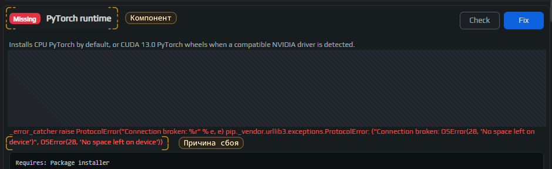

# Диагностика

Если YoloEase не создал модель или EyeAuras распознаёт не так, как вы ждали, найдите первый этап, на котором что-то пошло не так. Для этого хватит своего проекта и текста ошибки. Не спешите переустанавливать Python или заново размечать все кадры.

## Сохранить сведения об одном сбое

1. Откройте проблемный проект. Запишите версию YoloEase, выбранную базовую модель и действие, после которого появилась ошибка.
2. Если ошибка про окружение, откройте `Prerequisites → Check all` и раскройте проблемную строку. Если ошибка в `Trainer`, раскройте `output` у неудачного этапа: там видны команда, вывод процесса и код завершения.
3. Чтобы скопировать текст, нажмите значок с подсказкой `Copy output`. В ленте хранятся только последние 1000 строк этапа, это не архив всех запусков.
4. Полный журнал открывается значком файла справа внизу главного окна — он ведёт в каталог данных приложения. Свежий журнал лежит в `logs/`, журналы подготовки окружения (если они есть) — в `tools/logs/`. Скопируйте нужный файл к себе, чтобы следующий запуск его не заменил.
5. Сравните последний успешный результат с таблицами ниже. Пока ищете причину, не удаляйте исходные изображения, разметку и веса.

В итоге у вас есть текст с этапом, командой и ошибкой. `Copy output` только копирует текст и никуда его не отправляет. Кнопка `Report a problem` открывает отдельное окно подготовки отчёта. Передавать ли файлы, вы решаете отдельно. Не кладите в отчёт чужие изображения и данные доступа.

## Окружение и исходные файлы

| Симптом | Что проверить |
| --- | --- |
| No space left on device | Свободное место и в хранилище проекта, и в каталоге данных приложения, где лежат `tools/downloads`, Python и окружение |
| Красная обязательная строка Prerequisites | Сначала `Check all`, потом `Install missing` или действие в самой строке. Подробности — в [требованиях](/ru/YoloEase/prerequisites) |
| CUDA не используется | Результат проверки `PyTorch runtime`. NVIDIA для обучения и запуск ONNX в EyeAuras настраиваются отдельно. `device=cpu` в Additional arguments явно выбирает CPU для обучения |
| Видео не открывается | Ошибку чтения метаданных в Extract frames. Декодирование зависит от кодеков Windows, а не от FFmpeg |
| В Project нет ожидаемых изображений | Путь источника и Refresh. Исходная папка должна оставаться доступной: синхронизация может удалить рабочие копии файлов, которые исчезли из источника |
| Слишком много почти одинаковых кадров | Увеличьте Frame step или сократите Range of frames to extract при [извлечении кадров](/ru/YoloEase/features/video-splitter) |

На старом снимке ниже место кончилось при подготовке PyTorch. По тексту строки видно, что это именно диск, а не нехватка видеопамяти во время обучения.

## Разметка и набор для обучения

| Симптом | Что проверить |
| --- | --- |
| Обучать нечего | Есть ли завершённые задачи и их XML в `assets/training/`. Просто добавленные картинки — ещё не размеченный набор |
| Нет data.yaml | Этап сборки, права на символические ссылки и каталог `datasets/<идентификатор>/`. YAML создаётся из разметки до обучения |
| Ошибка train/valid | В каждой части нужен хотя бы один кадр. Процент разбиения не гарантирует, что редкий класс попадёт в обе |
| Предложения редактора не видны в обучении | Предложения временные, пока вы не нажали Accept или Accept all на текущем кадре. Проверьте сохранённые рамки и статус задачи |
| Объект размечен непоследовательно | В [редакторе](/ru/YoloEase/features/annotation-editor) проверьте класс и плотность рамок на похожих кадрах. Реальные кадры без объекта оставляйте без рамок |
| У изменённых кадров видны цветные контуры | Это ограничение [генератора аугментаций](/ru/YoloEase/features/augmentations), а не часть объекта |

## Обучение и экспорт

| Симптом | Что проверить |
| --- | --- |
| Нет best.pt | Вывод этапа обучения. Каталог runs создаётся и при неудаче, готовой модели в нём может не быть |
| best.pt есть, ONNX нет | Отдельный вывод экспорта: веса могли сохраниться, а преобразование — упасть с ошибкой |
| Не хватает VRAM | Уменьшите Model Size или возьмите базовую модель поменьше, например `yolo11n.pt`. Можно также задать `batch` или `device=cpu` в Additional arguments |
| Резко выросла память Windows | Не увеличивайте workers без причины. Если аргумент не задан, YoloEase добавляет `workers=0` |
| Ultralytics предлагает обновление и этап остановился | Сохраните версию и вывод, проверьте окружение через Prerequisites. Установка другого глобального pip не обновляет окружение, которым управляет YoloEase |
| Метрики хорошие, новые кадры распознаются плохо | Проверьте, что valid не повторяет train, что есть реальные примеры всех классов и нет почти одинаковых копий после аугментаций. Хороший график ещё не значит, что модель годится |

## ONNX и EyeAuras

| Симптом | Что проверить |
| --- | --- |
| Выбран .pt | В EyeAuras загружается экспортированный `.onnx`. Разница описана [в статье про YOLO ONNX](/ru/YoloEase/features/yolo-onnx) |
| ONNX не загружается | Тип задачи detect, форму входа и выхода, opset и совместимость с программой, которая загружает модель. Расширение файла не гарантирует, что подойдёт любой YOLO |
| Имена классов не совпадают | Метаданные names, порядок классов и сопоставление меток в редакторе. Сопоставление YoloEase не переписывает метаданные для EyeAuras |
| В редакторе YoloEase хорошо, в EyeAuras плохо | Тот же ли ONNX выбран, совпадают ли область, рамки окна, масштаб и эффекты. Редактор использует YoloDotNet, а EyeAuras запускает ONNX и разбирает результат по-своему |
| Рамки смещены | Сначала сравните пиксели в предпросмотре и область захвата. Потом проверьте, как реакция пересчитывает координаты. Порог уверенности здесь не поможет |
| Ложные мелкие объекты в дереве | Когда модель проверена, используйте фильтры Width и Height в ML Find Class. Ошибочную разметку они не исправляют |

Если распознаётся верно, но в EyeAuras медленно, посмотрите **Processing time** в подсказке FPS и доступный **Provider** в [AI Search](/ru/triggers/images/ai-search-trigger). Для своего цикла в скрипте есть [профилирование цепочки CV](/ru/scripting/examples/advanced/profiling-cv): оно показывает отдельно прогрев и последующие захват и поиск. Эти замеры относятся к программе, которая использует модель, а не к обучению в Python.

Если модель ошибается на новых реальных кадрах, добавьте их в проект, исправьте разметку и запустите следующий цикл [Trainer](/ru/YoloEase/features/trainer). Как сверить источник и результат, описано в [интеграции с EyeAuras](/ru/YoloEase/features/eyeauras-integration).
