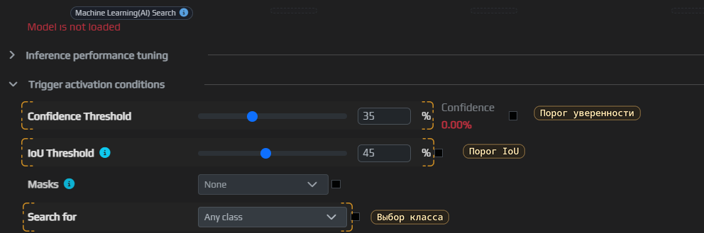
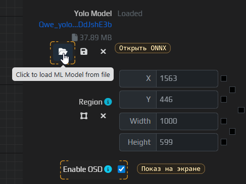

# Проверить модель на захвате EyeAuras

Прежде чем что-то нажимать, убедитесь, что модель правильно рисует рамки на вашем окне. YoloEase обучает модель и делает ONNX, а EyeAuras ищет объекты на захваченной картинке.

Нужны экспортированный `.onnx` для `detect`, имена его классов и ваше окно с объектами, которые вы размечали. На время проверки оставьте реакции ауры и узлы ввода выключенными.

## От записи к тому же источнику

1. Настройте [захват](/ru/triggers/images/imagecapturetriggers) нужного окна и области. Запомните размер кадра, обрезку, включён ли захват рамки окна и какие стоят эффекты.
2. Если собираете новые данные, нажмите в предпросмотре `Save Video` и запишите разные состояния окна. Видео добавьте через `YoloEase → Project → Add Video... → Extract frames`, затем [разметьте кадры и обучите модель](/ru/YoloEase/annotate-and-train).
3. После успешного цикла откройте результат в `Trainer` кнопкой `open...`. Возьмите `.onnx`, а `.pt` сохраните для обучения.
4. В EyeAuras добавьте в ауру `Machine Learning(AI) Search`. В `Capture settings → Target Window` выберите своё окно и выставьте ту же область и те же эффекты. В `Yolo Model → Load from file...` выберите ONNX.
5. В `Search for` выберите класс из модели. Для начала задайте `Confidence Threshold = 30` и `IoU Threshold = 40` и раскройте `Preview captured image`.

   

6. Поменяйте состояние окна: покажите объект и уберите его. Сравните рамки и имена в результате. `Active` значит, что находка прошла фильтр поиска.

Всё в порядке, если на вашем кадре правильный класс и рамка, а триггер переключается вместе с объектом. Только после этого подключайте реакцию. Все настройки триггера описаны в [AI Search](/ru/triggers/images/ai-search-trigger).

| Что сравнивать | Почему это важно |
| --- | --- |
| Окно и Crop region | Модель должна видеть такую же область, как в размеченных данных |
| Заголовок, рамка, размер окна | Меняют геометрию и относительный размер объектов |
| Effects... | Эффекты при поиске должны быть те же, что при записи. Повторно накладывать уже записанный эффект на обучающий кадр не нужно |
| Search for | Берите имя из загруженной модели. Any class пропускает любой класс, для проверки конкретного объекта это слишком широко |
| Confidence Threshold | Отсекает находки по оценке модели |
| IoU Threshold | Управляет подавлением перекрывающихся рамок |

## Почему результат редактора может отличаться

Авторазметка в YoloEase работает через YoloDotNet на CPU и запускается только по вашей команде. В EyeAuras модель загружает ONNX Runtime, а кадр и выход обрабатывает собственный код. Для обычной детекции EyeAuras растягивает кадр до размера входа, переводит RGB в диапазон 0–1 и переносит рамки обратно на размер обработанного изображения. Другие программы могут обрабатывать поля и масштаб иначе.

Поэтому хороший результат авторазметки сначала повторите на реальном захвате. Если рамка съехала после смены `Crop region`, масштаба или эффектов, разбирайтесь с геометрией кадра — повышать уверенность бесполезно. Требования к входу, выходу и метаданным — в [YOLO ONNX](/ru/YoloEase/features/yolo-onnx).

Дерево поведения и старое демонстрационное приложение

В дереве работает отдельный узел `ML Search`, а не редактор триггера ауры. Узел ищет при выполнении и передаёт результат следующим узлам через переменные дерева. На снимке экранная разметка включается через `Enable OSD`, в текущем редакторе она в группе `On-screen display`.

Чтобы выбрать объект, добавьте в `Sequence` сначала `ML Search`, потом `ML Find Class`: поиск должен пройти раньше выбора класса. В `Filters → Class` введите настоящее имя класса из модели и нажмите `Add`. Пустой список классы не фильтрует.

| Настройка ML Find Class | Как выбрать |
| --- | --- |
| Strategy | First in List берёт первый подходящий, Highest Confidence — с наибольшей оценкой, Closest — ближайший к заданной точке |
| Closest To → Cursor | Для Closest выбирает рамку, ближайшую к курсору. Center в текущем редакторе недоступен |
| Class и Add | Добавляют фильтр по существующей метке. В старом демо tgt — цель, btn — кнопка |
| Уверенность в строке класса | Дополнительный порог, например 70 для уже проверенного tgt. Результаты, которые раньше отбросил ML Search, он не вернёт |
| Width, Height, Area | Минимум и максимум размера рамки в пикселях обработанного изображения. Нулевой максимум значит «без верхнего предела» |
| On-screen display | Показывает найденную область на экране. Удобно проверить до подключения ввода |

В старом простом дереве после выбора стояли `Mouse Move` и `Key Press MouseLeft`. Для первой проверки рамок они не нужны.

В демо для AimTrainer.io стоял `Selector`. Ветка `btn` блокировала действие, когда появлялась кнопка завершения. Другая ветка выбирала ближайший `tgt` с порогом 70 и ограничениями размера.

Остались [запись сессии](https://youtu.be/MdLETBZPeec) и [пакет демонстрации](https://eyeauras.net/share/S20260507232328uRAOxLRumL6o).

Как устроены деревья, читайте в [первых шагах с деревьями поведения](/ru/behavior-trees/gettings-started) и в описании узлов [Selector](/ru/behavior-trees/nodes/selector) и [Sequence](/ru/behavior-trees/nodes/sequence). Координаты и окно, куда идёт ввод, задаются отдельно в [Mouse Move](/ru/behavior-trees/nodes/MouseMoveAbs) и [Key Press](/ru/behavior-trees/nodes/KeyPress).

## Вернуть ошибку в обучение

| Наблюдение на новых кадрах | Следующий шаг |
| --- | --- |
| Ложная рамка на пустом фоне | Добавьте такие реальные кадры без объекта и не рисуйте на них рамок |
| Объект пропущен | Добавьте похожие кадры с объектом и разметьте его |
| Перепутаны два класса | Проверьте метки и добавьте примеры обоих классов |
| Рамка неточна | Поправьте границы в [редакторе](/ru/YoloEase/features/annotation-editor) и обучите заново |
| Только EyeAuras даёт другой результат | Сначала проверьте файл модели, пиксели, область и эффекты по [диагностике](/ru/YoloEase/features/diagnostics) |

Когда исправите данные, запустите [Trainer](/ru/YoloEase/features/trainer) и загрузите новый ONNX.
