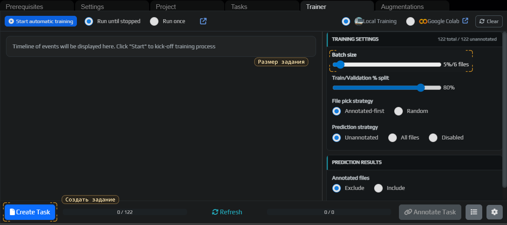
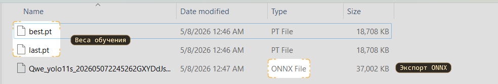

# Запустить один цикл обучения и найти ONNX

**Trainer** создаёт задачи на разметку, обучает модель и экспортирует её в ONNX. Здесь запустим один локальный цикл и откроем готовую модель. Обучение идёт на завершённых задачах с сохранёнными рамками. Непринятые предложения и одни только имена классов в выборку не попадают.

Нужны YoloEase 2, [установленные компоненты](/ru/YoloEase/prerequisites), доступные кадры и хотя бы одна задача, завершённая через **Finish Job**. В наборе должно получиться минимум одно изображение для обучения и одно для проверки. Убедитесь, что у редких классов хватает разных примеров.



На снимке другой проект из 122 файлов: при 5% Trainer предлагает 6 файлов.

## Выполнить локальный запуск

1. Откройте **Settings → Training settings** и проверьте настройки. В таблице — значения нового проекта, в существующем они могут быть другими.

| Настройка | Назначение и исходное значение |
| --- | --- |
| `Yolo8/10+ base model` | `yolo11s.pt`. Базовые веса ищутся в `modelCache` и скачиваются, если их там нет. Можно выбрать свой совместимый `.pt`. |
| `Epochs` | `50` — число эпох. |
| `Model Size` | `640` — значение `imgsz`. |
| `Additional arguments` | Дополнительные параметры Ultralytics, по умолчанию пусто. Например, `device=cpu` явно выбирает CPU. |
| `Max CPU Cores` | Передаёт процессу обучения настройку `NUM_THREADS`. 0 означает **Any**. Это не лимит нагрузки на весь компьютер. |

2. В Trainer выберите **Local Training** и **Run once**, задайте **Train/Validation % split = 80%** и нажмите **Start automatic training**. Запустится локальный YOLO CLI, в Colab набор не отправляется.
3. Следите за лентой и раскрытым выводом текущего этапа. Сначала обновляются данные и предсказания, затем применяются включённые аугментации, собирается набор, идёт обучение и экспорт ONNX. Перед первым обучением модели ещё нет, поэтому предсказания пропускаются.


4. Дождитесь результата. У успешного шага есть кнопка **open...** — она открывает папку и выделяет в ней файл модели. Если в ленте есть ошибка или отмена, строка **Cycle completed** ещё не значит, что обучение удалось.


5. В папке найдите `.onnx`, веса и `results.csv`/`results.png`. YoloEase экспортирует ONNX после обучения и может переименовать файл: в имени будут проект, базовая модель и запуск. Скопируйте ONNX для [проверки в EyeAuras](/ru/YoloEase/use-in-eyeauras), а `.pt` оставьте для дообучения.



Обычно рабочая папка выглядит так:

```text
datasets/<run-id>/
  data.yaml
  cvataat.json
  train/images, train/labels
  valid/images, valid/labels
  test/images, test/labels
  runs/train/weights/best.pt
  runs/train/weights/last.pt
  runs/train/results.png
  runs/train/results.csv
  runs/train/weights/<имя-проекта-модели-запуска>.onnx
```

Доля `test` сейчас равна 0. Папки и строка в YAML создаются, но отдельной тестовой выборки там нет. Изображения в собранном наборе могут быть символическими ссылками на рабочие кадры. Один `data.yaml` — это не набор, не переносите его без остального.

## Управлять повторением и следующими задачами

| Элемент | Что делает |
| --- | --- |
| `Start automatic training` / `Stop automatic training` | Запускает цикл / просит отменить текущую работу. Перед новым запуском дождитесь, пока Trainer освободится. |
| `Run once` | Останавливается после одного цикла, даже если он закончился ошибкой. |
| `Run until stopped` | Повторяет циклы, пока не остановите. Если ничего не изменилось, обучение может пропускаться. |
| `Create Task` | Выбирает новую партию и открывает её для разметки. |
| `Annotate Task` / список задач | Открывает незавершённую задачу или ту, что вы выбрали. **All tasks** показывает и завершённые. |
| `Refresh` | Обновляет состояние проекта, файлов, задач и моделей, а не только список источников. |
| `Clear` | Очищает ленту. Веса и разметка остаются. |
| `Batch size` | Процент от файлов, которые ещё не вошли в задачи. Исходно 5%. Рядом показано округлённое число файлов. Если файлов мало, увеличьте процент, чтобы не получить 0. Это не параметр `batch` обучения. |
| `Train/Validation % split` | Исходно 80% на обучение, остальное на проверку. Точные количества зависят от размера набора и округления. |

Для начала удобно разметить 5–10 кадров и получить модель. Партии увеличивайте, когда убедитесь, что авторазметка помогает. [Весь цикл от разметки до модели](/ru/YoloEase/annotate-and-train).

<details>
<summary>Стратегии выбора и предсказаний</summary>

| Настройка | Значение |
| --- | --- |
| `File pick strategy → Annotated-first` | Сначала берёт файлы, которые ещё не вошли в задачи и для которых есть предсказания, потом добирает случайные. Это не отбор кадров, где модель точно ошиблась. |
| `File pick strategy → Random` | Случайный выбор из оставшихся файлов. |
| `Prediction strategy → Unannotated` | Предсказания по файлам, которые ещё не вошли в задачи. Название не означает «только кадры без рамок». |
| `All files` | Предсказания по всем файлам проекта. Работы может быть больше. |
| `Disabled` | Новые предсказания не делаются, но уже имеющиеся можно использовать. |
| `Annotated files → Include/Exclude` | Учитывать или нет файлы из задач в статистике предсказаний. |
| `Threshold → Global/Per Label` | Один порог или свой для каждого класса при отборе предсказаний. Исходная уверенность 25%, IoU предсказаний 70%. |


Эти пороги помогают выбирать файлы и строить авторазметку. Фильтры загруженной модели в EyeAuras они не заменяют. `Score` — оценка модели, а не измеренная вероятность правильного действия. Перед Finish Job проверяйте рамки и классы.

</details>

<details>
<summary>Разделение данных и чтение метрик</summary>

Конвертер раскладывает изображения по частям подряд, в том порядке, в каком получил. Он их не перемешивает и не выравнивает по классам. Для каждой ненулевой части резервируется минимум одно изображение. Имена и индексы классов пишутся в `data.yaml` в порядке, в каком они встретились в разметке, а не по внутреннему LabelId проекта. Не называйте один и тот же класс по-разному и не переносите индексы между моделями без их `names`.

| Метрика | Что показывает |
| --- | --- |
| `precision` | Долю правильных находок среди всех предсказанных объектов на проверке. |
| `recall` | Долю найденных объектов среди всех размеченных. |
| `mAP50` | Оценку обнаружения при IoU 0.5. |
| `mAP50-95` | Оценку по более строгому диапазону порогов IoU. |
| `train/val loss` | Значения функции ошибки на обучении и проверке. Это не процент ошибочных кликов. |


На картинках старые учебные запуски. Ваши значения и время будут другими, и качество не обязано расти после двух-трёх поколений. Проверяйте модель на своих кадрах, которых не было в обучении. Почти одинаковые соседние кадры делают оценку обманчивой.

</details>

<details>
<summary>Команды, устройства и облачный режим</summary>

Локальный запуск собирает команду такого вида. Пути подставляет YoloEase, вручную её выполнять не нужно:

```text
yolo task=detect mode=train plots=true project="<папка запуска>/runs" model="<базовые веса>" data="<data.yaml>" imgsz=640 epochs=50
```

| Дополнительный аргумент | Назначение |
| --- | --- |
| `device=cpu` | Явно выбирает CPU. Если устройство не задано, приложение проверяет CUDA в PyTorch и добавляет `device=0`, когда она доступна. |
| `workers=0` | Добавляется сам, если вы не задали `workers`. Ваше значение, например `workers=2`, важнее. |
| `batch=8`, `patience=20` | Размер обучающего пакета и критерий ранней остановки Ultralytics. К размеру задачи разметки не относятся. |
| `cache=false`, `amp=false` | Настройки кэширования и смешанной точности Ultralytics. |
| `seed=0` | Пример явного seed обучения через Additional arguments. Конвертер train/valid в YoloEase от этого перемешивать не начнёт. |

Параметры, заданные вручную, могут конфликтовать с настройками в UI или не поддерживаться установленной версией Ultralytics. Смотрите настоящую команду и ошибку в ленте. Экспорт идёт отдельной командой `yolo export` с `format=onnx` и `opset=17`. Сменить расширение `.pt` на ONNX недостаточно — это не преобразование.

**Google Colab** — другой режим. Он готовит ZIP с набором и показывает ссылку на ноутбук. Загружать данные, запускать ноутбук и забирать обученную модель вы будете сами. Выбор Colab сам не обучает модель в облаке, и учётная запись сервиса всё равно нужна. Перед переносом проверьте, что в архиве лежат настоящие кадры и разметка, а не одни локальные ссылки.

[Файлы и ONNX](/ru/YoloEase/features/yolo-onnx), [интеграция с EyeAuras](/ru/YoloEase/features/eyeauras-integration), [диагностика](/ru/YoloEase/features/diagnostics).

</details>
