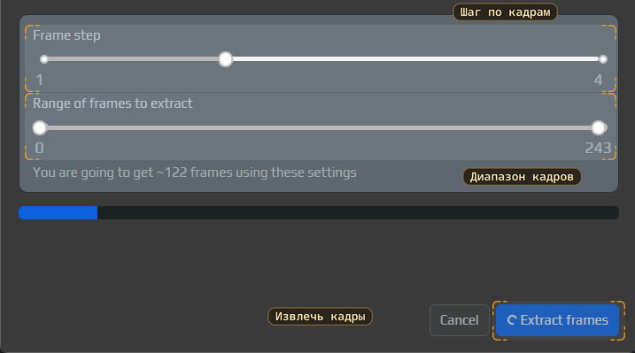

# Извлечение кадров из видео

YoloEase умеет сам нарезать видео на PNG-кадры. Запишите короткое видео своего окна, и программа сохранит кадры в хранилище проекта и добавит папку как источник.

Нужны открытый проект и видео, которое читают кодеки Windows. Можно выбрать `.mp4`, `.m4v`, `.mov`, `.avi`, `.mkv`, `.wmv`, `.webm`, `.mpg`, `.mpeg`. Видео читается через Windows Media, а не через FFmpeg.

## Получить кадры для первой задачи

1. В `Project` нажмите `Add Video...` и выберите файл или перетащите его в зону источников. Для каждого видео открывается своё окно `Extract frames`.
2. Дождитесь, пока закончится `Reading video metadata...`. Если появилась ошибка декодирования, извлечь кадры не получится. Проверяйте файл и кодек — компоненты обучения Python тут ни при чём.
3. Поставьте `Frame step = 5` и небольшой `Range of frames to extract`. Например, для записи длиной от 300 кадров диапазон `0–45` даст 10 кадров: `0, 5, …, 45`. Значения задаются только ползунками, ввести число нельзя. На коротком видео ползунок может не дойти до 5 — тогда берите шаг, который доступен.

4. Проверьте подсказку `You are going to get ~… frames using these settings` и нажмите `Extract frames`.
5. Когда всё закончится, откроется папка с результатом, а источник появится в `Project`. Откройте несколько PNG. Нужны разные состояния и хорошо видимые объекты, а не только пустое начало записи.
6. Нажмите `Refresh` и создайте небольшую задачу по [инструкции подготовки данных](/ru/YoloEase/prepare-data).

Кадры ещё не размечены: рамки вы нарисуете в [редакторе](/ru/YoloEase/features/annotation-editor).

## Диапазон и количество

| Настройка | Точное значение |
| --- | --- |
| Range of frames to extract | Кадры считаются с 0. Обе границы включены. Последний кадр попадёт в выборку, только если на него придётся шаг |
| Frame step | Каждый N-й кадр от начала диапазона. Минимум 1, исходно 5. Максимум ползунка — число кадров, делённое на 60 и округлённое вниз, но не меньше 1 |
| Подсказка количества | Для непустого допустимого диапазона: целая часть `(конец − начало) / шаг` плюс 1. Новых файлов может получиться меньше из-за повторов |
| Полный диапазон | От 0 до числа кадров минус 1. Число кадров оценивается по длительности и частоте, заранее все кадры не читаются |
| Cancel или закрытие | Отменяет извлечение. Уже записанные PNG могут остаться на диске |

Не выбрасывайте кадры с меню или пустым фоном не глядя. Если модель должна отличать эти состояния, оставьте их как реальные примеры без объекта или разметьте нужным классом.

## Файлы и повторы

Кадры сохраняются в хранилище проекта:

`local-sources/<имя видео>/<начало>-<конец> x<шаг>/<имя видео> #<индекс>.png`

Сам видеофайл туда не копируется. Каждый PNG берётся через Windows Media по времени `индекс / FPS` — выбирается ближайший кадр. Если у видео переменная частота или неточные метаданные, кадр может не совпасть с номером в точности.

Файлы, которые уже существуют, пропускаются. Потом окно ищет такие же имена среди файлов проекта и удаляет из папки результата те, что считает уже добавленными. Совпадение определяется по имени файла, а не по содержимому. Поэтому не давайте разным видео одинаковые имена.

Если всё уже добавлено, YoloEase предложит изменить диапазон или шаг. Новая серия подключается как источник, а в `assets/training` кадры копирует обычная [синхронизация данных](/ru/YoloEase/features/data-sources).

Для первой ручной разметки обычно удобно взять 5–20 разных кадров. Следующие партии подбирайте по реальным ошибкам модели и размечайте через [Trainer](/ru/YoloEase/features/trainer) с проверенной авторазметкой.
