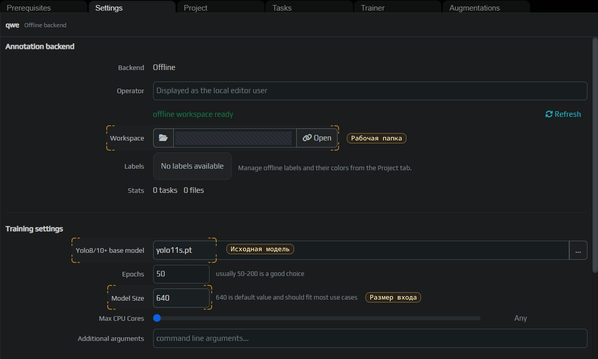
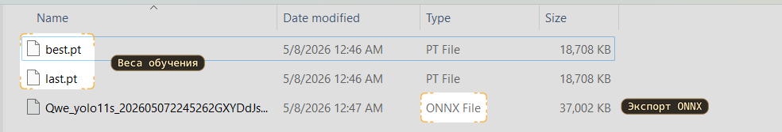

# YOLO ONNX и веса моделей

После обучения получаются два вида файлов. `.onnx` — это экспорт, его загружает EyeAuras. `.pt` — исходные веса, они нужны для дальнейшего обучения, сохраните их тоже. Переименовать один файл в другой нельзя: смена расширения ничего не преобразует.

Здесь речь о задаче `detect` — поиске классов с прямоугольными рамками. У моделей YOLO для позы, сегментации и классификации другой выход, и заменить ими detect-модель нельзя, хотя все они называются YOLO.

## Найти результат своего обучения

Нужны проект с завершёнными задачами, готовые [Prerequisites](/ru/YoloEase/prerequisites) и хотя бы по одному кадру для обучения и проверки.

1. В `Settings → Yolo8/10+ base model` выберите `yolo11s.pt` или свой локальный совместимый файл `.pt` для детекции. `Model Size = 640` — размер изображения при обучении, `Epochs` — число проходов по данным.

2. В `Trainer` выберите `Local Training`, затем `Run once` и нажмите `Start automatic training`. Обучение и экспорт — два отдельных этапа, у каждого свой `output`. Если появился `best.pt`, это ещё не значит, что ONNX экспортировался.
3. Когда всё закончится, нажмите `open...` у результата и найдите каталог `runs/train/weights` нужного набора в `datasets/<идентификатор>/`. Если запусков было несколько, сверяйтесь с путём из вывода, а не только с именем папки.
4. Сохраните `best.pt`, `last.pt` и экспортированный ONNX. Готовый ONNX YoloEase переименовывает: в имени будут проект, модель и запуск. Веса `.pt` остаются под своими именами.

5. Загрузите `.onnx` в `Machine Learning(AI) Search → Load from file...` и проверьте настоящий класс на своём окне по [инструкции интеграции](/ru/YoloEase/features/eyeauras-integration).

| Файл или настройка | Для чего нужен |
| --- | --- |
| best.pt | Веса лучшего результата обучения по выбору Ultralytics. Подходят для следующего обучения совместимым инструментом |
| last.pt | Веса последней эпохи. Сохраните, если будете продолжать эксперимент |
| .onnx | Экспорт вычислений и метаданных для совместимой среды запуска. Python-окружение обучения для этого файла EyeAuras не требует |
| Yolo8/10+ base model | Имя базовой модели или путь к локальным весам. Доступно ли имя, зависит от установленного Ultralytics и наличия файла |
| Model Size | Размер изображения при обучении, например 640. Не путайте с буквой n/s/m/l/x в названии архитектуры |
| n, s, m, l, x | Варианты размера внутри одного семейства моделей. Память, скорость и качество сравнивайте на своих данных |

## Что экспортирует YoloEase

В своём окружении YoloEase вызывает Ultralytics `yolo.exe export` с аргументами `model=<путь к best.pt>`, `format=onnx`, `opset=17`. Переключатели `dynamic`, `nms` и отдельный размер экспорта он не задаёт — остальное зависит от установленного Ultralytics и весов.

`opset` — версия набора операций ONNX. Программа, которая загружает модель, должна ещё поддерживать форму входа, тип результата и способ получения рамок.

| Граница | Что проверить перед переносом |
| --- | --- |
| Тип задачи | detect с прямоугольниками. Не подставляйте вместо него pose или OBB |
| Вход EyeAuras | Вход с именем images и фиксированными положительными размерами. Для первого переноса берите обычный квадратный вход, например 640 × 640 |
| Обычный выход YOLO детекции | Один трёхмерный выход с координатами и оценками классов — такой EyeAuras умеет разбирать. Встроенный NMS или другой порядок осей меняют формат |
| Предобработка EyeAuras | Растяжение до размера входа, RGB и нормирование 0–1. Другие схемы подготовки изображения не подставляются |
| names и порядок классов | Числовой индекс выхода должен соответствовать имени. Смотрите имена после загрузки, а не только список меток проекта |
| Версия инструментов | Ultralytics и зависимости в окружении YoloEase проверяются через Prerequisites. YoloDotNet в редакторе и ONNX Runtime в EyeAuras — две разные программы, которые загружают модель |

В опубликованном демонстрационном ONNX для `btn` и `tgt` записано: вход `images: 1 × 3 × 640 × 640`, выход `output0: 1 × 6 × 8400`, `opset 17`, `dynamic=False`, `nms=False`. При другом числе классов или другом поколении YOLO они будут другими.

Классы, облачный путь и внешние модели

Имена из разметки конвертер пишет в `data.yaml`. Индекс класс получает, когда встречается первый раз, — он не копируется из ID меток проекта. Затем экспорт Ultralytics может сохранить имена в `names` внутри ONNX. В EyeAuras проверьте, что показанное имя относится к нужному индексу. Сопоставление меток в [редакторе разметки](/ru/YoloEase/features/annotation-editor) действует только в этом редакторе и файл для других программ не меняет.

При обучении через ZIP и Google Colab работает отдельное окружение со своими версиями пакетов. Верните результат обучения и ONNX в свой проект, как описано в [Trainer](/ru/YoloEase/features/trainer). Не считайте, что настройки экспорта в Colab совпадают с локальным `opset=17`.

Для чужого файла сверяйте экспорт с [официальными параметрами Ultralytics](https://docs.ultralytics.com/modes/export/). Совместима ли модель, покажут только загрузка и распознавание на реальном входе.

## Материалы старого демо

От прежнего проекта остались [ONNX](https://s3.eyeauras.net/media/2026/05/Qwe_yolo11s_202605072245262GXYDdJshE3b.onnx), [веса PyTorch](https://s3.eyeauras.net/media/2026/05/Qwe_yolo11s_202605072245262GXYDdJshE3b.pt) и [проект YoloEase](https://s3.eyeauras.net/media/2026/05/AimTrainerDemo.zip). Условия использования исходной модели и данных уточняйте у их владельцев.

Если экспорт не завершился или файл не загружается, начните с [диагностики](/ru/YoloEase/features/diagnostics) и вывода нужного этапа [Trainer](/ru/YoloEase/features/trainer).
