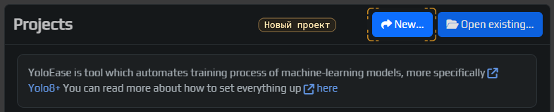

# Получить свою первую модель в YoloEase

В проекте YoloEase лежат кадры, разметка и обучение. Здесь мы возьмём свои изображения с двумя разными объектами, разметим первую задачу вручную, получим модель и применим её к следующей партии. Файл `.pt` нужен для дальнейшего обучения, `.onnx` — для распознавания в совместимой программе, например в EyeAuras.

Нужны Windows x64, YoloEase 2 и [готовое окружение](/ru/YoloEase/prerequisites). Приготовьте 10 своих PNG-кадров, на которых видны цели и кнопка. Классы в этом руководстве называются `tgt` и `btn`. В YoloEase их нет, вы создаёте их сами.



## Пройти первый цикл

1. На стартовом экране нажмите **New...** и сохраните проект в своей папке, например как `MyTargets.yeproj`. Рядом появится рабочая папка проекта. Переносите её вместе с `.yeproj`.
2. На **Project** нажмите **Add label**, введите `tgt` и нажмите **Add**. Так же добавьте `btn`. Перетащите свои PNG в область **Drop folders, images, or videos here**. Отдельные изображения копируются в проект. Подробнее — в [подготовке данных](/ru/YoloEase/prepare-data).
3. В **Trainer** посмотрите, сколько файлов показано, и задайте **Batch size**. Для первой задачи возьмите 5 кадров. Нажмите **Create Task** — выбранная партия откроется в редакторе.
4. Выберите класс и инструмент прямоугольника `N`. Двумя щелчками отметьте противоположные углы объекта. Разметьте все нужные объекты на каждом кадре и нажмите **Finish Job**. Закрыть окно и завершить задачу — разные действия. Подробнее — в описании [редактора](/ru/YoloEase/features/annotation-editor).
5. Для первого локального запуска выберите в **Trainer** **Local Training** и **Run once**, затем нажмите **Start automatic training**. YoloEase экспортирует завершённые задачи в набор данных, обучит модель и экспортирует её в ONNX. Предложения модели, которые вы не обработали, в обучение не попадают.
6. Дождитесь результата или сообщения об ошибке в ленте. У успешного шага обучения кнопка **open...** открывает файл модели в папке результата. Сохраните путь именно к `.onnx`: одного `.pt` для EyeAuras недостаточно. Подробнее — в [управлении обучением](/ru/YoloEase/features/trainer).
7. Создайте следующую задачу. В её **Models** добавьте **Latest**, нажмите **Load** и проверьте, что классы совпадают. Включите **Create suggestions** и нажмите **Run current**. Примите правильные предложения, исправьте ошибки и нажмите **Finish Job**. Дальше этот цикл [разметки и обучения](/ru/YoloEase/annotate-and-train) можно повторять.

В итоге у вас есть ONNX-файл и рамки на реальном кадре, которые появились после запуска модели. Ни число кадров, ни число поколений сами по себе не гарантируют нужную точность. Проверяйте её на других своих кадрах.

```text
старт: 5-10 кадров руками -> первая модель
                            |
                            v
десятки/сотни кадров -> авторазметка -> проверка и исправления
        ^                                      |
        |                                      v
        +---------- новая модель <- Trainer <--+
                            |
                            v
                 .pt/.onnx -> EyeAuras или другая программа
```

| Результат шага | Что сохраняется |
| --- | --- |
| `.yeproj` и рабочая папка | Настройки, источники, задачи, разметка и история обучения. Внешние папки источников при переносе нужно учитывать отдельно. |
| `Finish Job` | Разметка завершённой задачи. Её можно брать в обучение. |
| `.pt` | PyTorch-веса для последующего обучения. |
| `.onnx` | Экспортированная модель. Программа, которая её загружает, должна поддерживать её задачу, входы и выходы. |
| Предсказания и предложения | То, что выдала текущая модель. Разметкой становятся только принятые и сохранённые рамки. |

## Подключить результат к своей задаче

[В EyeAuras](/ru/YoloEase/use-in-eyeauras) сначала загрузите ONNX в **Machine Learning(AI) Search**, выберите своё окно и проверьте рамки без действий ввода. Только после этого связывайте найденный класс с реакцией.

Ниже старая демонстрация. Модель для AimTrainer.io различает `tgt` и `btn`, а дерево поведения решает, когда нажимать. Обучение и логика действий — разные этапы. Модель читает изображение, а не внутреннее состояние тренажёра.


<details>
<summary>Готовый учебный проект и остальные возможности</summary>

Вместо подготовки данных с нуля можно изучить авторский пример:

- [записанная сессия](https://youtu.be/MdLETBZPeec);
- [пакет EyeAuras с деревом и моделью](https://eyeauras.net/share/S20260507232328uRAOxLRumL6o);
- [ONNX](https://s3.eyeauras.net/media/2026/05/Qwe_yolo11s_202605072245262GXYDdJshE3b.onnx) и [PyTorch-веса](https://s3.eyeauras.net/media/2026/05/Qwe_yolo11s_202605072245262GXYDdJshE3b.pt);
- [проект YoloEase с историей обучения](https://s3.eyeauras.net/media/2026/05/AimTrainerDemo.zip).

Это материалы конкретной демонстрации, а не результат вашего обучения. Чтобы открыть проект, не обязательно запускать его модель или импортированный ввод.

| Следующая задача | Руководство |
| --- | --- |
| Получить кадры из видео | [Извлечение кадров](/ru/YoloEase/features/video-splitter) |
| Понять копии и внешние пути | [Источники данных](/ru/YoloEase/features/data-sources) |
| Увеличить разнообразие изображений | [Аугментации](/ru/YoloEase/features/augmentations) |
| Разобраться в весах и экспорте | [YOLO ONNX](/ru/YoloEase/features/yolo-onnx) |
| Настроить реакцию в EyeAuras | [Интеграция](/ru/YoloEase/features/eyeauras-integration) |
| Найти причину сбоя | [Диагностика](/ru/YoloEase/features/diagnostics) |

</details>
