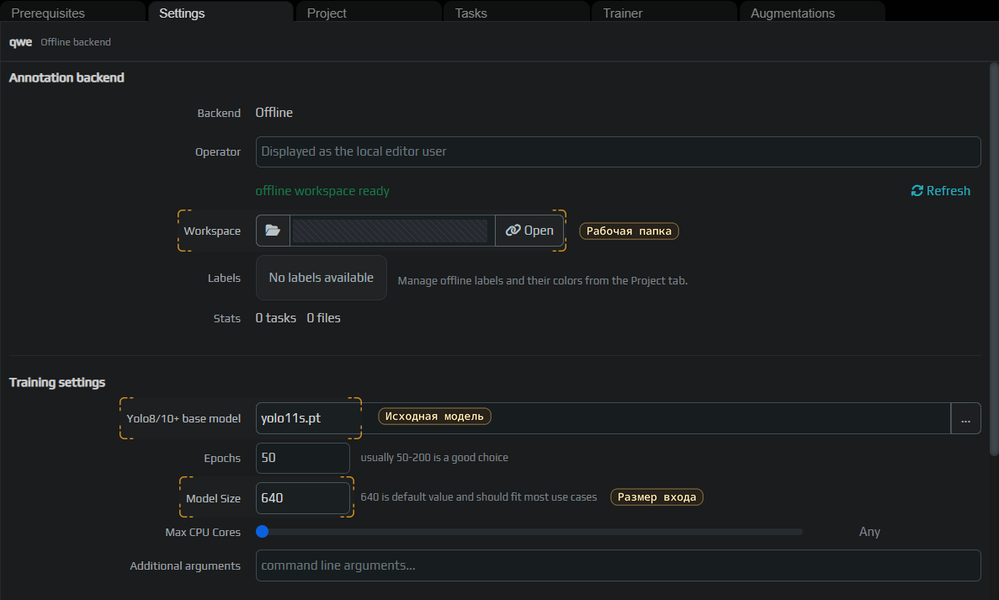
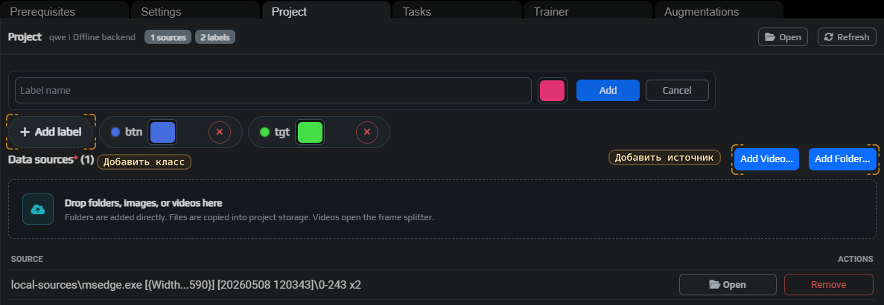
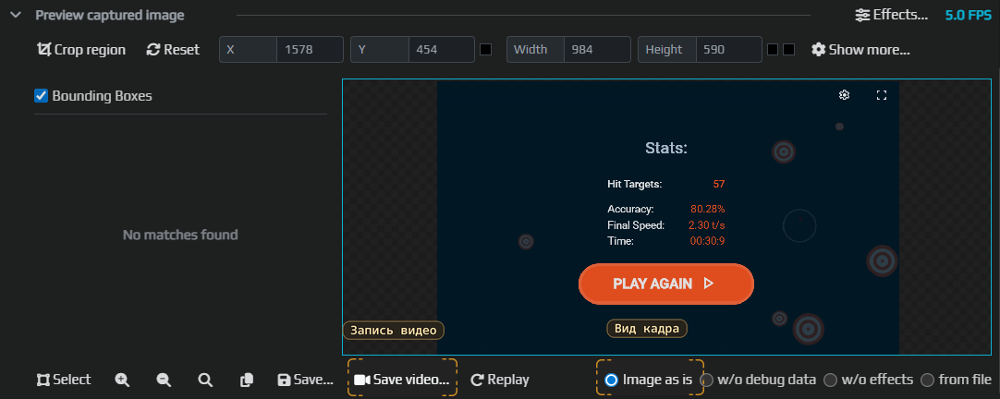
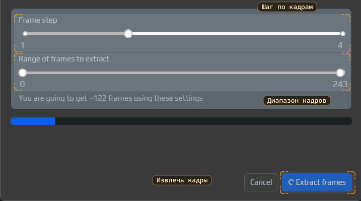

# Создать проект с кадрами и классами

Здесь мы создадим проект с изображениями целей и кнопки. `tgt` и `btn` будут двумя разными классами. Нужны настоящие PNG-кадры или своё видео.

Нужен YoloEase 2 на Windows x64. Чтобы потом собрать набор данных и обучить модель, пройдите [проверку компонентов](/ru/YoloEase/prerequisites). Исходные файлы должны быть доступны для чтения. В рабочей папке должны быть разрешены запись и создание символических ссылок.

## Сохранить проект и задать вход обучения

1. Нажмите **New...** и сохраните `MyTargets.yeproj` в своей локальной папке. Рядом YoloEase создаст папку `MyTargets` с рабочими данными.
2. Откройте **Settings**. Проверьте, что **Backend** показывает **Offline**, а **Workspace** ведёт в папку вашего проекта. Это встроенная разметка, учётная запись CVAT для неё не нужна.
3. В **Training settings** задайте значения из таблицы.

| Настройка | Значение и назначение |
| --- | --- |
| `Yolo8/10+ base model` | `yolo11s.pt` — исходные веса. Приложение ищет их в своём кэше и загружает, если их там нет. Кнопкой `...` можно выбрать свой совместимый `.pt`. |
| `Epochs` | `50` — число эпох. |
| `Model Size` | `640` — значение `imgsz`, а не размер записанного видео. |
| `Additional arguments` | Для первого опыта оставьте пустым. Чтобы явно обучать на CPU, можно указать `device=cpu`. Параметры передаются в Ultralytics. |
| `Storage subfolder` / `Resolved storage` | Относительная рабочая подпапка и фактический путь. В новом проекте оставьте созданный путь. **Apply** меняет настройку, но не переносит все существующие файлы. |

## Добавить классы и изображения

4. На **Project** нажмите **Add label**, введите в **Label name** `tgt`, выберите цвет и нажмите **Add**. Повторите для `btn`. Цвет помогает различать рамки.
5. Проще всего перетащить 10 своих PNG в область добавления данных. Другой способ — нажать **Add Folder...** и выбрать свою папку с PNG/JPG/BMP. Для папки сохраняется внешний путь, а синхронизация создаёт рабочие копии. Подробнее — в [устройстве источников](/ru/YoloEase/features/data-sources).

6. Откройте **Trainer**, нажмите **Refresh** и проверьте число файлов. Сами рамки появятся только после [работы в редакторе](/ru/YoloEase/features/annotation-editor).

Имена классов должны быть одинаковыми во всём проекте. Не рассчитывайте, что внутренний `LabelId` равен номеру класса YOLO: соответствие имён и индексов записывается в `data.yaml` при экспорте.

## Если исходник — видео

7. Запишите своё учебное окно или возьмите готовый видеофайл. В EyeAuras можно записать видео из предпросмотра CV. Тогда сохранится именно то подготовленное изображение, с которым будет работать распознавание.

8. В YoloEase нажмите **Add Video...** и выберите запись не короче 300 кадров, иначе на ползунке не будет шага 5. В окне **Extract frames** выберите **Frame step = 5** и диапазон кадров, затем нажмите **Extract frames**. Смотрите на показанное число выбранных кадров. Шаг считается в кадрах, а не в секундах.

После извлечения откроется папка с PNG, а в `local-sources` добавится источник. Эти кадры можно разбить на маленькую первую задачу и следующие партии. Видео декодирует media-система Windows, поэтому не каждый файл откроется. Подробнее — в [извлечении кадров](/ru/YoloEase/features/video-splitter).

Для учебного примера нужны разные положения и состояния объектов: видимая цель, кнопка, пустой фон. Рисуйте рамки по одним и тем же правилам. Используйте те же эффекты изображения, что потом примените в EyeAuras.

Проект переносится вместе с рабочей папкой. Внешние источники должны оставаться доступными, либо заранее импортируйте отдельные файлы в проект. Следующий шаг — [разметить первую партию и запустить обучение](/ru/YoloEase/annotate-and-train).
