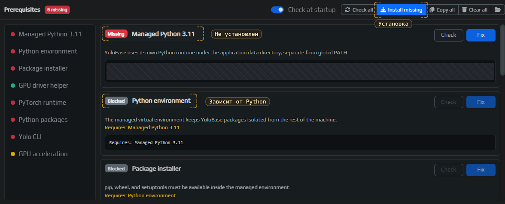
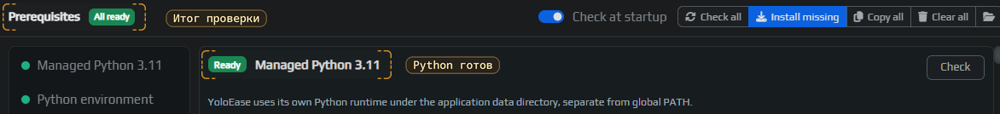
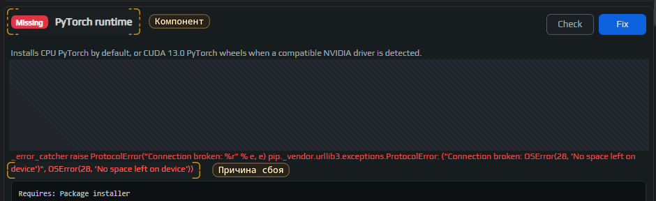

# Подготовить YoloEase к локальному обучению

Здесь мы проверим, что YoloEase может запустить свои Python и YOLO. В конце все обязательные компоненты на вкладке **Prerequisites** должны быть готовы. Модель на этом этапе ещё не обучается.

Руководство относится к YoloEase 2 с управляемым окружением Python. Нужны Windows x64 и распакованный [дистрибутив YoloEase](https://github.com/iXab3r/YoloEase/releases/). Это отдельное приложение, а не действие C# Script в EyeAuras. Оно собрано для .NET 8 Windows. Python YoloEase устанавливает сам, отдельно, и от глобального `PATH` он не зависит.

| Нужно заранее | Для чего |
| --- | --- |
| Доступ к папке данных приложения и папке своего проекта | Туда записываются окружение, журналы, кадры и результаты. Для первого опыта выберите обычную локальную папку, доступную вашей учётной записи. |
| Возможность создавать символические ссылки | Ссылки нужны для локальной сборки набора данных и подключения базовых весов. Если Windows не даёт их создавать, настройте права до обучения. |
| Интернет для первой установки | Загружаются архив Python, пакеты PyTorch/Ultralytics/ONNX и, если нужно, базовые веса. Работающая сеть ещё не значит, что все компоненты готовы. |
| Свободное место | Окружение, загруженные пакеты, кадры и запуски обучения занимают место по отдельности. Фиксированный размер установки не гарантируется. |
| CPU; NVIDIA GPU необязателен | Обучать можно и на CPU. Ускорение CUDA включается, только если драйвер подходит и CUDA доступна в PyTorch. |

## Проверить и установить компоненты

1. Запустите YoloEase, создайте или откройте свой `.yeproj` и перейдите на **Prerequisites**.
2. Нажмите **Check all**. Разверните строку, чтобы увидеть найденные пути, версии и причину, по которой компонента нет.

3. Нажмите **Install missing** и дождитесь завершения. Устанавливаются управляемые компоненты приложения, но не драйвер видеокарты. Менять вручную системный Python или переменные окружения для этого не требуется.
4. Если нужно, ещё раз нажмите **Check all**. Обязательные проверки должны проходить. **GPU acceleration** и **GPU driver helper** — информационные, поэтому без GPU обучение на CPU не блокируется.

| Проверка | Что она проверяет или готовит |
| --- | --- |
| `Managed Python 3.11` | Собственный CPython 3.11.9 из закреплённого архива, с проверкой SHA256. |
| `Python environment` | Виртуальное окружение в папке данных приложения. Оно одно на всю установку YoloEase, а не отдельное для каждого проекта. |
| `Package installer` | `pip`, `wheel`, `setuptools` внутри управляемого окружения. |
| `GPU driver helper` | Найденные адаптеры и сведения о драйвере. **Open help** открывает справку. Драйверы автоматическая установка компонентов не ставит. |
| `PyTorch runtime` | CPU- или CUDA-вариант PyTorch. В этой ветке закреплены `torch 2.11.0` и `torchvision 0.26.0`. CUDA 13.0 выбирается, если NVIDIA-драйвер подходит. |
| `Python packages` | Ultralytics, OpenCV, NumPy, Matplotlib, Shapely, ONNX и ONNX Runtime. Часть версий задана файлом требований, поэтому это не всегда «последняя совместимая версия». |
| `Yolo CLI` | Запускается ли `yolo checks` из управляемого окружения. |
| `GPU acceleration` | Доступна ли CUDA на самом деле, по данным PyTorch. Одного наличия видеокарты недостаточно. |

Дальше переходите к [своим кадрам и проекту](/ru/YoloEase/prepare-data). Проверка окружения ничего не говорит о качестве модели, поддержке любого видео или скорости будущего обучения.

Где окружение и как разбирать ошибку установки

В папке данных приложения лежат `tools/python-3.11`, `tools/venv`, `tools/downloads` и `tools/logs`. Фактические пути видны в выводе проверок. Кадры и модели проекта лежат отдельно, рядом с `.yeproj`.

| Кнопка | Действие |
| --- | --- |
| `Copy all` | Копирует диагностический вывод, но сама ничего не отправляет. Перед отправкой проверьте, какие пути и сведения в нём есть. |
| `Clear all` | Очищает показанный вывод проверок. Python и проект не удаляет. |
| `Check at startup` | Включает проверку при запуске. Обучение она не запускает и вашу модель не загружает. |

Если установка остановилась, прочитайте ошибку в конкретной строке. Например, при **No space left on device** освободите место на указанном диске, нажмите **Clear all** и повторите **Install missing**. Сообщение о драйвере и ошибка загрузки пакета требуют разных действий.

Версии пакетов и выбор CPU/CUDA сверяйте с выводом своей сборки. Общий порядок и файлы описаны в [YOLO ONNX](/ru/YoloEase/features/yolo-onnx), разбор ошибок — в [диагностике](/ru/YoloEase/features/diagnostics).

