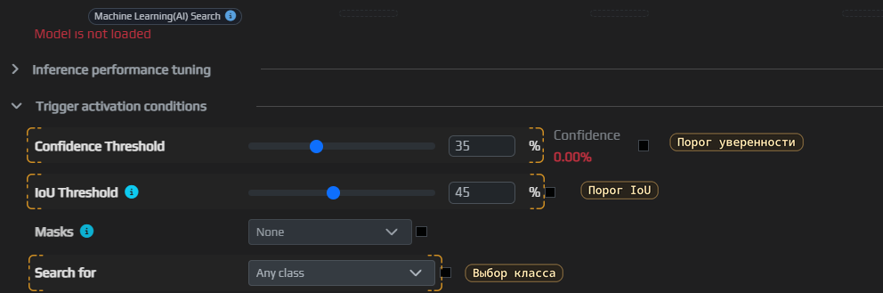
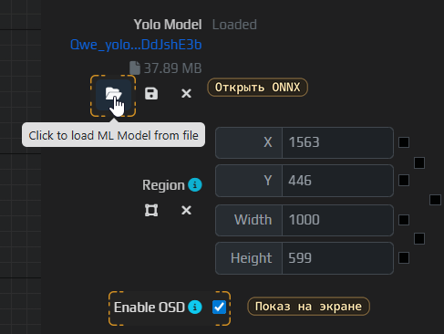

# Проверить свою ONNX-модель в EyeAuras без кликов

Здесь мы загрузим модель из YoloEase в визуальный поиск EyeAuras и увидим рамки нужного класса на своём окне. Сначала проверяем только распознавание. Действия ввода и дерево поведения подключаются отдельно.

Нужны три вещи: настоящий `.onnx`, экспортированный после [успешного обучения](/ru/YoloEase/features/trainer), настольный EyeAuras с OpenCV/ONNX Runtime и своё окно с теми объектами, которые вы размечали. `.pt` оставьте для обучения: в AI Search он не загружается как готовая модель.

## Загрузить модель и увидеть результат

1. В YoloEase у завершённого шага обучения нажмите **open...** и найдите экспортированный ONNX. Если нужно, скопируйте его в постоянную папку. В имени файла могут быть названия проекта и запуска.
2. В своей ауре EyeAuras добавьте триггер **Machine Learning(AI) Search**. В руководствах его также называют **AI Search**. Узел дерева **ML Search** — это другой способ использовать модель.
3. В блоке модели нажмите **Load from file...** и выберите свой `.onnx`. Дождитесь загрузки: должны появиться сведения о модели и список классов.
4. Выберите своё окно и область захвата, как описано в [настройках захвата](/ru/triggers/images/imagecapturetriggers). Оставьте окно видимым. Если обучающие кадры записывались с эффектами EyeAuras, примените ту же цепочку эффектов до распознавания.
5. В **Search for** выберите свой класс, например `tgt`. Чтобы видеть все классы, есть **Any class**. Для первого сравнения явно задайте **Confidence Threshold = 30** и **IoU Threshold = 40**, затем откройте **Preview captured image**.

   

6. Покажите реальный объект, а потом кадр без него. В предпросмотре должны появляться настоящие рамки и подписи модели. Состояние триггера зависит от находок, которые прошли фильтр. Если находок нет, не добавляйте клик «для проверки».

| Настройка или результат | Что проверить |
| --- | --- |
| Класс | Имя из метаданных именно этой модели. `tgt`/`btn` есть, только если вы их разметили и экспортировали. |
| `Confidence Threshold` | Порог оценки модели в процентах. |
| `IoU Threshold` | Порог перекрытия рамок при удалении дубликатов. |
| Окно, область, эффекты | От них зависит, какие пиксели попадут на вход. Не добавляйте эффект повторно, если он уже записан в проверяемом изображении. |
| Пустой результат / ошибка | Модель не нашла подходящий объект или операция не выполнилась — это разные состояния. Смотрите ошибку и предпросмотр. |

## Какая модель подходит

В этом руководстве YoloEase обучает задачу `detect` и экспортирует ONNX с `opset=17`. EyeAuras использует свой ONNX Runtime и parser. Редактор авторазметки YoloEase работает на другом движке — YoloDotNet.

Обычной detect-модели YOLO11 нужны вход `images` с изображением в NCHW и выход обнаружений, который понимает текущий parser. Имена классов берутся из метаданных `names`. В учебном экспорте ожидается статический вход 1×3×640×640 при размере 640 и выход вида 1×(4+число-классов)×число-кандидатов. Другая задача, динамическая форма, встроенный NMS, pose/OBB или произвольный ONNX не становятся совместимыми только из-за названия YOLO.

EyeAuras растягивает кадр до размера входа модели, а потом переводит рамки обратно к обработанному изображению и его области. Проверяйте реальные рамки на тех же размерах, эффектах и состояниях окна. Подробнее — в [AI Search](/ru/triggers/images/ai-search-trigger) и [YOLO ONNX](/ru/YoloEase/features/yolo-onnx).

Подключить реакцию после проверки

В дереве поведения **ML Search** даёт результат поиска, **ML Find Class** выбирает класс или объект, **Mouse Move** получает позицию, а **Key Press** добавляет настроенное нажатие. **Enable OSD** у CV-узла помогает сначала проверить рамки без ввода. Такое дерево настраивается отдельно.

Допустим, `btn` — кнопка повтора, а `tgt` — цель. Что с ними делать, решает дерево: модель только возвращает найденные классы. Адресат и система координат ввода должны соответствовать выбранному окну. Рамка ещё не значит, что сработает универсальный фоновый клик. Подробнее — в [деревьях поведения](/ru/behavior-trees/gettings-started) и [полной интеграции](/ru/YoloEase/features/eyeauras-integration).

От старого законченного сценария остались [записанная сессия](https://youtu.be/MdLETBZPeec), [пакет EyeAuras](https://eyeauras.net/share/S20260507232328uRAOxLRumL6o) и [ONNX](https://s3.eyeauras.net/media/2026/05/Qwe_yolo11s_202605072245262GXYDdJshE3b.onnx). В метаданных этих демонстрационных весов: классы `btn`/`tgt`, вход `images` 1×3×640×640, выход `output0` 1×6×8400, `task=detect`, `opset=17`, без встроенного NMS. Если загрузка или распознавание не работает, откройте [диагностику](/ru/YoloEase/features/diagnostics).

