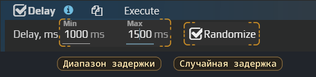

# Delay — сделать паузу между действиями

Delay ждёт заданное время, и только потом запускается следующее действие той же группы. Например, так можно развести два звуковых сигнала, чтобы они не прозвучали подряд.

## Два сигнала с паузой в одну секунду

Нужна одна аура и включённый звук на компьютере. Запускать её будем вручную через [Fixed Value](/ru/triggers/fixed-value).

1. Добавьте в ауру триггер Fixed Value и выберите **Is NOT Active**. Другие триггеры не нужны.
2. В **On Enter** добавьте [Play Sound](/ru/actions/play-sound), выберите звук Ping и выключите **Play in background**. Тогда пауза начнётся после окончания звука.
3. Следом в ту же группу добавьте Delay. Выключите случайную задержку: **Randomize** в прежнем редакторе или кнопку с перекрещёнными стрелками в новом. В **Delay, ms** укажите `1000`.
4. После Delay добавьте ещё один Play Sound со звуком Bell. Порядок такой: Play Sound → Delay → Play Sound.
5. В Fixed Value выберите **Is Active** и не выключайте ауру до второго сигнала.

Прозвучит Ping, примерно через секунду после него — Bell. Чтобы повторить, переключите Fixed Value в Is NOT Active и снова в Is Active. В **While Active** цепочка повторялась бы, пока аура активна.

На снимке из прежнего редактора задержка случайная, от 1000 до 1500 мс. Для паузы ровно в секунду снимите Randomize и задайте 1000 мс.

## Настройки

| Настройка | Что делает |
| --- | --- |
| Delay, ms | Длина паузы в миллисекундах. `1000` мс — одна секунда. |
| Randomize | При каждом запуске берёт новую длину паузы из заданного диапазона. В новом редакторе включается кнопкой с перекрещёнными стрелками. |
| Min / Max | Границы случайной задержки. Например, `800` и `1200` дают паузу примерно от 0,8 до 1,2 секунды. |

Delay ждёт время, а не событие в другом приложении. Если сначала должно появиться окно, проверяйте его отдельным триггером [Window Exists](/ru/triggers/window-exists). Другие ауры во время паузы продолжают работать.
