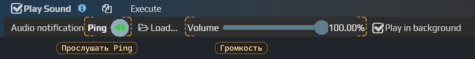

# Play Sound — услышать, что условие выполнилось

Play Sound проигрывает выбранный звук. Когда именно — решает триггер ауры. В примере ниже это [Window Exists](/ru/triggers/window-exists): сигнал прозвучит, когда откроется Блокнот.

## Подайте сигнал при открытии Блокнота

1. Создайте ауру с одним триггером Window Exists. В **Target Window** введите `notepad` и проверьте, что он находит Блокнот. Под выражение могут попасть и другие окна с похожим заголовком — тогда уточните его.
2. В группу **On Enter** добавьте Play Sound.
3. В **Audio notification** выберите Ping, **Volume** поставьте на `50%`. Нажмите кнопку прослушивания рядом со списком и убедитесь, что звук слышен.
4. Закройте все подходящие окна Блокнота и дождитесь, пока аура станет неактивной. Затем откройте Блокнот снова.

Когда окно появится и аура станет активной, прозвучит один сигнал. Пока окно на месте, On Enter не повторяется. Чтобы звук играл при каждом новом появлении окна, аура между появлениями должна успеть стать неактивной.

Кнопка с динамиком проигрывает Ping. На снимке из прежнего редактора громкость 100%, для упражнения поставьте 50%.

Если кроме звука нужно напоминание на экране, добавьте в ту же ауру [Text](/ru/overlays/text) и напишите сообщение в **Content**. Обычно текст виден, пока аура активна. Размещение и блокировка описаны в [общих параметрах](/ru/overlays/common-options).

## Настройки

| Настройка | Что делает |
| --- | --- |
| Audio notification | Встроенный звук. В прежнем редакторе поле называется Notification. |
| Load... | Загружает ваш WAV- или MP3-файл. Звук сохраняется в самом действии, поэтому исходный файл потом можно переименовать или удалить. |
| Volume | Громкость уведомления. Звук идёт через устройство вывода по умолчанию. Проверьте и системную громкость. |
| Play in background | По умолчанию включено: действие запускает звук, и сразу начинается следующее действие. Если выключить, следующее действие начнётся после окончания звука. |

Если нужна пауза **после окончания** сигнала, выключите Play in background и поставьте следом [Delay](/ru/actions/delay). При фоновом воспроизведении Delay начинает отсчёт, пока звук ещё может играть.

Для одиночного уведомления берите On Enter. В While Active звук будет запускаться снова и снова, пока аура активна.
